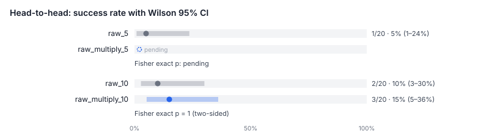
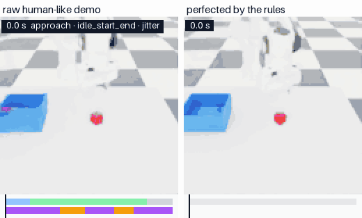

# SANT

**S**imulate · **A**ugment · **N**eaten · **T**rain: perfect one demo, then multiply it.

*Perfect, then multiply.*

**Record one robot demo by moving your hand in front of a webcam. Get back many physics-checked
training demos.**

Our entry for the [Nebius x NVIDIA Global AI Hackathon](https://nebiusglobalaihackathon.devpost.com/),
Physical AI track. Everything runs in simulation, with no physical robot; the official FAQ allows that
([screenshot](docs/superpowers/notes/2026-10-15-faq-physical-ai-simulation-allowed.jpg)).

## What it is

Robots learn a task by copying demonstrations, and they need a lot of them. Human demos are the
expensive part:
- Teleoperation rigs cost $6k–$80k, and operators cost $25–$50 an hour.
- 20–30% of demos get thrown away. These are vendor estimates.

A webcam costs almost nothing, but webcam demos are noisy: shaky, with pauses and off-center grasps.
<!-- src: docs/superpowers/specs/2026-10-15-perfect-then-multiply-design.md §2 (vendor estimates) -->

This project takes one cheap demo and cleans it up with code. NVIDIA Isaac Lab then checks it in
physics, and the project multiplies it into many verified copies, each with the cube and bin in new
places. The output is a standard LeRobot dataset that you can train a robot policy on.

## The result

We trained the same robot policy (ACT, 30k steps) twice from the same 10 source demos. Then we tested
both policies on 40 new scenes. The scenes and the stopping rule were fixed in advance, and those
scenes were never used to choose anything.

| Training data | Success on 40 new scenes | 95% CI |
|---|---|---|
| The 10 demos alone | **3 / 40 (7.5%)** | 2.6–19.9% |
| The 10 demos + 100 multiplied, physics-verified variants | **17 / 40 (42.5%)** | 28.5–57.8% |

**Fisher exact p = 0.0005.** The confidence intervals don't overlap. This is our first significant
evidence that multiplying demos makes the trained robot better.
<!-- src: docs/superpowers/notes/2026-10-15-t3-status.md (2026-10-17 13:15, sprint 7 Tasks 3–4: confirmatory seeds 5020–5059, p = 0.00055; pair chosen at 11:43 before any extension seed; stopped by the 13:00 time rule); docs/media/README.md (T1 re-counted 3/40 vs 17/40 independently) -->



*Each pair shows successes out of attempts, with a 95% confidence interval. The bottom pair is the
result above, counted over all 60 scenes it ran on (4/60 vs 24/60). That count includes the 20
scenes used to pick this pair, so it is optimistic; quote the 40-scene numbers. The top two pairs
are earlier, smaller runs at 10k steps (1/20 vs 5/20, 2/20 vs 3/20). Neither of them is significant
alone.*
<!-- src: docs/media/README.md (charts/comparison.svg); docs/superpowers/notes/2026-10-15-t3-status.md (sprint 7 "All sprint 7 cells") -->

**What it does not show yet:**
- **One setup:** one task (cube into bin), one simulated robot (Franka), one policy type, one training run per arm.
- **Scripted demos:** the 10 source demos came from a scripted expert. The real webcam demos are in the next
  section.
- **Repair not tested here:** the scripted demos were already clean, so this skipped repair. Whether
  repairing noisy human demos first helps a trained policy is not measured yet.
- **Equal steps, not equal epochs:** the raw arm saw its data ~49 times, the multiplied arm ~4.5.
- **It still drops the cube:** 22 of the multiplied policy's 23 failures are drops: it lifted the cube, then lost it.
<!-- src: docs/superpowers/notes/2026-10-15-t3-status.md (sprint 7 Tasks 3–4, "Reading, honestly" and Task 4); docs/media/README.md ("All the human demos here are synthetic") -->

## Real webcam demos (2026-10-19 and 2026-10-20)

One person recorded 10 demos with a webcam, driving the simulated Franka live.

| Step | Result |
|---|---|
| **Physics check, as recorded** | **0 / 10** pass. Every demo put the cube in the bin live, but the gripper pressed into the bin while placing (9/10, up to 927 N against a 5 N limit), and some regrasps dropped the cube. |
| **Repair with the rules, then multiply** | **3 / 10** repaired and verified → **24 / 30** multiplied copies verified |
| **Blind A/B: Nemotron edits vs the rules,** same 10 demos | Nemotron **5 / 10** vs rules **3 / 10**. Nemotron fixed every demo the rules fixed, plus two more. **McNemar p = 0.50: not significant**, one run. Nemotron cost **$0.21** for all 10. |
| **Training on what SANT made from them** (27 episodes from the 3 repaired demos), one arm | **3 / 40** (7.5%, 95% CI 2.6–19.9%) on the same 40 unseen scenes. Most failures dropped the cube (26 of 37). There's no comparison arm: the raw arm would have trained on 10 failed replays. |
<!-- src: docs/superpowers/notes/2026-10-19-live-test-10-results.md ("Re-run, achieved path"; "Neaten for the human demos' failures + human10c": 3/10 perfected, 24/30 variants); docs/superpowers/notes/2026-10-20-nemotron-repair.md ("Result: the blind A/B": 5/10 vs 3/10, paired 3/0/2/5, exact McNemar p = 0.50, $0.207); docs/superpowers/notes/2026-10-20-human10c-multiplied-only.md ("Result": 3/40, Wilson 2.6–19.9%, pre-registered e979c54, ACT 30k, seeds 5020–5059; dropped 26/37) -->

**How to read it:**
- Real hands make demos that physics rejects, and that is the gap this project is for.
- Repair turns some of those rejects into demos that pass, and a demo that passes multiplies well.
- Three repaired demos are not enough to train on yet: 3/40. For reference, not a comparison, the scripted run
  got 17/40 from 10 demos (110 episodes). That suggests the number of distinct repaired demos matters, but the two
  runs also differ in source and size, so it doesn't show why. More repaired demos is the next step.
- The rules had a home advantage: two of their ops were written after looking at these same 10 failures, and
  Nemotron saw neither.
- 10 demos and one run are a promising sign, not proof. Replays of these demos reproduce their live outcome only
  2–4 times in 10.

The full table, with every source note, is in [docs/submission/README.md](docs/submission/README.md#results-measured-only).

## How it works



*One demo replayed in Isaac Lab. Left: the raw demo, 13.8 s, with tremor, pauses and idle time.
Right: the same demo after repair, 9.3 s. Both replays succeeded. This "human" demo is synthetic:
the scripted expert, with noise added on purpose.*
<!-- src: docs/media/README.md (Before and after perfecting) -->

1. **Record.** Your browser tracks your hand with MediaPipe, and a simulated Franka arm in Isaac
   Lab follows it.
2. **Check.** Code measures every movement: speed, shake, pauses, idle time and how centered the
   grasp is. NVIDIA Nemotron can also look at key frames. The result is a timestamped list of
   problems.
3. **Repair.** Code fixes those problems from a fixed menu: trim idle time, remove pauses, smooth
   tremor, retime, recenter the grasp, and release above the bin. Or NVIDIA Nemotron writes small edits to
   the hand's path from what the simulator measured. Code caps each edit at 5 cm and checks it is smooth, and
   physics verifies the result.
4. **Verify.** Isaac Lab replays the repaired demo, and physics decides whether it worked. All 50
   of our 50 scripted test demos pass.
5. **Multiply, export, train.** Each verified demo becomes many variants with new cube and bin
   positions, and each variant is verified again. The training set came out 100/100; MimicGen
   publishes 38–74% for this step. Only verified demos are exported as a LeRobot dataset, and an
   ACT policy is trained on it.
<!-- src: spec §1 and §4; docs/superpowers/notes/2026-10-15-t2-status.md (sprint 2 Task 3: Franka batch 50/50; sprint 6 Task 2: home-start multiply 100/100); spec §3 (MimicGen 38–74%); docs/superpowers/notes/2026-10-15-t4-status.md (sprint 7 T4: the repair ops trim, remove_pause, smooth, retime, recenter, replan, discard) -->

## How it relates to NVIDIA GR00T-Mimic / Isaac Lab Mimic

Isaac Lab Mimic (NVIDIA's GR00T-Mimic workflow) multiplies **good** teleop demos:
- It splits each demo into subtasks, one per object.
- It moves each segment rigidly to new object poses.
- It keeps a new demo only if the task succeeds.

Its tutorial starts from "10 successful demonstrations". This project is the step before that. It checks human
demos in physics as they were recorded, repairs the ones that fail (rules or Nemotron edits), and then multiplies
them the same way, in its own code.
Details and the comparison table: [docs/submission/README.md](docs/submission/README.md#how-sant-relates-to-nvidia-gr00t-mimic--isaac-lab-mimic).
<!-- src: C:\isaac\IsaacLab docs/source/features/imitation-learning/teleop_imitation.rst (Isaac Lab 3.0: "What is Isaac Lab Mimic?", Step 1 "Collect 10 successful demonstrations", generation success ~40%); src/demo_pipeline/multiply.py -->

## Where NVIDIA Nemotron fits (honestly)

- **As a repairer, it did at least as well as the rules.** In a pre-registered, blind A/B on the 10 real webcam
  demos, its trajectory edits repaired 5/10 against the rules' 3/10. That is not significant (p = 0.50, one run).
  Code checks every edit; physics decides.
  <!-- src: docs/superpowers/notes/2026-10-20-nemotron-repair.md ("Result: the blind A/B") -->
- **As a demo judge, it lost to code.** In a fair, pre-registered test on 32 synthetic demos, code
  alone scored F1 0.90, and rules plus Nemotron scored 0.86. Without the code-measured grasp
  offset, Nemotron called all 8 centered grasps off-center. So code is the judge, and Nemotron adds
  nothing there yet.
  <!-- src: docs/superpowers/notes/2026-10-15-t4-status.md (sprint 6 Task 1, v2 ablation: code_all 0.90, hybrid 0.86, hybrid_blind 0.80, FP 8/8) -->
- **As a translator of plain repair requests, it works.** We tested 34 requests, like "The pause
  at the start is fine but center the grasp" and "Don't trim the end, just remove the pauses".
  Nemotron turned 34/34 into the right repair
  operations, against 31/34 for a keyword parser.
  - **The test was small.** The gap is not significant (p = 0.25), and one person wrote the
    requests, the prompt and the baseline.
  - **It's a prototype.** Whether it ships is the team's decision; it is not wired into the app.
  <!-- src: docs/superpowers/notes/2026-10-15-t4-status.md (sprint 7 T4, Task 4: R6 results; McNemar p = 0.25); docs/superpowers/notes/2026-10-17-r6-results/model.json (the request texts quoted) -->
- **Where it runs and what it costs.** It runs on Nebius Token Factory and costs well under 1 cent
  per call: about $0.0016 per demo diagnosis and $0.0002 per repair request. The models are
  `nvidia/Nemotron-3.5-Super-VL` for images and `nvidia/nemotron-3-super-120b-a12b` for requests.
  <!-- src: docs/superpowers/notes/2026-10-15-t4-status.md (sprint 6 Task 1: hybrid 35 calls / $0.0544; sprint 7 T4 Task 4: $0.000206 per request, model id); docs/superpowers/notes/2026-10-15-t4-nemotron-vl.md (VL model id) -->

## Status (2026-10-20)

| | What |
|---|---|
| **Done** | A live session with a real person: 10 webcam demos recorded (live test #10); 0/10 pass physics as recorded |
| **Done** | Rules repair → multiply on them: 3/10 repaired, 24/30 copies verified |
| **Done** | Nemotron as a repairer (trajectory edits, checked by code): blind A/B 5/10 vs rules 3/10, p = 0.50 |
| **Done** | The site: a descent intro (forest → reactor → the ring → the workshop), the robot wall and catalog, drag a cartridge to the machine, the workbench, Record with keyboard/mouse/camera and three twin views |
| **Done** | Training on what SANT made from the webcam demos (27 episodes, 3 repaired demos): 3/40, one arm |
| **Next** | More repaired webcam demos to train on (more recordings, or Nemotron's repairs), and fixing the drops |
| **Next** | Re-run the repair A/B (`repair_ab2`) to see how stable 5 vs 3 is |
| **Next** | Record the 3-minute video; the shot list is in [`docs/submission/video_script.md`](docs/submission/video_script.md) |

<details><summary>Status on 2026-10-17</summary>

| | What |
|---|---|
| **Done** | Every pipeline stage, from record to train, is built and tested, and the pipeline has run end to end on the live Isaac Lab simulator |
| **Done** | Physics checks: 50/50 scripted demos verify; multiply yield 100/100 on the training set |
| **Done** | Multiplying helps: 3/40 vs 17/40 (above) |
| **Done** | Fair test of Nemotron as a judge (code won); prototype of Nemotron as a request translator (34/34) |
| **Done** | Web pages: Record, Review (with a Perfect button), Dataset and Results. CI on GitHub |
| **Done** | Faster evaluation: several scenes at once in one Isaac process, 2.1× faster than one at a time (7 of 8 outcomes agree) |
| **Done** | A bigger multiplied dataset: 10 demos × 30 variants, 300/300 verified |
| **Next** | Train and test a policy on the 10 × 30 dataset |
| **Next** | A live session with a real person at the webcam. The Record page works, but so far only a scripted fake hand has driven it (376/376 steps recorded) |
| **Next** | The same experiment on human demos: raw vs perfected + multiplied |
| **Next** | Decide Nemotron's role in the app |
| **Next** | Record the 3-minute video; the shot list is in [`docs/submission/video_script.md`](docs/submission/video_script.md) |

</details>
<!-- src (2026-10-20 rows): docs/superpowers/notes/2026-10-19-live-test-10-results.md; docs/superpowers/notes/2026-10-20-nemotron-repair.md; docs/superpowers/notes/2026-10-20-live-11-integration.md -->
<!-- src: docs/TECHNICAL.md (Pipeline status); docs/superpowers/notes/2026-10-15-t2-status.md (50/50; 100/100); docs/superpowers/notes/2026-10-16-web-pages.md (no real person yet; fake-hand smoke 376/376); docs/RUNBOOK.md §10 (CI); docs/superpowers/notes/2026-10-15-t2-status.md (sprint 7 Task 2a: 2.12× at N = 4, 7/8 agree; Task 2b: 300/300 verified, the next training cell for T3); docs/superpowers/plans/2026-10-17-sprint7-make-multiply-convincing.md (T4: role is the user's decision) -->

## Repo map

| Folder | What's in it |
|---|---|
| `src/` | `demo_pipeline/` (measure, rules, repair, multiply, stats; pure Python), `app/` (FastAPI backend and the Nemotron diagnoser), `nebius_llm/` (the Token Factory client) |
| `sim_worker/` | The Isaac Lab scene, the robot, the scripted expert, replay and verify, and the HTTP server |
| `sim_eval/` | Tests a trained policy in Isaac Lab on unseen scenes |
| `lerobot_tools/` | LeRobot export, dataset assembly, training and the policy server |
| `scripts/` | Batch runs, scoring, results and charts, and launch scripts (`scripts/launch/`) |
| `web/` | The React pages (`web/src/pm/`) and the hand tracking |
| `tests/` | Backend and pipeline tests (`uv run pytest -q`) |
| `docs/` | [RUNBOOK](docs/RUNBOOK.md) (how to run), [TECHNICAL](docs/TECHNICAL.md) (full details), `media/`, `submission/`, and `superpowers/` (the spec, plans and dated notes behind every number) |

## Run it

First do the one-time setup in [docs/RUNBOOK.md §2](docs/RUNBOOK.md#2-fresh-windows-setup) (Windows 11, an NVIDIA GPU,
three Python environments). The RUNBOOK covers everything else: recording, perfecting, experiments and training.

```powershell
uv run pytest -q; npm --prefix web test                                    # tests
powershell -ExecutionPolicy Bypass -File scripts\launch\start.ps1 -Backend -Web
powershell -ExecutionPolicy Bypass -File scripts\launch\start.ps1 -Sim      # Isaac Lab, ~4.5 GB GPU
# open http://localhost:5173/pm/record, then /pm/review to perfect a demo
powershell -ExecutionPolicy Bypass -File scripts\launch\stop.ps1
```
<!-- src: docs/RUNBOOK.md §3.2–3.3 (start/stop scripts, sim worker ~4.5 GB), §4 (/pm/record), §2.2 and §2.5 (test commands) -->

## Team and history

David Hernandez Del Risco and Susana Rojas.
<!-- src: docs/superpowers/notes/2026-10-16-prepublish-audit.md (finding 5, the suggested names) -->

SANT started as a room organizer and grew into this robot-training tool on 2026-10-15. Some of the
room-organizer code is still in the tree; see [docs/TECHNICAL.md](docs/TECHNICAL.md#history).
<!-- src: docs/TECHNICAL.md (History); spec header (approved 2026-10-15) -->

Full details (every stage and measurement, prior art, our claim, limitations): [docs/TECHNICAL.md](docs/TECHNICAL.md).
Parts of it predate the result above; where they disagree, this page is current.

MIT license, see [LICENSE](LICENSE).
