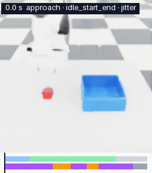

# Perfect, then multiply

**Built to turn a noisy webcam robot demo into many physics-verified training demos:
code and NVIDIA Nemotron 3.5 Super VL diagnose it, code repairs it, Isaac Lab checks it,
and the verified demo is multiplied and exported for LeRobot.**
<!-- src: docs/superpowers/notes/2026-10-17-claims-audit.md (README.md:3-5); wording follows the user's decision on Nemotron's role -->

Submission for the [Nebius x NVIDIA Global AI Hackathon](https://nebiusglobalaihackathon.devpost.com/),
Physical AI track. Simulation only, no physical robot (allowed by the official FAQ; see
[the screenshot](docs/superpowers/notes/2026-10-15-faq-physical-ai-simulation-allowed.jpg)).

**Rule: the AI decides, code acts, physics checks.**

> **Status (2026-10-17): work in progress.** Every stage is built and tested, and the
> pipeline has run end to end on a live Isaac Lab sim worker. Measured so far:
> - 50/50 scripted demos verify.
> - Multiplication yield: **30/30** (clean expert), **75/75** (degraded and perfected,
>   up from 34/75 before the handover fix), **100/100** (the home-start training set).
> - **First policy results, too small to call:** ACT trained on 10 scripted demos
>   succeeds on 2/20 unseen scenes; on the same 10 plus 100 multiplied variants, 3/20.
>   Fisher p = 1.0, so this is a tie, not a win for multiplication.
> - In a pre-registered diagnosis test, code alone scored higher than Nemotron (F1 0.90
>   vs 0.86; see [Results](#results)).
>
> Perfected + multiply, and the policy ablation, are still PENDING. Nothing below claims a
> result that has not been measured.
> <!-- src: docs/superpowers/notes/2026-10-15-t2-status.md (sprint 2 Task 3: 50/50; sprint 4 Task 1: 30/30; sprint 4 Task 3: 34/75 -> 75/75; sprint 6 Task 2: 100/100); docs/superpowers/notes/2026-10-15-t3-status.md (sprint 6 Task B: 2/20 vs 3/20, p = 1.0); docs/superpowers/notes/2026-10-15-t4-status.md (sprint 6 Task 1: v2 ablation) -->

## The problem

- Robot policies learn by imitating demonstrations, and they need many of them.
- Human demonstrations are the expensive part. Vendor estimates: teleoperation rigs cost
  $6k–$80k, operators $25–$50/hour, and 20–30% of demos are discarded.
  <!-- src: docs/superpowers/specs/2026-10-15-perfect-then-multiply-design.md §2 (vendor estimates) -->
- A webcam costs almost nothing, but webcam teleoperation demos are noisy: pauses, shaking,
  off-center grasps.

So the question is: can a cheap, noisy demo be *perfected*, checked in physics, and then
*multiplied* into many good ones?


*One demo replayed in Isaac Lab on one clock. Left: raw, 13.8 s, with tremor, two pauses,
slowness and idle time. Right: the rules-perfected demo, 9.3 s. Both replays verified. The
strip under the left panel is the diagnosis. The "human" demo here is the scripted expert,
degraded synthetically with ground truth; no real webcam demo has been recorded yet.*
<!-- src: docs/media/README.md (Before and after perfecting); docs/superpowers/notes/2026-10-15-t1-status.md (sprint 4 Task 2) -->

## How it works

One task: pick up a red 5 cm cube and place it in a blue bin, with a simulated Franka arm.
<!-- src: spec §4 -->

```
record ─► measure ─► diagnose ─► repair ─► verify ─► multiply ─► export ─► train
webcam    code       Nemotron    code      Isaac     code +       LeRobot   LeRobot
hand      metrics    3.5 Super   (fixed    Lab       Isaac        v3.0      ACT
                     VL          menu)     replay    verify
```

1. **Record.** The browser tracks your hand with MediaPipe and sends a hand pose at about
   30 Hz over a WebSocket. The backend validates each message and relays it to the sim
   worker, which maps it to an end-effector target for differential IK. Start and Stop on the
   Record page save a human demo with its episode.
   <!-- src: spec §8.1; docs/superpowers/notes/2026-10-15-t4-status.md (sprint 1b); docs/superpowers/notes/2026-10-16-web-pages.md (sprint 3c T5 Tasks 1-4) -->
2. **Measure.** Pure code computes motion metrics in 0.5 s windows: speed, jerk, gripper
   state, end-effector-to-cube distance, cube height and contacts.
   <!-- src: spec §7 Metrics -->
3. **Diagnose.** The result is JSON: the demo's segments, its issues with timestamps, which
   repairs to run, and a `keep` / `repair` / `discard` decision. The default diagnoser is
   **hybrid**:
   - The rules detector owns the timing issues: pause, jitter and idle.
   - Nemotron 3.5 Super VL, on Nebius Token Factory, gets key frames, the metrics table,
     the rules' findings and the code-measured grasp offset.
   - The model looks only for what the rules never name: an off-center grasp, a bad
     release, a drop, the wrong object, a rim contact, and the segments.
   - Since sprint 5 it also gets measured release facts, and any `drop` or `bad_release`
     claim on a replay that verified is dropped. The perfect pipeline (`app/jobs.py`) does
     not pass the bin pose yet, so there the model gets no release facts.
     <!-- src: docs/superpowers/notes/2026-10-15-t4-status.md (sprint 5 Task 1b); docs/superpowers/notes/2026-10-17-claims-audit.md (E3) -->

   What that adds is measured in [Results](#results).
   <!-- src: docs/superpowers/notes/2026-10-15-t4-status.md (sprint 4 Tasks 1-2) -->
4. **Repair.** Code applies the chosen repairs from a fixed menu: `trim`, `remove_pause`,
   `smooth`, `retime`, `recenter_grasp`, `replan_transit`, `discard`. Each op has
   unit-tested invariants (for example, `remove_pause` leaves no position jump over 1 cm at
   the stitch). <!-- src: spec §8.4 -->
5. **Verify.** Isaac Lab replays the trajectory through the same diff-IK controller and
   records the episode. Pure code (`demo_pipeline/success.py`) then decides success: cube
   in the bin, gripper open, cube settled, no hard arm collisions, no drop.
   <!-- src: spec §8.5; docs/superpowers/notes/2026-10-15-t2-status.md -->
6. **Multiply.** A verified demo is transformed to newly sampled cube and bin positions:
   up to the grasp it moves rigidly with the cube, from the release on rigidly with the
   bin, and the carry between them is re-planned along the new grasp→release line. Each
   variant is verified again, and failures are kept out of the dataset with a named
   reason. Sampling ranges are per robot.
   <!-- src: docs/superpowers/notes/2026-10-15-t1-status.md (sprint 3 Tasks 1-2); docs/superpowers/notes/2026-10-15-t2-status.md (sprint 2 Task 4) -->
7. **Export.** Only verified episodes go out, as a LeRobot v3.0 dataset with front and
   wrist video. Each episode gets a *passport* recording its lineage, repairs, diagnosis
   source and model ID. <!-- src: docs/superpowers/notes/2026-10-15-t3-status.md -->
8. **Train.** LeRobot ACT, served over HTTP by a policy server and evaluated in Isaac on
   fixed test scenes by `sim_eval/`, with the same success check.
   <!-- src: docs/superpowers/notes/2026-10-15-t3-status.md (sprint 2 Task 2; sim_eval final summary) -->

### How NVIDIA Nemotron 3.5 Super VL is used (via Nebius Token Factory)

- **Model ID:** `nvidia/Nemotron-3.5-Super-VL` (text+image→text). The API echoed the same
  ID back. <!-- src: docs/superpowers/notes/2026-10-15-t4-nemotron-vl.md -->
- **Endpoint:** Token Factory's OpenAI-compatible API, `https://api.tokenfactory.nebius.com/v1/`,
  through the repo's `nebius_llm` client (vision tier `nemotron-vl` in
  [`src/nebius_llm/config.py`](src/nebius_llm/config.py); override it with
  `NEBIUS_MODEL_VISION_NEMOTRON`). Every call is logged to `usage_log.jsonl` with its token
  counts and estimated cost.
- **Input per diagnosis:** at most **8 images**, because Token Factory rejects more with
  HTTP 400. That means 7 evenly spaced front-camera frames, each captioned with its time,
  plus 1 wrist frame at the first gripper close, or 8 front frames when there is no wrist
  frame. Also the metrics table as compact text, the task sentence, and the replay success
  flag. Thinking is turned off (`chat_template_kwargs: {enable_thinking: false}`).
  <!-- src: docs/superpowers/notes/2026-10-15-t4-nemotron-vl.md; docs/superpowers/plans/2026-10-15-sprint1-parallel-tracks.md T4 Task 2 -->
- **Output:** one JSON `Diagnosis` that is validated before use: segments in order and
  inside the demo, issue types and repair ops from fixed lists, valid times. The prompt is
  generated from the pydantic schema, so the prompt and the validator cannot drift apart.
  <!-- src: docs/superpowers/notes/2026-10-15-t4-status.md -->
- **On failure:** an invalid reply is retried once, with the validation error appended.
  If it is still invalid, or Token Factory returns an error (auth, 429, 400), the backend
  falls back to the rules detector and records `diagnosis_source: "rules"`.
  <!-- src: docs/superpowers/notes/2026-10-15-t4-status.md (sprint 2, Task 5) -->
- **Metric gate:** after parsing, `gate_diagnosis` drops any `rim_contact`, `jitter` or
  `slow` issue that the measured windows contradict (no arm-bin contact, jerk below the
  jitter limit, speed not slow), along with the repairs tied only to it. If nothing is
  left, the decision becomes `keep`. Every dropped item is listed and stored with the
  diagnosis, and the Review page shows it struck through. The hybrid adds a grasp gate. It
  drops a `grasp_off_center` claim when the measured gripper-to-cube offset at the close is
  under 3.3 mm, which is the IK tracking error measured in sprint 2 (not fitted to the
  test set).
  <!-- src: docs/superpowers/notes/2026-10-15-t4-status.md (Diagnoser calibration, "Gate"; sprint 3 Task 1; sprint 4 Task 1) -->
- **Measured cost and latency:**

  | Call | Images | Prompt tokens | Completion tokens | Cost | Latency |
  |---|---|---|---|---|---|
  | Synthetic demo, 256×256 frames | 8 | 3,269 | 390 | $0.001332 | 2.52 s |
  | Real Isaac episode, old prompt | 8 | 3,595 | 633 | $0.001648 | 3.9 s |
  | Same episode, calibrated prompt | 8 | 3,990 | 188 | $0.001366 | 2.3 s |

  <!-- src: row 1 docs/superpowers/notes/2026-10-15-t4-nemotron-vl.md; row 2 docs/superpowers/notes/2026-10-15-t4-status.md (sprint 2, Task 6); row 3 t4-status (Diagnoser calibration, Before / after table and "Tokens") -->
  - Price: $0.30 per 1M prompt tokens, $0.90 per 1M completion tokens. Images are billed
    as prompt tokens, about 263 tokens per 256×256 image.
    <!-- src: docs/superpowers/notes/2026-10-15-t4-nemotron-vl.md -->
  - So one diagnosis costs about $0.0013–$0.0016 and takes about 2.3–3.9 s.
    <!-- src: the three rows above -->
- **What it is good at so far:** see [Results](#results). In short:
  - The format is mostly reliable: over the 110 ablation calls (42 in sprint 4, 68 in the
    v2 test), 4 replies needed a retry and 1 fell back to the rules (a zero-length
    segment).
  - Its segmentation is good.
  - **In a pre-registered test on 32 synthetic demos (set v2), code alone beat it:** F1
    0.90 for a zero-call code check, against 0.86 for the hybrid.
  - **It does not read the grasp from the 128×128 wrist frame:** without the measured
    offset, it called all 8 centered grasps off-center.
  - It never reported a `drop`; it called drops `bad_release`.
  <!-- src: docs/superpowers/notes/2026-10-15-t4-status.md (sprint 4 Task 3: 42 calls; sprint 6 Task 1: 68 calls, retries, fallback, F1 table, R1 bar, breakdown 2) -->

### NVIDIA Isaac Sim 6.2 / Isaac Lab 3.0

- The pick-place scene is defined in `sim_worker/scene_cfg.py`: table, Franka
  (`FRANKA_PANDA_HIGH_PD_CFG`), red cube, a blue bin built from 5 cuboids, contact sensors,
  and two 128×128 cameras (front and wrist). <!-- src: docs/superpowers/plans/2026-10-15-sprint1-parallel-tracks.md T2 Task 2; t2-status -->
- `sim_worker/replay.py` drives the arm with differential IK (absolute pose) and records
  the episode: joint states, actions, images, cube pose and contacts.
- **Joint-velocity feedforward is on by default.** The arm used to trail the target: the
  joint PD drive's damping lags a moving target by about 0.2 s. Sending the commanded
  twist as joint velocity targets cut the mean tracking error from 26.8 to 2.1 mm (16.0
  to 3.3 mm at the gripper close), without changing the demo. More IK iterations changed
  nothing. <!-- src: docs/superpowers/notes/2026-10-15-t2-status.md (sprint 2 Task 2) -->
- `sim_worker/robots.py` holds per-robot constants: the Franka, and two second-arm trials,
  the OpenArm and the Flexiv Rizon 4s (see [Results](#results) for why their yields are
  low). <!-- src: t2-status (sprint 2 Task 5; sprint 3 Task 3) -->
- `sim_worker/server.py` is the sim worker's HTTP server (`/replay`, `/multiply`,
  `/health`). It runs one job at a time and answers 409 `busy` otherwise; `/multiply`
  resumes by seed. While a job runs, it asks Windows not to sleep (see
  [Results](#results)). <!-- src: t2-status (sprint 3 Task 1; sprint 4 Task 2) -->
- `sim_worker/teleop_session.py` and `scripts/teleop_sink.py` are the webcam-teleop side:
  they follow the hand at 50 Hz, pause on tracking loss, and save each recording as a demo.
  <!-- src: docs/superpowers/notes/2026-10-16-web-pages.md (sprint 3c T5 Tasks 2-3) -->
- Physics dt 0.01 s, control and recording at 50 Hz. <!-- src: spec §6 -->

### LeRobot

- `lerobot_tools/export.py` writes verified episodes as a LeRobot dataset (lerobot 0.6.1,
  dataset format v3.0): state, action, front and wrist video, task text, plus a
  `passports.jsonl`.
  <!-- src: docs/superpowers/notes/2026-10-15-t3-lerobot-windows.md -->
- Policy: LeRobot **ACT** (`lerobot-train --policy.type=act`).

## Prior art and our claim

This work builds on, and cites:

- **MimicGen**: object-relative demo multiplication.
- **SkillGen**: segment-wise repair.
- **DemoBridge**: planner-based repair of single-view human demos, with no VLM.
- **ISR**: de-pausing demos, reported +25%. <!-- src: spec §5 -->
- **DQAF**: VLM diagnosis of teleop demos, given as feedback to the human only.
- **handrobot** and **AnyTeleop**: webcam teleoperation.

**Our claim (to our knowledge):**

> "A structured, timestamped diagnosis of a teleoperation demo drives its automatic repair
> from a fixed menu; physics replay verifies every repair; and the verified demo is
> multiplied across positions."

We also tested whether a VLM (Nemotron 3.5 Super VL) improves that diagnosis over code. In
a pre-registered test it did not (F1 0.86 vs 0.90). The webcam recorder and two second arms
are built but not yet shown working: no person has recorded a demo yet, and neither arm is
demo-grade.
<!-- src: docs/superpowers/notes/2026-10-17-claims-audit.md (README.md:196-200, proposed wording; it rewords spec §5 and awaits the user's approval); t4-status (sprint 6 Task 1); docs/superpowers/notes/2026-10-16-web-pages.md (no real person yet); t2-status (OpenArm 0/30, Flexiv 9/30) -->

We do **not** claim to be the first at webcam teleop, demo repair, VLM demo critique or demo
multiplication. Each of those exists already (see above). <!-- src: spec §5 -->

## Pipeline status

| Stage | Code | State today |
|---|---|---|
| Record | `demo_pipeline/teleop.py`, `src/app/routers/teleop.py`, `web/src/pm/record/`, `sim_worker/teleop_session.py`, `sim_worker/scripts/teleop_sink.py` | Built end to end: hand→target mapping, gripper latch, relay with record/stop/reset controls, the Isaac sink that drives the arm and saves the demo, and the Record page. Automated fake-hand smoke in Isaac: 376/376 steps recorded, verified live and again by replay. **No run with a real person yet** |
| Measure | `demo_pipeline/measure.py` | Built, tested |
| Diagnose | `src/app/ai/diagnose.py`, `POST /demos/{id}/diagnose` | Built: rules, Nemotron (calibrated prompt + metric gate), and the default hybrid. Scored in a pre-registered ablation on 32 rendered synthetic demos (set v2), where code alone beat the hybrid (see [Results](#results)) |
| Rules detector + repair | `demo_pipeline/rules.py`, `repair.py` | Built. Scored on synthetic tremor demos and on rendered degraded episodes |
| Verify | `sim_worker/replay.py`, `demo_pipeline/success.py` | Built, measured: 50/50 scripted demos verify |
| Multiply | `demo_pipeline/multiply.py`, `sim_worker/scripts/multiply_run.py`, `client_multiply.py` | Built, measured in Isaac on current code: clean expert 30/30; degraded and perfected sources 75/75; home-start training set 100/100 (10 sources × 10) |
| Second arm | `sim_worker/robots.py` | OpenArm 0/30 and Flexiv 9/30 multiplied: neither is demo-grade yet (see [Results](#results)) |
| Perfect pipeline | `POST /demos/{id}/perfect`, `GET /jobs/{id}`, `scripts/run_pipeline_batch.py`, `scripts/run_experiment.py` | **Ran live** on the sim worker: a 12-demo set, 5 synthetic human-style demos × raw / rules / Nemotron, multiplied into a training grid that T3's dry run accepts |
| Export | `lerobot_tools/export.py`, `assemble.py` | Built, tested |
| Train / eval | `lerobot_tools/train.py`, `experiments.py`, `policy_server.py`; `sim_eval/` | Built and evaluated in Isaac on 20 unseen scenes. Sprint 3 cells (5/10/13 demos): 0/20 each. Home-start cells: raw_10 2/20, raw_multiply_10 3/20 (p = 1.0, a tie). Perfected + multiply not run |
| Web pages | `web/src/pm/` | Record (drives the sim), Review (with the Perfect button), Dataset and Results are built and tested; Results reads `GET /results` |

<!-- src: docs/superpowers/notes/2026-10-15-t1-status.md (sprint 2 tremor run; sprint 3); docs/superpowers/notes/2026-10-15-t2-status.md (sprint 2; sprint 3 Tasks 1, 3; sprint 4 Tasks 1, 3); docs/superpowers/notes/2026-10-15-t3-status.md (sprint 2; sim_eval; sprint 3 Tasks 3-4; Task 4 eval run: 0/20 ×3; sprint 6 Task B: 2/20 vs 3/20); docs/superpowers/notes/2026-10-15-t4-status.md (calibration; sprint 3 Task 3; sprint 4; sprint 6 Task 1: v2 ablation); docs/superpowers/notes/2026-10-15-t2-status.md (sprint 6 Task 2: 100/100); docs/superpowers/notes/2026-10-16-web-pages.md (sprint 3c T5, incl. Task 3 follow-up: the fake-hand smoke) -->

## Setup (Windows 11, verified on an RTX 5080 16 GB)

The project uses **three Python environments**, because Isaac Lab, LeRobot and the backend
pin different versions. `demo_pipeline` depends only on numpy and pydantic, so all three
can import it. <!-- src: spec §6, Changes -->

**Rule for every environment:** keep it **outside OneDrive** (we use `C:\venvs\...`) and
run uv with `UV_LINK_MODE=copy`. A `.venv` inside a OneDrive folder fails to install (os
errors 5 and 396). <!-- src: spec Changes; sprint1 plan Global Constraints -->

### 1. Backend + pipeline (the "SANT" venv)

Needs Python 3.11+, [uv](https://docs.astral.sh/uv/), and a Nebius Token Factory API key
from [tokenfactory.nebius.com](https://tokenfactory.nebius.com).

```powershell
git clone https://github.com/davidhernandez0771/Nebius-X-NVIDIA-Hackathon-Project.git
cd Nebius-X-NVIDIA-Hackathon-Project

$env:UV_PROJECT_ENVIRONMENT = "C:\venvs\pm-<name>"   # any folder outside OneDrive
$env:UV_LINK_MODE = "copy"
uv sync --all-extras

cp .env.example .env    # then paste your key into NEBIUS_API_KEY; never commit .env
```

Set the two `$env:` variables again in every new PowerShell before any `uv` command. In Git
Bash, a bare `python` may hit a broken uv trampoline, so use `uv run python`.
<!-- src: docs/superpowers/notes/2026-10-15-t1-status.md; 2026-10-16-fix-windows-tests.md -->

### 2. Isaac Sim 6.2 + Isaac Lab 3.0 (the sim worker)

What works on this machine: the **Isaac Sim 6.2.0.0 pip package** on **Python 3.12**, with
**Isaac Lab from the `release/3.0.0` branch**. The venv is `C:\isaac\env_isaaclab`
(Python 3.12.14) and the Isaac Lab checkout is `C:\isaac\IsaacLab`.
<!-- src: spec §6 (venv, Python 3.12.14); t2-status (Isaac Lab 3.0.0 / Isaac Sim 6.2 / Python 3.12); sprint1 plan T2 (C:\isaac\IsaacLab); pip version 6.2.0.0 and branch release/3.0.0 from the submission-docs task brief (not in a note) -->

> **Unverified here:** the exact install commands for Isaac Sim and Isaac Lab were not
> recorded in this repo's notes. Follow NVIDIA's official Isaac Lab pip installation guide
> for those versions, using a venv outside OneDrive.

Then install this repo's pure-Python contract into Isaac's venv:

```powershell
C:\isaac\env_isaaclab\Scripts\python.exe -m pip install -e <path-to-this-repo> --no-deps
C:\isaac\env_isaaclab\Scripts\python.exe -m pip install pytest
```

<!-- src: docs/superpowers/plans/2026-10-15-sprint1-parallel-tracks.md, Track T2 -->

Gotchas:

- **Isaac Lab 3.0 opens no window unless you pass `--viz kit`.** Without it, runs are
  headless. <!-- src: sprint1 plan, T2 Gotchas -->
- The first launch downloads assets. It took 37 s here. <!-- src: t2-status -->
- Isaac Lab 3.0 uses **xyzw** quaternions. This repo uses wxyz everywhere and converts only
  at the sim boundary. <!-- src: t2-status, Decision 1 -->

### 3. LeRobot (export + training)

```powershell
$env:UV_LINK_MODE="copy"
uv venv --python 3.12 C:\venvs\lerobot
uv pip install --python C:\venvs\lerobot\Scripts\python.exe torch torchvision --index-url https://download.pytorch.org/whl/cu128
uv pip install --python C:\venvs\lerobot\Scripts\python.exe "lerobot[dataset,training]==0.6.1" pytest
uv pip install --python C:\venvs\lerobot pydantic
uv pip install --python C:\venvs\lerobot\Scripts\python.exe -e <path-to-this-repo> --no-deps
```

<!-- src: docs/superpowers/notes/2026-10-15-t3-lerobot-windows.md (Install); pydantic line from docs/superpowers/plans/2026-10-15-sprint2-parallel-tracks.md T3 -->

- The CUDA 12.8 build is needed for the RTX 5080. <!-- src: sprint1 plan T3 Task 1 -->
- **Load and train with `video_backend=pyav`.** torchcodec could not load here: it needs a
  *shared* FFmpeg 4–8, and the system FFmpeg was a static 9.0 build. PyAV bundles its own
  FFmpeg. <!-- src: t3-lerobot-windows, Problems found 1 -->
- pydantic is needed by `demo_pipeline` but is not a LeRobot dependency. Install it
  explicitly, as above. <!-- src: t3-status, Blocked 3 -->
- **Bare `lerobot-train` exits 1 at every checkpoint save on Windows** (`WinError 1314`:
  it creates a symlink, which needs admin rights or Developer Mode).
  <!-- src: t3-lerobot-windows --> Train through the wrapper instead,
  `python -m lerobot_tools.train <lerobot-train args>`. It writes a `last.txt` pointer
  instead of the symlink and resumes with `--resume-last <output_dir>`. A 1,000-step run
  with 4 checkpoint saves exits 0. <!-- src: docs/superpowers/notes/2026-10-15-t3-status.md (sprint 2 Task 1 and final summary) -->

### 4. Web app + MediaPipe hand-tracking assets

The Record page loads MediaPipe's WASM runtime and the hand model from local files, not from a
CDN. Both are git-ignored, so **a fresh clone has no hand model until you run these steps**
(PowerShell, from the repo root; tested in a scratch copy on 2026-10-16):

```powershell
npm --prefix web ci
New-Item -ItemType Directory -Force web\public\mediapipe\wasm, web\public\models | Out-Null
Copy-Item -Force web\node_modules\@mediapipe\tasks-vision\wasm\* web\public\mediapipe\wasm\
Invoke-WebRequest -OutFile web\public\models\hand_landmarker.task `
  https://storage.googleapis.com/mediapipe-models/hand_landmarker/hand_landmarker/float16/1/hand_landmarker.task
```

- The WASM files are copied from the pinned `@mediapipe/tasks-vision` 0.10.17, so they
  match the package exactly.
- The model is pinned to `float16/1`, not `latest`. It is about 7.8 MB.
- The page loads them from `/mediapipe/wasm` and `/models/hand_landmarker.task`, as set in
  `web/src/hand/tracking/mediapipeTracker.ts`.

<!-- src: docs/superpowers/notes/2026-10-16-prepublish-audit.md (finding 7); HAND_INTERACTION_PLAN.md (Assets); web/package.json (0.10.17); model size from the URL's Content-Length, 7,819,105 bytes, checked 2026-10-16 -->

## Run what exists today

**Tests (backend + pipeline, all AI calls mocked, no network, no spend):**

```powershell
uv run pytest -q
```

Latest run (2026-10-17, code identical to `9b781d4`): **1294 passed, 18 skipped, 0
failed.** The skips need lerobot, PIL, pyarrow or torch (they run in the other venvs),
Isaac, a GPU (gated by `T3_GPU_TESTS=1`), or an opt-in launcher run; one launcher test
skips when `web/node_modules` exists. Re-run on the submission commit.
<!-- src: test output 2026-10-17, recorded in docs/superpowers/notes/2026-10-16-web-pages.md (Sprint 7, Track T5); T7 got 1295 / 17 at 9b781d4 (claims audit E1) -->


**Isaac-side tests** (they need no repo fixtures, hence `--noconftest`):

```powershell
C:\isaac\env_isaaclab\Scripts\python.exe -m pytest -q --noconftest -p no:cacheprovider (Get-ChildItem tests\test_dp_*.py, tests\test_sim_*.py).FullName sim_eval\tests
```

- Last run (2026-10-16, on `68e4e68`): **539 passed, 1 skipped.** Re-run before
  submitting. <!-- src: docs/superpowers/notes/2026-10-16-web-pages.md (docs refresh after sprint 4) -->
- If Isaac's venv has an older editable install of this repo, set
  `$env:PYTHONPATH = "<path-to-this-repo>\src"` first, so the tests import this checkout's
  `demo_pipeline`.

<!-- src: docs/superpowers/notes/2026-10-16-web-pages.md (Sprint 3c T5 Task 3 and final summary) -->

**Smoke replay in Isaac Lab** (scripted expert on a fixed scene → replay → verify):

```powershell
C:\isaac\env_isaaclab\Scripts\python.exe sim_worker\scripts\smoke_replay.py --no-cameras --out data\smoke
```

- It prints `RESULT_JSON {"success": true, ...}`. <!-- src: t2-status -->
- Drop `--no-cameras` to also record front and wrist 128×128 PNGs (`--out data\smoke_cam`
  was used for the camera run).
- **Unverified:** adding `--viz kit` to open a window. The script uses Isaac Lab's
  standard launcher arguments, but it was only run headless.

**Webcam teleop (Record page → Isaac):**

```powershell
# automated smoke, no person and no backend: a scripted fake hand records one demo,
# then sim_worker.replay re-checks it
C:\isaac\env_isaaclab\Scripts\python.exe sim_worker\scripts\teleop_sink.py --fake-hand --no-cameras --data-dir <scratch dir>

# live: start the backend (below), then the sink with a window, then open /pm/record
C:\isaac\env_isaaclab\Scripts\python.exe sim_worker\scripts\teleop_sink.py --viz kit
```

- **The smoke passed:**
  - It recorded 376 of 376 steps, and both the live check and the replay check verified
    success.
  - It ran at 19.1 ms per control step, headless and without cameras, just inside the 20 ms
    real-time budget.
- **Not done yet:** a run with a real person, and a speed measurement with cameras or
  `--viz kit`.

<!-- src: docs/superpowers/notes/2026-10-16-web-pages.md (Sprint 3c T5 Task 3 follow-up) -->

**Nemotron diagnosis (real, billed Token Factory calls):**

```powershell
uv run python scripts/smoke_test.py                 # checks the API key with one tiny call
uv run python scripts/diagnose_smoke.py             # synthetic demo with one 0.9 s pause
uv run python scripts/diagnose_real_episode.py --dry-run --episode <episode-dir>   # builds inputs + runs rules, no call
```

- `smoke_test.py` comes from the previous README and was not re-run for this one.
- Both diagnose scripts refuse to run past their call budget, so they cannot overspend by
  accident. <!-- src: script docstrings; t4-status -->

**Backend** (http://localhost:8000):

```powershell
uv run uvicorn app.main:app --reload --app-dir src
```

The new routes:

- `GET /teleop/status` and the WebSocket `/ws/teleop?role=browser|sim`;
- `POST /demos`, `GET /demos`, `GET /demos/{id}`, `POST /demos/{id}/diagnose`,
  `GET /demos/{id}/diagnosis`;
- `POST /demos/{id}/perfect?diagnoser=hybrid|nemotron|rules` (default `hybrid`) → 202 with a job id, then
  `GET /jobs/{id}`. It answers 503 when the sim worker (default `http://127.0.0.1:8770`,
  or `SIM_WORKER_URL`) is not running;
- `GET /results`: `DATA_DIR/results/results.json`, or 404 "no results yet".

Demos and results live under `DATA_DIR` (default `data/`, git-ignored).
<!-- src: t4-status sprint 1b, sprint 2 Task 5, sprint 3 Tasks 2-3; docs/superpowers/notes/2026-10-16-web-pages.md (sprint 3b, GET /results) -->

**Web pages** (Record, Review, Dataset, Results, under `/pm/` in the dashboard):

```powershell
npm --prefix web ci
npm --prefix web test
npm --prefix web run build
```

- Latest run: **178 web tests passed**, and the build passes. The Record page also needs
  the MediaPipe assets from [Setup step 4](#4-web-app--mediapipe-hand-tracking-assets).
  <!-- src: docs/superpowers/notes/2026-10-16-web-pages.md (Sprint 3c T5 final summary) -->
- To open them, run the backend above and the Vite dev server (`npm --prefix web run dev`,
  from `web/package.json`; the backend's CORS allows `http://localhost:5173`), then go to
  `/pm/review`. <!-- src: CORS port from docs/superpowers/notes/2026-10-15-t4-status.md (sprint 1b) -->
- Every page shows a clear message when the store is empty, the backend or sim worker is
  down, or a route is missing. Results shows the sample file under a **SAMPLE DATA**
  banner until `GET /results` serves measured data.
  <!-- src: docs/superpowers/notes/2026-10-16-web-pages.md -->

**LeRobot exporter tests and the ACT training smoke:**

```powershell
C:\venvs\lerobot\Scripts\python.exe -m pytest -q lerobot_tools\tests
C:\venvs\lerobot\Scripts\python.exe -m lerobot_tools.train_smoke
```

<!-- src: t3-status (5 passed); t3-lerobot-windows (train smoke) -->

## Results

Every number here was measured, and each cites the note it comes from. Anything not
measured yet is marked **PENDING**.

### Physics: verify and multiply (Isaac Lab, Franka)

| What | Result |
|---|---|
| Scripted demos replayed and verified | **50/50** success, 13 s per episode, no cameras <!-- src: docs/superpowers/notes/2026-10-15-t2-status.md (sprint 2 Task 3) --> |
| Workspace corners | **8/8** success <!-- src: t2-status (sprint 2 Task 3) --> |
| With front + wrist cameras | **20/20** success, median 38.0 s per episode, peak GPU 5980 MiB <!-- src: t2-status (sprint 2 Task 6) --> |
| Tracking error, after the velocity feedforward fix | mean **26.8 → 2.1 mm**, at the gripper close 16.0 → 3.3 mm <!-- src: t2-status (sprint 2 Task 2) --> |
| **Multiplication yield, clean expert, Franka** | **30/30 = 100%** (seeds 100–129, current code, through the sim worker; 9.8 s per variant). It was 27/30 before the handover fix <!-- src: docs/superpowers/notes/2026-10-15-t2-status.md (sprint 4 Task 1); 27/30: t2-status (sprint 2 Task 4) --> |
| **Multiplication yield, degraded and perfected demos** | **75/75**, up from 34/75 (5 synthetic human demos × {raw, rules-perfected, Nemotron} × 5 variants, the same seeds) <!-- src: t2-status (sprint 4 Task 3) --> |
| **Multiplication yield, home-start training set** | **100/100** (10 scripted sources × 10 variants, seeds 3100–3199, cameras; every episode starts at the same home pose, spread ≤ 0.0002 rad) <!-- src: t2-status (sprint 6 Task 2) --> |
| Webcam-teleop smoke (fake hand) | 376/376 steps recorded; live check and replay both verified <!-- src: docs/superpowers/notes/2026-10-16-web-pages.md (Sprint 3c T5 Task 3 follow-up) --> |

**The multiply failures were traced, not guessed, and the fix is measured.**

| Source | Before (old worker) | After (current code) |
|---|---|---|
| raw (5 × 5) | 12/25 | **25/25** |
| rules-perfected | 10/25 (5 of the 15 failures were `sim_error`, see below) | **25/25** |
| Nemotron | 12/25 | **25/25** |

<!-- src: t2-status (sprint 4 Task 3 table) -->

- **Cause:** the old transform handed the hand over from the cube's frame to the bin's at
  a fixed time after the grasp. With human timing (slowness, pauses) that moment fell
  earlier in the lift, so failed variants swung 0.31–0.42 m off the cube→bin line and
  reached up to 1.0 m from the shoulder.
  <!-- src: t2-status (sprint 4 Task 3, classification); docs/superpowers/notes/2026-10-15-t1-status.md (sprint 4 Task 1) -->
- **Fix:** the carry now follows the new grasp→release line, with the handovers at the
  gripper events. Every variant swings at most 0.020 m and reaches at most 0.714 m.
  <!-- src: t1-status (sprint 3 Task 1); t2-status (sprint 4 Task 3) -->
- **The 5 `sim_error`s were Windows going to sleep, not the demo.**
  - Windows logged "The system is entering sleep" at 16:46:29, the same second as the
    worker's first CUDA error.
  - Replayed directly, the same 5 variants all succeed.
  - **Fix:** while a job runs, the worker now asks Windows to stay awake
    (`SetThreadExecutionState`, no power setting changed and no admin needed). After a
    failed replay, it waits for the GPU to answer again and retries once.
  <!-- src: t2-status (sprint 4 Task 2) -->
- **Our task is easier than MimicGen's** (published 38–74%): one 5 cm cube, a large open
  bin, a top-down grasp. The honest claim is that the transform + verify loop keeps every
  failure out of the dataset, with a named reason.
  <!-- src: t2-status (sprint 2 Task 4, "vs MimicGen"); MimicGen range: spec §3, §8.6 -->

### The second arm (negative results so far)

- **Flexiv Rizon 4s + Grav gripper:** **9/30** multiplied, against the OpenArm's 0/30 on the
  same seeds; 5/30 scripted.
  - The failures were grip physics (near-massless finger bodies slip or drag) and the old
    handover swing, not reach.
  - Its fitted ranges are Franka's, except bin y ≥ −0.25.
  - Better than the OpenArm, but not demo-grade. A re-run after the handover fix is
    PENDING.
  <!-- src: t2-status (sprint 3 Task 3 and final summary); t1-status (sprint 3c Task 1) -->

**OpenArm:**

- The OpenArm runs end to end: scene, replay, batch and multiply. It tracks within 4 mm
  below about 0.20 m and grasps with 1.0–1.2 mm error at the close.
  <!-- src: t2-status (sprint 2 Task 5) -->
- **But its yield in the shared workspace is near zero:** 0/30 multiplied, 2/30 scripted.
  22 more scripted runs put the cube in the bin but fail the strict `unreachable` rule
  (they deviate 3–4.5 cm from the demo for more than 1 s). <!-- src: t2-status (sprint 2 Task 5) -->
- **Cause, measured:** its wrist joint is limited to ±45°, so holding the gripper
  vertical confines it to a ~0.15–0.2 m height band, and the shared workspace does not
  fit in that band from any base placement we tried. Its fitted range is the box around
  its only 2 successes, so it is not recommended.
  <!-- src: t2-status (sprint 2 Task 5; sprint 3 final summary, Open items 4); t1-status (sprint 3c Task 1) -->

### Diagnosis: rules and Nemotron

- **The rules detector under synthetic webcam tremor:** F1 on the issue types it detects
  (pause, idle, jitter) went from **0.00 to 0.97–0.99** at 1–4 mm of tremor, with precision
  ≥ 0.99 (seeds 0–199; 0.98 pooled on held-out seeds 1000–1199). Clean demos are unchanged.
  <!-- src: docs/superpowers/notes/2026-10-15-t1-status.md (sprint 2, Step 5 tables and "Reading the tables") -->
- **What the rules cannot do:** on a 60-demo mixed set they never name `slow` or
  `grasp_off_center` (54 of the 57 misses); F1 over all issue types is 0.85. That gap is
  where Nemotron has to earn its place. <!-- src: t1-status (sprint 3 Task 3, rules baseline on pilot60) -->
- **Nemotron's false positives, fixed on the test episode.** On a clean Isaac episode,
  the first prompt reported 5 issues, all false (2 jitter, 2 slow, 1 rim contact), and
  would have "repaired" a perfect demo. With the calibrated prompt and the metric gate:
  **0 issues, decision `keep`**, matching the rules. That call cost $0.0014 and took
  2.3 s. <!-- src: docs/superpowers/notes/2026-10-15-t4-status.md (Diagnoser calibration, Before / after) -->
  - The gate alone, applied offline to the old reply, also removes all 5.
  - **Limits:** this was one episode and one call. The concern at the time was that "when
    in doubt, leave it out" could hide real issues, and it did (next bullet).
    <!-- src: t4-status (Diagnoser calibration, "Limits, honestly"; sprint 3 Task 3) -->
  - What it adds over the rules so far: **segmentation**, six segments (approach,
    grasp, lift, carry, release, retreat) against the rules' three.
    <!-- src: t4-status (Diagnoser calibration, "Segmentation is unchanged") -->
- **Then the calibration over-corrected.** On the first live pipeline run (3 degraded demos,
  9 true issues), the calibrated Nemotron kept every demo and reported 0 issues. The rules
  found the idle time, the pauses and the tremor. Scored on 5 demos, Nemotron's recall was
  0, and the rules' recall over all types was 0.81.
  <!-- src: t4-status (sprint 3 Task 3); t1-status (sprint 4 Task 2, "s1 compare"); docs/media/README.md (Diagnosis scores) -->
- **So the default became a hybrid** (see [How it works](#how-it-works)): the rules own
  timing, and the model is given the code-measured grasp offset and asked only about what
  the rules never name. <!-- src: t4-status (sprint 4 Task 1) -->



*A rendered degraded demo with the rules' diagnosis: segments, plus jitter, pauses and
idle. Its 11.8 mm off-center grasp is the kind of issue the rules never name.*
<!-- src: docs/media/README.md (A diagnosis timeline) -->

**Ablation, pre-registered** (set v2: 32 rendered synthetic demos, with 8 off-center
grasps, 8 centered-grasp negatives, 6 drops, 6 bad releases and 4 clean; F1 over all issue
types; arms and thresholds fixed before any result):

| Diagnoser | F1, all types | grasp recall / FP on 8 centered | drop F1 | bad_release F1 | Calls / cost |
|---|---|---|---|---|---|
| rules | 0.81 | 0.00 / 0/8 | 0.00 | 0.00 | 0 / $0 |
| rules + code grasp check | 0.84 | 1.00 / 1/8 | 0.00 | 0.00 | 0 / $0 |
| **code only** (grasp + release checks) | **0.90** | 1.00 / 1/8 | **1.00** | **1.00** | 0 / $0 |
| hybrid (rules + Nemotron + gates) | 0.86 | 1.00 / 1/8 | 0.00 | 0.71 | 35 / $0.054 |
| Nemotron without the measured offset | 0.80 | 1.00 / **8/8** | 0.00 | 0.67 | 33 / $0.050 |

<!-- src: docs/superpowers/notes/2026-10-15-t4-status.md (sprint 6 Task 1 RESULTS: tables, spend) -->

An earlier, unregistered 20-episode test (sprint 4) gave the same ordering: code grasp
check 0.95, hybrid 0.90, rules 0.82, Nemotron alone 0.00.
<!-- src: t4-status (sprint 4 Task 3, Results table) -->

What this says, honestly:

- **Code alone matches or beats both model arms on every issue type.**
- **The hybrid's grasp calls are the code metric's.** The two differ on one episode, where
  the hybrid fell back to the rules.
- **Without the measured offset, the model fails the pre-registered bar:** it called all 8
  centered grasps off-center.
- **On releases, the model flags too much.** The verified-success gate dropped 20 of its
  claims, and it never reports `drop`.
- **Shared misses:** every arm misses all 16 `slow` issues and 5 of 41 pauses, because
  timing comes from the rules.
- **Limits:** n = 32 synthetic demos, 128×128 frames, one prompt fixed in advance. Larger
  crops and real webcam scenes are untested.
- Which role Nemotron keeps is the user's decision.
  <!-- src: t4-status (sprint 6 Task 1: R1 bar, Breakdown 1-4, "What this means for Nemotron's role", limits) -->

### Training and evaluation

- **LeRobot ACT trains natively on Windows:** 300/300 steps at 20.7 steps/s (batch 8),
  0.99 GB of torch memory; the checkpoint reloads and returns a finite action. Synthetic
  data only. <!-- src: docs/superpowers/notes/2026-10-15-t3-lerobot-windows.md -->
- **The Isaac eval harness works end to end** on a smoke checkpoint: 3 test scenes, every
  episode ran its full 30 s with no policy errors. That checkpoint was never trained on
  real episodes, so its 0/3 says nothing about the method.
  <!-- src: docs/superpowers/notes/2026-10-15-t3-status.md (sim_eval Step 4) -->
- **Sprint 3 cells** (5, 10 and 13 clean-expert demos, each starting above its own cube):
  **0/20** each on unseen scenes.
- **That 0 is too little data, not a bug:** the 13-demo policy succeeds on 3/5 of its own
  training scenes and 0/5 unseen ones.
- **Home-start cells, ACT 10k steps, 20 unseen scenes:** `raw_10` (10 scripted demos)
  **2/20** (Wilson 95% CI 3–30%); `raw_multiply_10` (the same 10 + 100 verified variants)
  **3/20** (5–36%). Fisher exact p = 1.0, so this is a tie. The multiplied policy grasps
  more often but drops the cube more (13 drops vs 4). It saw about 1.5 epochs against
  about 16, so it is probably undertrained.
- **What n = 20 can't say:** whether multiplying helps. At n = 20 the test had 24% power
  to detect a true 10% → 30% improvement, so "no significant difference" is not evidence
  of "no effect".
  <!-- src: t3-status (Task 4 eval run: 0/20 ×3; sprint 6 Task A; sprint 6 Task B 22:12); CIs and power: docs/superpowers/notes/2026-10-17-power.md (T1, sprint 7) -->

### The chart: partly measured

> **Measured:** 10 demos, raw vs raw + multiply: 2/20 vs 3/20 on unseen scenes (p = 1.0).
> The demos are the **scripted expert's**, not human ones, and n is 20 per cell, not the
> planned 50.
> <!-- src: t3-status (sprint 6 Task B); t2-status (sprint 6 Task 2: scripted-expert sources) -->
>
> **PENDING:** perfected + multiply, the 5- and 20-demo points, and logged human minutes.
> The planned chart is policy success on 50 fixed test positions against the number of
> human demos (5, 10, 20), for raw; raw + multiply (a MimicGen-style baseline); and
> perfected + multiply (ours). <!-- src: spec §3 -->
>
> The web Results page draws it from `GET /results` as soon as the experiment writes
> `DATA_DIR/results/results.json`; values not measured yet show as "pending".

### Policy ablation: PENDING

> **PENDING, not yet measured.** Policy success at 10 human demos: rules-only repair vs
> rules + Nemotron repair. <!-- src: spec §3 --> This is separate from the diagnosis
> ablation above, which scores diagnoses against ground truth, not trained policies.

Negative results will be reported as they come out.

## Limitations

- **Policy results are small and not significant yet:** 2/20 vs 3/20 (p = 1.0) on 20
  unseen scenes, trained on scripted demos. Perfected + multiply and the policy ablation
  have not run. <!-- src: t3-status (sprint 6 Task B) -->
- **Every "human" demo so far is synthetic:** the scripted expert, degraded with tremor,
  pauses, slowness, idle time and off-center grasps. The webcam → sim loop is built and
  passed its fake-hand smoke, but no real person has recorded a demo yet.
  <!-- src: docs/media/README.md; docs/superpowers/notes/2026-10-16-web-pages.md (Sprint 3c T5 Task 3 follow-up) -->
- **Nemotron did not beat code as a diagnoser.** In the pre-registered v2 test (32 demos,
  with grasp negatives, drops and bad releases), a zero-call code check scored F1 0.90
  against the hybrid's 0.86. Without the measured offset, the model called every centered
  grasp off-center. Wrong-object issues and real webcam frames were not tested.
  <!-- src: t4-status (sprint 6 Task 1) -->
- **Rules numbers are on synthetic tremor** (6 Hz Gaussian) and rendered degraded demos,
  not yet on real webcam recordings. <!-- src: t1-status (Tremor run final summary, For the lead 3); t4-status (sprint 4 Task 3) -->
- **No second arm is demo-grade yet:** OpenArm 0/30, Flexiv 9/30 (see above).
- **Start pose:** the sprint 3 demos each started above their own cube, which leaked the
  cube's position into the first frame. Since sprint 6, every training demo and every eval
  episode starts at one shared home pose.
  <!-- src: t2-status (sprint 5 Task 1; sprint 6 Task 2); t3-status (sprint 6 Task B) -->
- **One task, simulation only, no real hardware.** <!-- src: spec §4 -->
- **Windows-specific workarounds** for LeRobot: `video_backend=pyav`, and the
  symlink-free training wrapper.
- **Windows sleep kills CUDA mid-run.** It happened twice. The sim worker and the batch
  scripts now keep the PC awake while a job runs, and retry once after the GPU recovers.
  - Between jobs the PC can still sleep, and an explicit sleep always wins.
  - Long batches resume by seed.
  <!-- src: t2-status (sprint 2 Task 6; sprint 4 Task 2 and final summary) -->
- **This machine resets about 4% of localhost HTTP responses** (4 of 100 in one probe;
  WinError 10054), even from a plain stdlib server. The sim-side client
  (`sim_worker/http_client.py`, used by `client_multiply.py`) retries, which is safe
  because `/multiply` is idempotent by seed. The backend's `src/app/sim_client.py` retries
  too: up to 3 times, 10 s apart, on a reset connection or a busy worker.
  <!-- src: t2-status (sprint 4 Task 3); t4-status (Follow-ups after sprint 4, 2. SimWorkerClient retries, 0b0992c) -->
- The problem-cost figures are vendor estimates, not our measurements.
- 16 GB VRAM, so 1 environment and 128×128 cameras. <!-- src: spec §11; t2-status -->

## Project layout

```
src/demo_pipeline/  pure numpy + pydantic: schemas, measure, rules, repair, multiply,
                    success, teleop, store, episode_io, process, sim_protocol, scoring
src/app/            FastAPI backend; ai/diagnose.py (Nemotron + gate), jobs.py, sim_client.py,
                    routers/demos.py, routers/teleop.py, routers/results.py
src/nebius_llm/     Token Factory client: config, chat, vision, usage log
sim_worker/         Isaac Lab scene, robots, scripted expert, replay, tracking, HTTP server, keep-awake,
                    teleop session; scripts/ (smoke, batch, multiply, teleop_sink)
sim_eval/           Isaac policy evaluation against the LeRobot policy server
lerobot_tools/      LeRobot v3.0 export, per-cell assembly, training wrapper, experiments, policy server
scripts/            make_experiment_set.py, run_pipeline_batch.py, diagnose_*.py, score_rules_on_degraded.py, ...
web/                React + Vite; src/pm/ (Record, Review, Dataset, Results), src/teleop/, src/hand/
docs/media/         GIFs, contact sheets and charts made from recorded sim episodes (see its README)
docs/superpowers/   spec, plans, and dated status notes with every measurement
docs/submission/    Devpost description, tool feedback, video script
```

## History

This repo started as **SANT**, a room organizer built earlier in the hackathon: photograph a
shelf, a vision model proposes items, you confirm them, and Nemotron suggests how to
arrange them. On 2026-10-15 the project changed direction to *Perfect, then multiply*.
<!-- src: previous README.md (SANT); spec header (approved 2026-10-15) -->
It reuses SANT's Token Factory client (`src/nebius_llm`), its FastAPI backend shell, its
MediaPipe hand tracking in `web/src/hand/`, and its usage logging. The SANT routes and
dashboard are still in the tree, but they are not part of this submission's pipeline.
`docs/HANDOFF.md`, `docs/ARCHITECTURE.md` and `docs/token-factory-notes.md` are from that era
and are marked as historical.

## License

MIT, see [LICENSE](LICENSE).
