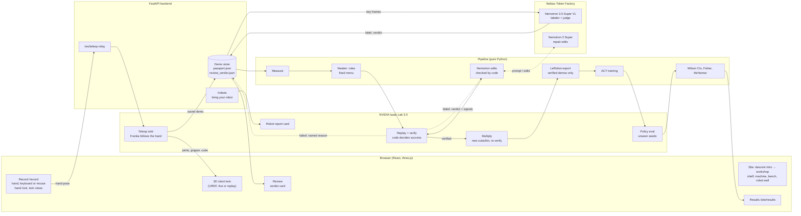

# SANT: perfect one demo, then multiply it

**S**imulate · **A**ugment · **N**eaten · **T**rain

Hackathon submission draft, updated 2026-10-20 ([Nebius x NVIDIA Global AI Hackathon](https://nebiusglobalaihackathon.devpost.com/),
Physical AI track). Everything runs in simulation; the official FAQ allows that
([screenshot](../superpowers/notes/2026-10-15-faq-physical-ai-simulation-allowed.jpg)).

Every number on this page comes from a dated note in `docs/superpowers/notes/`, named next to it. The
Results tables list only measured numbers.

## What SANT is, in plain words

You show a robot a task once, by moving your hand in front of an ordinary webcam. SANT turns that one
demonstration into a stack of training data a robot can learn from:

1. **Record.** The browser tracks your hand (MediaPipe), and a simulated Franka arm in NVIDIA Isaac Lab
   follows it. A 3D twin of the arm on the page shows what the robot is doing, from behind, the side and above.
2. **Physics-check.** Isaac Lab replays the demo with real contacts, and plain code decides whether it
   worked: cube in the bin, gripper open, cube settled, no hard collision, no drop.
3. **Repair (Neaten).** A demo that fails is repaired, then checked in physics again. There are two repairers:
   - **The rules.** Code measures the demo (speed, shake, pauses, idle time, how centered the grasp is, where the
     arm hit the bin). It fixes the demo from a fixed, unit-tested menu: trim, remove pauses, smooth, retime,
     recenter the grasp, release above the bin.
   - **Nemotron edits** (new, 2026-10-20). NVIDIA Nemotron reads what the simulator measured: contact forces,
     grasp offsets, where the cube was let go. It writes small, concrete edits to the hand's path. Code rejects
     any edit that moves the tool more than 5 cm, leaves the workspace or isn't smooth, and sends the errors back.
     Physics verifies every accepted plan and sends the new verdict back. Up to 3 rounds.
4. **Multiply.** Each verified demo is re-planned for new cube and bin positions. Every copy is replayed and
   kept only if physics says it still works; a failed copy is dropped with a named reason.
5. **Label.** NVIDIA Nemotron 3.5 Super VL looks at key frames and says what the person did ("red cube into
   the blue bin"). It also says whether each physics-checked copy still does what the person meant. The label
   and the verdict are saved next to each demo's *passport* (its lineage and repairs).
6. **Train.** Only verified demos are exported as a standard LeRobot dataset, and an ACT policy trains on it.

The rule throughout: **the AI proposes, code checks, physics decides.** The model never moves the robot directly
and never overrules the physics check: a Nemotron repair counts only if Isaac Lab replays it and it passes.

## Why it matters

Robot policies learn by imitating demonstrations, and they need many. Collecting them is the expensive part:
teleoperation rigs cost $6k–$80k, operators $25–$50 an hour, and 20–30% of demos are thrown away (vendor
estimates, [design spec §2](../superpowers/specs/2026-10-15-perfect-then-multiply-design.md)). A webcam is
nearly free, but webcam demos are noisy. If one noisy demo can be cleaned, checked and multiplied into many
good ones, the cost of teaching a robot a new task drops from a rig and an afternoon to a laptop and a minute.

Our measured evidence so far:
- **Multiplying helps training.** One set of demos plus their physics-verified copies made the robot succeed
  **17/40** times on scenes it had never seen, instead of **3/40** (scripted demos; below).
- **Real webcam demos need repair, and repair works.** All 10 of our real webcam demos failed the physics check
  as recorded. Repair rescued 3 of them with the rules and 5 with Nemotron edits. The 3 rules-repaired demos
  multiplied into **24 verified copies**.
- **But 3 repaired demos aren't enough yet.** A policy trained only on those 27 episodes succeeded **3/40** times
  (2.6–19.9%), so more repaired demos are the next step.
- **On clean mouse demos, raw vs SANT is not significant.** It was pre-registered: 10 mouse demos that all passed
  physics. Raw got **0/40** and SANT **3/40**, Fisher **p = 0.24**. SANT's policy got the cube into its fingers
  more, but it also collided with the bin or table in 27/40 episodes.

## How it uses NVIDIA and Nebius

| Part | What it does in SANT |
|---|---|
| **NVIDIA Isaac Lab 3.0** (Isaac Sim 6.2) | The simulated Franka the hand drives live; the physics check of every demo, every repair and every copy; the policy evaluation on unseen scenes; the "bring your robot" report card for any URDF |
| **NVIDIA Nemotron 3.5 Super VL** (`nvidia/Nemotron-3.5-Super-VL`) | Labels what the person did and judges whether each copy kept their intent, from key frames |
| **Nemotron, text** (`nvidia/nemotron-3-super-120b-a12b`, thinking on; the `nano` tier for the site's Ask SANT) | **Repairs failed demos** by writing trajectory edits from the simulator's measurements (the blind A/B below: 10 demos, **$0.207**). Also turns plain repair requests into repair operations (prototype), and picks one tool for the site's Ask SANT box |
| **Nebius Token Factory** | Serves every Nemotron call. The pre-registered labeler/judge test: 108 calls, **$0.1064** in all, about $0.001 per call ([nemotron-judge](../superpowers/notes/2026-10-18-nemotron-judge.md)) |
| LeRobot (ACT) | Training, natively on Windows: 20.7 steps/s on one RTX 5080 ([t3-lerobot-windows](../superpowers/notes/2026-10-15-t3-lerobot-windows.md)) |

Training and Isaac Lab run locally on one RTX 5080 (16 GB); Nebius serves the models.

## Architecture

Nemotron never sits between a demo and the dataset as a gate: physics decides what is kept, and the label and
verdict are attached to what physics kept. As a repairer it only proposes. Code applies a plan within code's
limits, and the plan is kept only if the replay passes.

## Results (measured only)

Policy rows: ACT, 30k training steps, batch 8, one training run per cell, tested in Isaac Lab on the same
**40 held-out scenes, seeds 5020–5059**, 30 s limit, front + wrist cameras. Seeds 5020–5059 were never used to
choose anything. Intervals are Wilson 95%. p is two-sided Fisher exact for unpaired arms and exact McNemar for
paired ones (`demo_pipeline.stats`).

### Scripted demos: does multiplying help training?

| What was tested | Result | Test, seeds | Source note |
|---|---|---|---|
| **Multiply → better robot.** 10 source demos alone vs the same 10 + 100 physics-verified copies (10×10) | **3/40** (7.5%, 2.6–19.9%) vs **17/40** (42.5%, 28.5–57.8%), **p = 0.0005** | Confirmatory, seeds 5020–5059 | [t3-status](../superpowers/notes/2026-10-15-t3-status.md), "2026-10-17 13:15, Sprint 7 Tasks 3–4" |
| **It replicates** with an independent multiplied set: 10 + 300 copies (10×30), trained separately | **16/40** (40.0%, 26.3–55.4%); vs raw 3/40 **p = 0.0012**; vs 10×10 17/40 p = 1.0 (no detectable difference) | Seeds 5020–5059 | [t3-status](../superpowers/notes/2026-10-15-t3-status.md), "Sprint 8: eval of raw_multiply_10x30" |
| **Grasp fix.** Centered-approach Neaten on the 10×10 data, pre-registered (needed ≥ 27/40) | **20/40** (50.0%, 35.2–64.8%) vs 17/40, **p = 0.65**: no detectable difference | Pre-registered, seeds 5020–5059 | [t3-grasp-fix](../superpowers/notes/2026-10-18-t3-grasp-fix.md), "Result: 20 / 40" |
| **Multiply yield** (physics-verified copies) | **100/100** (10 sources × 10); **300/300** (10 × 30) | Variant seeds 3100–3199 / 3100–3399 | [t2-status](../superpowers/notes/2026-10-15-t2-status.md), sprint 6 Task 2; "Task 2b" |

How to read these rows together: multiplying turned "never gets the cube" into "gets it, sometimes drops it" (22
of the 10×10 policy's 23 failures are drops). Tripling the copies and centering the approach didn't measurably
move that further.

### Real webcam demos: check, repair, multiply

| What was tested | Result | Test, seeds | Source note |
|---|---|---|---|
| **Physics check as recorded.** 10 real webcam demos, one person, live test #10 | **0/10** pass. Live, every demo put the cube in the bin. But the gripper pressed into the bin while placing (9/10, up to 927 N against a 5 N limit), and some regrasps dropped the cube | Replay of the arm's achieved path, lookahead 0 | [live-test-10-results](../superpowers/notes/2026-10-19-live-test-10-results.md), "Re-run, achieved path" |
| **Rules repair → multiply** (`human10c`) | **3/10** repaired and verified (9f47, c045, a029) → **24/30** copies verified (6, 9, 9). Grid written: raw 10 episodes vs perfected + multiplied 27 | Frozen in `human10c/config.json` | [live-test-10-results](../superpowers/notes/2026-10-19-live-test-10-results.md), "Neaten for the human demos' failures + `human10c`" |
| **Blind repair A/B.** Nemotron edits vs the rules, on the same 10 failed webcam demos | Nemotron edits **5/10** (24–76%) vs rules **3/10** (11–60%). Paired: both 3, only rules 0, only edits 2, neither 5. **Exact McNemar p = 0.50, not significant.** Nemotron cost **$0.207** | Pre-registered (`repair_ab1`, frozen at commit `1718f5f`) | [nemotron-repair](../superpowers/notes/2026-10-20-nemotron-repair.md), "Result: the blind A/B" |
| **The A/B re-run** (`repair_ab2`), same 10 demos, with the token-cap re-ask | Nemotron edits **2/10** (6–51%) vs rules **3/10** (11–60%). Paired: both 1, only rules 2, only edits 1, neither 6. **Exact McNemar p = 1.0.** Nemotron cost **$0.278** | Pre-registered, same prompt as `repair_ab1` | [nemotron-repair](../superpowers/notes/2026-10-20-nemotron-repair.md), "Result: repair_ab2" |
| **Training on the webcam demos, one arm.** ACT trained only on what SANT made from them: the `human10c` multiplied cell, **27 episodes from 3 repaired human roots** (7 / 10 / 10) | **3/40** (7.5%, Wilson 95% **2.6–19.9%**). All 37 failures ran out the 30 s limit; the cube was dropped in 26 of them. **One arm, not a comparison:** the raw arm would have trained on 10 failed replays | Pre-registered (commit `e979c54`), ACT 30k, batch 8, serial eval, seeds 5020–5059 | [human10c-multiplied-only](../superpowers/notes/2026-10-20-human10c-multiplied-only.md), "Result" |

How to read these rows: real hands make demos that physics rejects (0/10), and that is the gap SANT is for. Repair
turned 3 (rules) or 5 (Nemotron) of those rejects into demos that pass, and a passing demo multiplies well (24/30).
In the A/B:
- Nemotron fixed every demo the rules fixed, plus two more (66bc, 87bd), without being shown any hand-written fix.
- 3 of its 5 passes came only after it read a failed replay's verdict and tried again.
- It did not replicate. The re-run gave edits 2/10 vs rules 3/10 (p = 1.0): Nemotron's plans vary from run to run.
  That is why the next repairer runs the rules first and asks Nemotron only for the demos they fail (the hybrid).

The training row is the honest bottom line for webcam demos today: a policy trained only on SANT's 27 episodes
from 3 repaired roots succeeds 3 times in 40.
- **For reference, not a comparison:** the scripted multiply run got 17/40 from 110 episodes over 10 roots (10×10,
  same recipe and seeds).
- **What it suggests:** the number of distinct repaired demos (roots) matters, not only the number of copies made
  from them. Three demos' grasps, multiplied, may not cover new scenes the way ten do.
- **What it doesn't show:** the two runs also differ in source (scripted vs human), size and spread, so this
  suggests a cause; it does not show one.
- **The lever:** more repaired roots (more demos recorded, or Nemotron's 5/10 repairs, which this cell didn't use)
  and fixing the drops.

### Real mouse demos: raw vs SANT (pre-registered)

| What was tested | Result | Test, seeds | Source note |
|---|---|---|---|
| **Physics check.** 10 mouse demos, the same person, live test #11, soft floor on (it held the target up in 9) | **10/10** pass live, **10/10** on replay; path error 1.6–4.6 mm mean; peak contact 0.0 N | Replay of the achieved path, lookahead 0 | [mouse20261020-results](../superpowers/notes/2026-10-20-mouse20261020-results.md), section 1 |
| **Repair → multiply** | **10/10** perfected (cleanups only: trim, smooth, remove_pause) → **100/100** copies verified | Frozen in `mouse20261020/config.json` | [mouse20261020-results](../superpowers/notes/2026-10-20-mouse20261020-results.md), section 2 |
| **Raw vs SANT.** ACT on the 10 raw episodes vs on SANT's 110 (10 repaired + 100 copies) | Raw **0/40** (Wilson 95% 0.0–8.8%) vs SANT **3/40** (2.6–19.9%). **Fisher p = 0.24, not significant.** Failures (an episode can have several): raw not_in_bin 40, collision 2; SANT not_in_bin 37, collision 27, dropped 26, gripper_closed 10 | Pre-registered ([prereg](../superpowers/notes/2026-10-20-kb-raw-vs-sant-prereg.md), amendment 1: input = mouse), two-sided Fisher, α = 0.05, ACT 30k, batch 8, seeds 5020–5059 | [mouse20261020-results](../superpowers/notes/2026-10-20-mouse20261020-results.md), sections 3–4 |

How to read the mouse rows:
- With clean demos, the raw arm trains on 10 good demos, not 10 failed replays, so this is a real two-arm test.
- It found no significant difference.
- SANT's policy gets the cube into its fingers, where the raw one records no drops. But it pushes into the bin or
  table far more (27/40 vs 2/40).
- It is not the soft floor teaching it to push down. T6 checked: no training label goes more than 3.7 mm under the
  floor ([floor-labels](../superpowers/notes/2026-10-20-floor-labels.md)). The cause is being traced in a per-step eval.

### Nemotron and robots

| What was tested | Result | Test, seeds | Source note |
|---|---|---|---|
| **Nemotron labeler:** what did the person do? 40 clips | **40/40** (91.2–100%); code baseline 39/40; sign test p = 1.0 | Pre-registered; item lists frozen in `sets.json` (sha256 `78ead6a2…`) | [nemotron-judge](../superpowers/notes/2026-10-18-nemotron-judge.md), "Results" |
| **Nemotron judge:** does the copy keep the intent? 60 pairs (30 matching, 30 deliberately wrong) | **59/60** (91.1–99.7%); code rule 60/60; sign test p = 1.0. The one miss: a failed copy labelled "passed", which it trusted (a hallucinated success) | Same pre-registration | [nemotron-judge](../superpowers/notes/2026-10-18-nemotron-judge.md), "Judge (60 pairs)" |
| **Bring your robot: Franka** (URDF → report card) | **30/30** pick-and-place copies verified | Seeds 100–129 | [byor-backend](../superpowers/notes/2026-10-18-byor-backend.md), "Results" |
| **Bring your robot: OpenArm** | **0/30**, all `unreachable`. The card names the cause (`openarm_joint6`, the ±45° wrist, at its limit in 30/30) and says `not_ready` | Seeds 100–129 | [byor-backend](../superpowers/notes/2026-10-18-byor-backend.md), "OpenArm reproduces the wrist flaw" |

## How SANT relates to NVIDIA GR00T-Mimic / Isaac Lab Mimic

Short version: **Mimic multiplies good demos. SANT is the step before it: it checks human demos in physics,
repairs the ones that fail, and only then multiplies.**

What Isaac Lab Mimic does, from its own docs in our install (Isaac Lab 3.0,
`docs/source/features/imitation-learning/teleop_imitation.rst`):
- It is "a trajectory data generation tool". It takes a set of human demonstrations and generates new ones for the
  same task in new spatial configurations.
- **Subtasks.** Each demo is split into subtasks, one per reference object (for example, grasp the red cube, then
  stack it on the blue one). The subtask boundaries are annotated by hand or by the environment's heuristics.
- **Generation.** It applies rigid-body transformations to each segment for the new object poses. It runs the
  result and keeps it only if the task succeeds. For the Franka cube-stacking example, the docs give a generation
  success rate of about 40%.
- **It starts from successful demos.** The tutorial says "Collect 10 successful demonstrations before proceeding".
  They are recorded with a keyboard, a SpaceMouse or XR teleop. Its tips ask for short, direct motions with no
  pauses, and a demo with a mistake is discarded with the reset key.
- **Platform and extensions.** It is documented as Linux-only. SkillGen (in the same docs) extends it with cuRobo
  motion planning between the human segments.

NVIDIA presents this workflow as GR00T-Mimic, part of the Isaac GR00T blueprint for synthetic manipulation motion
generation. We compare against Isaac Lab Mimic as documented in our install; we did not run GR00T-Mimic.

Where SANT differs:

| | Isaac Lab Mimic | SANT |
|---|---|---|
| Input | A few successful teleop demos (keyboard, SpaceMouse, XR) | Demos as people actually make them, from a webcam and a hand, or a keyboard or mouse |
| A demo that fails | Discarded by the operator before generation | **Physics-checked as recorded** (our 10 webcam demos: 0/10 pass), with the reason named |
| Repair | None: the tips ask the person to demo well | **Rules** (a fixed menu of ops) or **Nemotron trajectory edits** (5 cm budget, checked by code), each re-verified in Isaac Lab |
| Multiply | Subtask segments moved rigidly with their reference object, kept if they succeed | The same idea in our own code (`demo_pipeline/multiply.py`): rigid in the cube's frame up to the grasp, in the bin's frame from the release, a chord in between. Every copy is replayed and kept only if it verifies |
| Language model | — | Nemotron labels what the person did, judges each copy's intent, and proposes repairs; physics decides |
| Platform | Linux | Windows 11 (Isaac Lab 3.0) |

SANT's multiply does not replace Mimic. Mimic's generation, or SkillGen's planning, could take SANT's repaired and
verified demos as its input; we have not tried that.

## Honest limitations

- **The headline result is on scripted demos, not human ones.** The 10 source demos behind 3/40 vs 17/40
  came from a scripted expert ([claims-audit](../superpowers/notes/2026-10-17-claims-audit.md)). Trained on the
  real webcam demos' 27 episodes, the policy got 3/40, a single arm with no comparison.
- **On human demos, raw vs SANT is not significant.** The one two-arm human test, on 10 clean mouse demos, gave
  0/40 vs 3/40, p = 0.24 ([mouse20261020-results](../superpowers/notes/2026-10-20-mouse20261020-results.md)).
  SANT's policy collided in 27 of 40 episodes, and the cause is not known yet.
- **The webcam demos are few.** There are 10, from one person, in one session (live test #10).
- **Replays are not exact.** Replaying a saved demo reproduces its live outcome only 2–4 times in 10: PhysX is not
  deterministic, and the live grasps were marginal. So a demo can pass or fail by luck
  ([live-test-10-results](../superpowers/notes/2026-10-19-live-test-10-results.md), "Latest (19:45)").
- **The rules had a home advantage in the A/B.** Their two newest ops (`release_above_bin`, the rules-emitted
  `recenter_grasp`) were written on 2026-10-19, after looking at these same 10 demos' failures. Nemotron was shown
  neither.
- **The A/B is small and didn't replicate** (n = 10): 5 vs 3 (p = 0.50), then 2 vs 3 in the re-run (p = 1.0).
- **Some Nemotron calls returned nothing.** In run 1, 3 of its 23 calls hit the 16k-token thinking cap with no plan.
  In the re-run, a re-ask got an answer for all 4 capped calls, but none of those answers passed.
- **Repair is not part of the multiply result.** The scripted sources were already clean, so the multiply test
  skipped Neaten. Whether repairing noisy human demos first helps a trained policy is not measured: the webcam
  training row has one arm, because the raw arm would have trained on 10 failed replays.
- **The "human" demos used in the Nemotron labeler/judge test are synthetic** (the scripted expert with tremor,
  pauses and slowness added). No real person's demo was in that test
  ([nemotron-judge](../superpowers/notes/2026-10-18-nemotron-judge.md), "The recordings").
- **Nemotron does not beat code as a judge.**
  - As labeler and judge it ties simple code baselines (p = 1.0 both ways).
  - In an earlier pre-registered diagnosis test, code alone scored F1 0.90 vs 0.86 with Nemotron
    ([t4-status](../superpowers/notes/2026-10-15-t4-status.md), sprint 6 Task 1).
  - Deciding whether a demo worked stays with physics. As a repairer, Nemotron is not yet better than the rules
    (5 vs 3, then 2 vs 3; neither significant).
- **Narrow setup.**
  - One task (cube into bin), one robot for training (Franka), one policy type (ACT).
  - One training run per cell, so training-seed variance is unmeasured.
  - Equal steps, not equal epochs (raw ≈ 49 epochs, 10×10 ≈ 4.5, 10×30 ≈ 1.6).
- **The policy still drops the cube.** Most failures of the multiplied policies are grasp-then-drop. The next
  lever (recovery copies + longer training, "run 2") is pre-registered but has not run
  ([t3-grasp-fix](../superpowers/notes/2026-10-18-t3-grasp-fix.md), "Run 2").
- **Simulation only.** No physical robot. 16 GB of VRAM means one Isaac environment and 128×128 cameras.
- **The site's newest parts are checked only headless.** The descent intro, the robot wall and the drag to the
  machine were seen in headless Chrome only (software rendering for the latest merge), not on a real GPU in a
  normal browser window ([live-11-integration](../superpowers/notes/2026-10-20-live-11-integration.md)).
- **Bring your robot is generic.** The OpenArm fails partly because the generic path doesn't know its hand-tuned
  settings, and the reach map is optimistic for it (≈ 0.51 vs 0/30 reached in replay)
  ([byor-backend](../superpowers/notes/2026-10-18-byor-backend.md)).

## The demo video

The 3-minute script is [video_script.md](video_script.md): the descent intro (forest → reactor → the ring → the
workshop) → the robot wall → drag a cartridge to the machine → Record with a live hand → the Nemotron repairer →
the results.

## Run it

[docs/RUNBOOK.md](../RUNBOOK.md) has the setup (Windows 11, an NVIDIA GPU, three Python environments). The live
Record session is in [live-test-10](../superpowers/notes/2026-10-19-live-test-10.md). Tests:
`uv run pytest -q` and `npm --prefix web test`.
