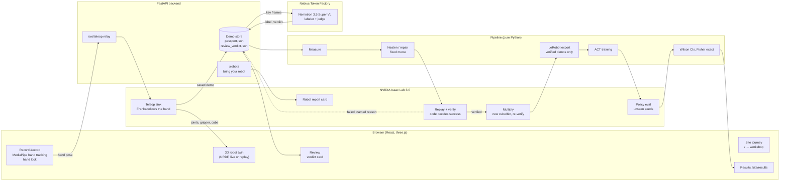

# SANT: perfect one demo, then multiply it

**S**imulate · **A**ugment · **N**eaten · **T**rain

Hackathon submission draft, 2026-10-19 ([Nebius x NVIDIA Global AI Hackathon](https://nebiusglobalaihackathon.devpost.com/),
Physical AI track). Everything runs in simulation; the official FAQ allows that
([screenshot](../superpowers/notes/2026-10-15-faq-physical-ai-simulation-allowed.jpg)).

Every number on this page comes from a dated note in `docs/superpowers/notes/`, named next to it. The
Results table lists only measured numbers. Anything not yet measured is marked **PENDING**.

## What SANT is, in plain words

You show a robot a task once, by moving your hand in front of an ordinary webcam. SANT turns that one
demonstration into a stack of training data a robot can learn from:

1. **Record.** The browser tracks your hand (MediaPipe), and a simulated Franka arm in NVIDIA Isaac Lab
   follows it. A 3D twin of the arm on the page shows what the robot is doing.
2. **Physics-check.** Isaac Lab replays the demo with real contacts, and plain code decides whether it
   worked: cube in the bin, gripper open, cube settled, no hard collision, no drop.
3. **Repair (Neaten).** Code measures the demo (speed, shake, pauses, idle time, how centered the grasp is) and
   fixes it from a fixed, unit-tested menu: trim, remove pauses, smooth, retime, recenter the grasp. The fixed
   demo is checked in physics again.
4. **Multiply.** Each verified demo is re-planned for new cube and bin positions. Every copy is replayed and
   kept only if physics says it still works; a failed copy is dropped with a named reason.
5. **Label.** NVIDIA Nemotron 3.5 Super VL looks at key frames and says what the person did ("red cube into
   the blue bin") and whether each physics-checked copy still does what the person meant. The label and the
   verdict are saved next to each demo's *passport* (its lineage and repairs).
6. **Train.** Only verified demos are exported as a standard LeRobot dataset, and an ACT policy trains on it.

The rule throughout: **the AI describes, code acts, physics decides.** The model never moves the robot and
never overrules the physics check.

## Why it matters

Robot policies learn by imitating demonstrations, and they need many. Collecting them is the expensive part:
teleoperation rigs cost $6k–$80k, operators $25–$50 an hour, and 20–30% of demos are thrown away (vendor
estimates, [design spec §2](../superpowers/specs/2026-10-15-perfect-then-multiply-design.md)). A webcam is
nearly free, but webcam demos are noisy. If one noisy demo can be cleaned, checked and multiplied into many
good ones, the cost of teaching a robot a new task drops from a rig and an afternoon to a laptop and a minute.

Our measured evidence so far: training on one set of demos plus their physics-verified copies made the
robot succeed **17/40** times instead of **3/40** on scenes it had never seen (below).

## How it uses NVIDIA and Nebius

| Part | What it does in SANT |
|---|---|
| **NVIDIA Isaac Lab 3.0** (Isaac Sim 6.2) | The simulated Franka the hand drives live; the physics check of every demo and every copy; the policy evaluation on unseen scenes; the "bring your robot" report card for any URDF |
| **NVIDIA Nemotron 3.5 Super VL** (`nvidia/Nemotron-3.5-Super-VL`) | Labels what the person did and judges whether each copy kept their intent, from key frames |
| **Nemotron, text** (`nvidia/nemotron-3-super-120b-a12b`; the `nano` tier for the site's Ask SANT) | Turns plain repair requests into repair operations (prototype); picks one tool for the site's Ask SANT box |
| **Nebius Token Factory** | Serves every Nemotron call. The pre-registered labeler/judge test: 108 calls, **$0.1064** in all, about $0.001 per call ([nemotron-judge](../superpowers/notes/2026-10-18-nemotron-judge.md)) |
| LeRobot (ACT) | Training, natively on Windows: 20.7 steps/s on one RTX 5080 ([t3-lerobot-windows](../superpowers/notes/2026-10-15-t3-lerobot-windows.md)) |

Training and Isaac Lab run locally on one RTX 5080 (16 GB); Nebius serves the models.

## Architecture

Nemotron never sits between a demo and the dataset as a gate: physics decides what is kept, and the label and
verdict are attached to what physics kept.

## Results (measured only)

All policy numbers: ACT, 30k training steps, batch 8, one training run per cell, tested in Isaac Lab on the
same **40 held-out scenes, seeds 5020–5059**, 30 s limit, front + wrist cameras. Seeds 5020–5059 were never used
to choose anything. Intervals are Wilson 95%; p is two-sided Fisher exact (`demo_pipeline.stats`).

| What was tested | Result | Test, seeds | Source note |
|---|---|---|---|
| **Multiply → better robot.** 10 source demos alone vs the same 10 + 100 physics-verified copies (10×10) | **3/40** (7.5%, 2.6–19.9%) vs **17/40** (42.5%, 28.5–57.8%), **p = 0.0005** | Confirmatory, seeds 5020–5059 | [t3-status](../superpowers/notes/2026-10-15-t3-status.md), "2026-10-17 13:15, Sprint 7 Tasks 3–4" |
| **It replicates** with an independent multiplied set: 10 + 300 copies (10×30), trained separately | **16/40** (40.0%, 26.3–55.4%); vs raw 3/40 **p = 0.0012**; vs 10×10 17/40 p = 1.0 (no detectable difference) | Seeds 5020–5059 | [t3-status](../superpowers/notes/2026-10-15-t3-status.md), "Sprint 8: eval of raw_multiply_10x30" |
| **Grasp fix.** Centered-approach Neaten on the 10×10 data, pre-registered (needed ≥ 27/40) | **20/40** (50.0%, 35.2–64.8%) vs 17/40, **p = 0.65**: no detectable difference | Pre-registered, seeds 5020–5059 | [t3-grasp-fix](../superpowers/notes/2026-10-18-t3-grasp-fix.md), "Result: 20 / 40" |
| **Multiply yield** (physics-verified copies) | **100/100** (10 sources × 10); **300/300** (10 × 30) | Variant seeds 3100–3199 / 3100–3399 | [t2-status](../superpowers/notes/2026-10-15-t2-status.md), sprint 6 Task 2; "Task 2b" |
| **Nemotron labeler:** what did the person do? 40 clips | **40/40** (91.2–100%); code baseline 39/40; sign test p = 1.0 | Pre-registered; item lists frozen in `sets.json` (sha256 `78ead6a2…`) | [nemotron-judge](../superpowers/notes/2026-10-18-nemotron-judge.md), "Results" |
| **Nemotron judge:** does the copy keep the intent? 60 pairs (30 matching, 30 deliberately wrong) | **59/60** (91.1–99.7%); code rule 60/60; sign test p = 1.0. The one miss: a failed copy labelled "passed", which it trusted (a hallucinated success) | Same pre-registration | [nemotron-judge](../superpowers/notes/2026-10-18-nemotron-judge.md), "Judge (60 pairs)" |
| **Bring your robot: Franka** (URDF → report card) | **30/30** pick-and-place copies verified | Seeds 100–129 | [byor-backend](../superpowers/notes/2026-10-18-byor-backend.md), "Results" |
| **Bring your robot: OpenArm** | **0/30**, all `unreachable`; the card names the cause (`openarm_joint6`, the ±45° wrist, at its limit in 30/30) and says `not_ready` | Seeds 100–129 | [byor-backend](../superpowers/notes/2026-10-18-byor-backend.md), "OpenArm reproduces the wrist flaw" |
| **Human-demo experiment:** real webcam demos, raw vs perfected + multiplied | **PENDING.** The one-command pipeline is built; its smoke run used stand-ins and is not a result | — | [human-demo-experiment](../superpowers/notes/2026-10-18-human-demo-experiment.md) |

How to read the top three rows together: multiplying turned "never gets the cube" into "gets it, sometimes
drops it" (22 of the 10×10 policy's 23 failures are drops). Tripling the copies and centering the approach
didn't measurably move that further.

## Honest limitations

- **The headline result is on scripted demos, not human ones.** The 10 source demos behind 3/40 vs 17/40
  came from a scripted expert ([claims-audit](../superpowers/notes/2026-10-17-claims-audit.md)). The same test
  on real webcam demos is the PENDING row.
- **Repair is not part of that result.** The scripted sources were already clean, so the multiply test skipped
  Neaten. Whether perfecting noisy human demos first adds more is not measured.
- **The "human" demos used in the Nemotron test are synthetic** (the scripted expert with tremor, pauses and
  slowness added). No real person's demo was in any scored test
  ([nemotron-judge](../superpowers/notes/2026-10-18-nemotron-judge.md), "The recordings").
- **Nemotron does not beat code yet.** As labeler and judge it ties simple code baselines (p = 1.0 both ways),
  and in an earlier pre-registered diagnosis test, code alone scored F1 0.90 vs 0.86 with Nemotron
  ([t4-status](../superpowers/notes/2026-10-15-t4-status.md), sprint 6 Task 1). It earns its place as the part
  that can say *what* a demo is in words, not as the judge of *whether* it worked; that stays physics.
- **Narrow setup.** One task (cube into bin), one robot for training (Franka), one policy type (ACT), one
  training run per cell, so training-seed variance is unmeasured. Equal steps, not equal epochs (raw ≈ 49
  epochs, 10×10 ≈ 4.5, 10×30 ≈ 1.6).
- **The policy still drops the cube.** Most failures of the multiplied policies are grasp-then-drop. The next
  lever (recovery copies + longer training, "run 2") is pre-registered but has not run
  ([t3-grasp-fix](../superpowers/notes/2026-10-18-t3-grasp-fix.md), "Run 2").
- **Simulation only.** No physical robot. 16 GB of VRAM means one Isaac environment and 128×128 cameras.
- **The live loop is new.** Record with the hand lock and the live 3D twin was first assembled for live test
  #10; the twin had not been watched live with Isaac before it
  ([live-test-10](../superpowers/notes/2026-10-19-live-test-10.md)).
- **Bring your robot** is generic: the OpenArm fails partly because its hand-tuned settings aren't known to
  the generic path, and the reach map is optimistic for it (≈ 0.51 vs 0/30 reached in replay)
  ([byor-backend](../superpowers/notes/2026-10-18-byor-backend.md)).

## The demo video

The 3-minute script is [video_script.md](video_script.md): the site journey → the workshop → Record with a
live hand → the hologram twin → the results.

## Run it

[docs/RUNBOOK.md](../RUNBOOK.md) has the setup (Windows 11, an NVIDIA GPU, three Python environments). The live
Record session is in [live-test-10](../superpowers/notes/2026-10-19-live-test-10.md). Tests:
`uv run pytest -q` and `npm --prefix web test`.
