# The bench, rebuilt as a five-stage "build a cartridge" moment (`pm/bench-v2`, 2026-10-20)

Branched from `pm/live-12` at `d28e591`; `pm/live-12` at `d4cf78f` (with the real robot GLBs) was merged in later for the
robot holograms ("The robot holograms, on the real models", below). Nothing pushed or rebased. No new dependencies, no
Blender.

**Not touched:**
- the Record page and the Python backend;
- the intro and descent;
- the robot wall (its stand-ins and its Franka loader are only read).

The user's words: *"6 of them laying on the table for the material, then you can change the color to whatever you want,
then the robot, the name and pum, it's done."*

## The five stages

The editor shows one stage at a time under a row of five steps (01 Material … 05 Done), with ← Back and Next →. Each
stage has its own camera shot (`layout.ts shotFor`), framed beside the editor on a desktop and above the bottom sheet on
a phone. The camera tweens between shots, and cuts instead under reduced motion.

**01 Material.** Six blank shells lie face up in a row on the bench's mat, in front of the turntable, one per finish:
- Matte;
- Brushed metal (fine streaks along its length);
- Glossy (lacquer, a near-mirror);
- Translucent (55% see-through: the reels show);
- Carbon (a 2×2 twill weave);
- Ceramic (a glaze with a fine speckle).

The shell in `cartridge.glb` has no UVs, so the patterns are drawn in the shader from object-space position
(`shellSurface.ts`, patched into the tier's own material: no new textures).

Hovering a blank in 3D, or the editor's radio, lifts it 7 cm; the description line follows. A click, or choosing the
radio, flies it up, standing it as it goes over, and down onto the turntable (0.8 s, eased in and out). Picking another
flies the first back to its place.

**02 Colour.** Eight swatches plus the browser's own colour picker ("Any colour", any #rrggbb). The shell eases to the new
colour in about a quarter second.

**03 Robot.** A teal hologram of the robot materializes on a ring of light on the cartridge's top. It rises from its base
behind a bright line, with fresnel edges, climbing scanlines and a slow turn on high and ultra. It materializes again at
each change, and the cartridge gives a small turn.
- **The models:** the robots' real models (see "The robot holograms, on the real models", below).
- **On the robot stage only:** the name's closer shot would cut it off.

**04 Name.** Type it; when the typing pauses (0.45 s), a print head runs down the label (0.55 s) and leaves the name
printed. Until then the label is blank paper. Enter, or Finish ✓, saves.

**05 Done ("pum").** Finish plays a timeline (`finale.ts`, tested):
- the cartridge clicks 6 cm down into the turntable and springs back with a hair of overshoot;
- 72 sparks pop off it at the bottom of the click;
- a light sweeps across its shell;
- the printer slides out its label;
- at 0.95 s it flies to its empty place on the spiral (the existing flight, 1.4 s).

The camera holds the close shot through the click, then pulls back to a shot from the room's front corner that takes in
the bench and the spiral, so the landing is seen.

The panel says where it went ("KITCHEN ARM is on the spiral, place 1 of 4."), and offers "Make another" (a fresh draft;
the blank drops back into the row) or "Back to the room".

**Kept from the first bench:**
- the saved list with remove (on the first and last stages);
- the full-spiral warning;
- the dock's buttons for saved cartridges;
- a half-made draft (and its stage) is kept for next time.

**A finished one starts fresh.** Older saved cartridges (a named shell) still read back, as that colour on Matte (Smoke
becomes Translucent).

## The robot holograms, on the real models (after merging `pm/live-12` at `d4cf78f`)

**Why it changed.** T7 held the first commit (`434d979`): since `site-robots-real`, `wallParts.STAND_INS` holds only
`flexiv`, so the SO-101, PiPER and OpenArm holograms threw "no stand-in". After merging `pm/live-12` (`d4cf78f`) the
hologram shows each robot's real model (`robotHolo.ts HOLO_SOURCE`):

| Robot | Source |
|---|---|
| SO-101 | `so101.glb` |
| Franka FR3 | `fr3.glb` |
| PiPER | `piper.glb` |
| OpenArm | `openarm.glb` |
| Rizon 4 | the robot wall's `flexiv` stand-in (the site has no model for it), turned to reach the same way as the models |

**My call on the Franka.** The real `fr3.glb` is the robot the label names. The twin's meshes are a Panda, and they
needed urdf-loader in the bench, which no longer loads it.

**How the models load:**
- with the robot wall's own loader (`loadRobotModel`), asynchronously;
- once per robot, then kept: a promise per robot, with `holoNow` for one already in;
- a failed load is retried on the next ask.

**What shows meanwhile:**
- **While loading:** only the ring shows, with an arc of light running round it (held still with reduced motion).
- **Once loaded:** the robot materializes from its base.
- **On a failure:** the ring stays, steady, and a console warning says which model.

**Checked in the browser:**
- every robot on the robot stage, at 1280×720 on high and low and on the phone (04, 05, 11, 14, 16–18);
- with `so101.glb` blocked: the ring and the warning, nothing else breaks (19).

## Keyboard, reduced motion, phones, fallbacks

**Keyboard.** Every choice is a native radio group, so the arrow keys move through it and Tab leaves it. On each new stage
the stage's heading takes the focus, so a screen reader says where you are; on a desktop the name stage focuses its
field.

**Reduced motion.** Every change lands at once:
- no flights, no sweep, no sparks and no print-head run;
- the camera cuts behind the veil;
- the CSS transitions and animations are off.

**Phones (390×844).** The editor is a sheet across the bottom, at most 360 px tall, its content scrolling inside. Every
shot keeps the bench above the sheet and clear of the journey rail. The phone's done shot uses its own higher eye and a
lens widened until the turntable and all four spiral places fit (`fitFrom`).

**The 2D fallback (no WebGL).** The whole flow runs in the HTML, which is what `Editor.test.tsx` drives.

**The room view.** Unchanged: the bench's 3D draws only while the bench is open.

## Cost

**Draw calls**, measured in the browser (one frame, all passes):

| | Room view | Material | Colour | Robot | Name | Done (spiral in shot) |
|---|---|---|---|---|---|---|
| High, 1280×720 | 55 | 42 | 43 | 46 | 42 | 57 |
| Low, 1280×720 | 40 | 28 | 29 | 32 | 28 | 43 |
| Reduced motion, 1280×720 | 54 | 42 | 43 | 46 | 42 | 57 |
| Low, phone 390×844 | 39 | 24 | 31 | 33 | 31 | 43 |

**The room view is as before** (55 / 40 / 54, the numbers in the holo-ui note).

**What the bench adds**, while it is open:
- the six blanks: 3 (one instanced draw for the five opaque ones, one for the translucent one, one instanced draw for
  their insides);
- the hologram: 1;
- the sparks: 1, only while they fly.

**No before/after on the same shot.** The first bench's numbers weren't measured on identical shots, so I can't give
one. The highest view, the done shot, is 57 on high because the whole spiral is in it. That is under the ≤ 60 the room
view is held to.

## Checks

| Check | Result |
|---|---|
| Tests first | `draft.test.ts` (stages, picks, colour), `layout.test.ts` (blanks, pick flight, every stage's shot on desktop and phone: on screen, clear of the editor and the rail, the camera inside the room), `finale.test.ts`, `robotHolo.test.ts` (rewritten for the real models: the sources, the foot centred on the ring, one load per robot, the stand-in without a load, a retry after a failure), `saved.test.ts` (finishes, colours, the old saves read back) and `Editor.test.tsx` (the five stages in the stills) failed before the code. |
| `npm --prefix web test` | 185 files, **1651 passed**, 1 skipped, 0 failed (after merging `pm/live-12` at `d4cf78f`). |
| `npx tsc -b` | Clean. |
| `npm --prefix web run build` | Passes (the old >500 kB chunk notice only). |

### In headless Chrome

**SwiftShader only:** no real-GPU browser while T4 trains. The dev server ran inside the check script's own process and
ended with it; no pm-t1 process was left.

| Walk | Result |
|---|---|
| 1280×720 high: 3D hover on a blank, 3D click to pick, colour, PiPER then Franka, name, Finish, Make another, back to the room | All stages reached. The hover reaches the editor's line. The saved cartridge stands in its place on the spiral. No console errors. |
| The finish in slow motion (the page's clock slowed 12× from the test script, no app code) | The click, the sparks at its bottom, the light across the shell and the print head on the label all show (06–08). |
| Keyboard only | Tab to the bench's tag, Enter; Tab and arrows through the shells, Tab to Next, Enter; the same through colour (including the picker), robot and name; Enter saves. The focus lands on each stage's heading, then on "Make another". |
| 1280×720 low; 1280×720 high with reduced motion; 390×844 @3× low (touch) | All five stages, as above. Reduced motion lands the pick at once (12). |

## Screenshots (`2026-10-20-bench-v2/`, 1280×720 unless marked)

| | |
|---|---|
| 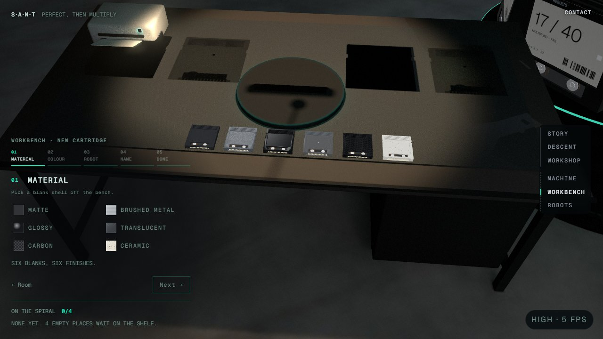 01 the six blanks on the mat |  02 a picked blank flying to the turntable |
| 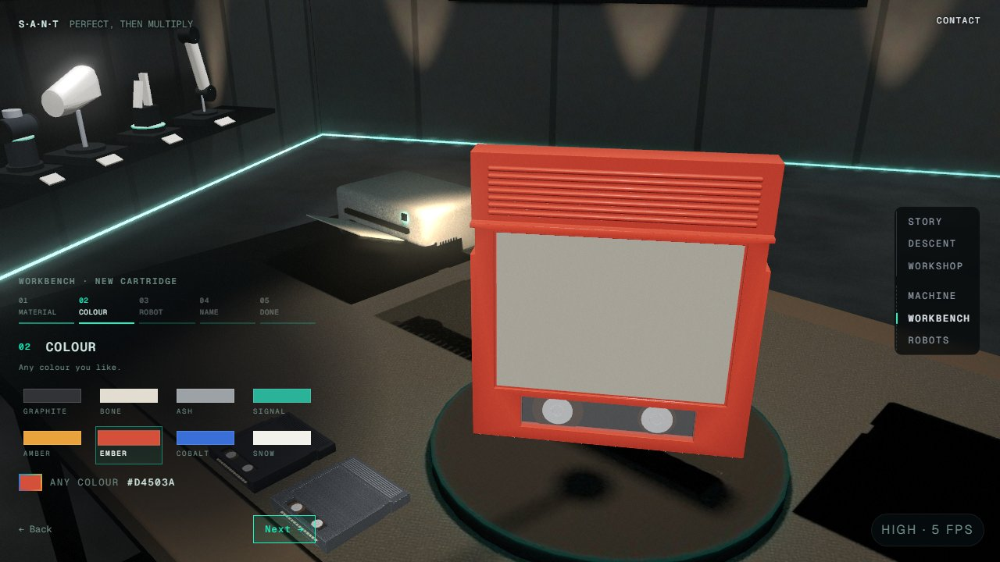 03 colour: Ember on Glossy | 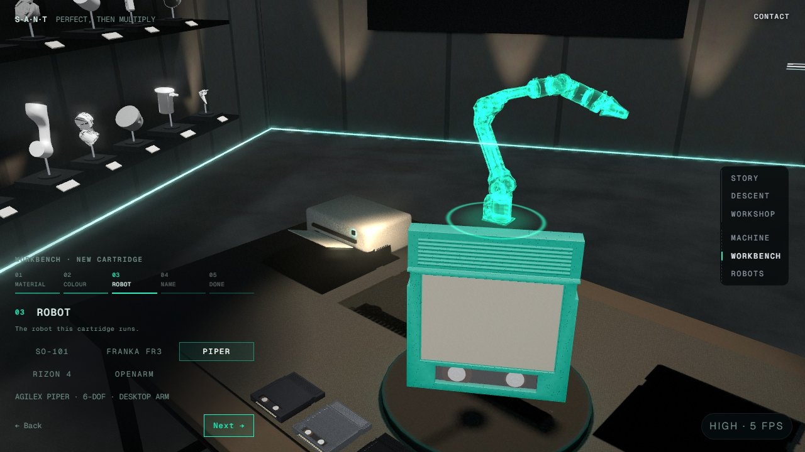 04 robot: the PiPER (its real model) |
| 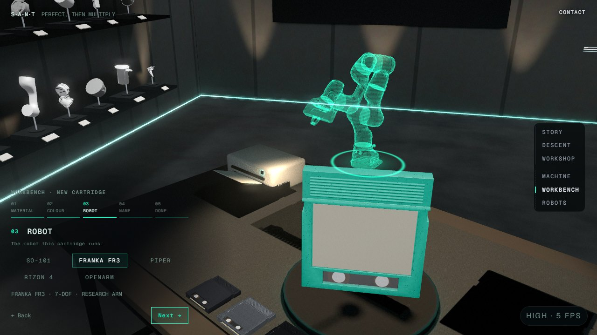 05 the Franka FR3 (fr3.glb) | 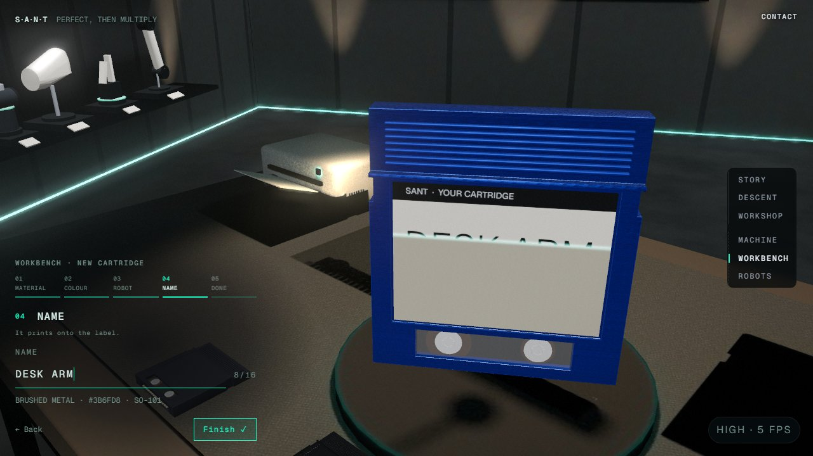 06 the print head running down the label |
| 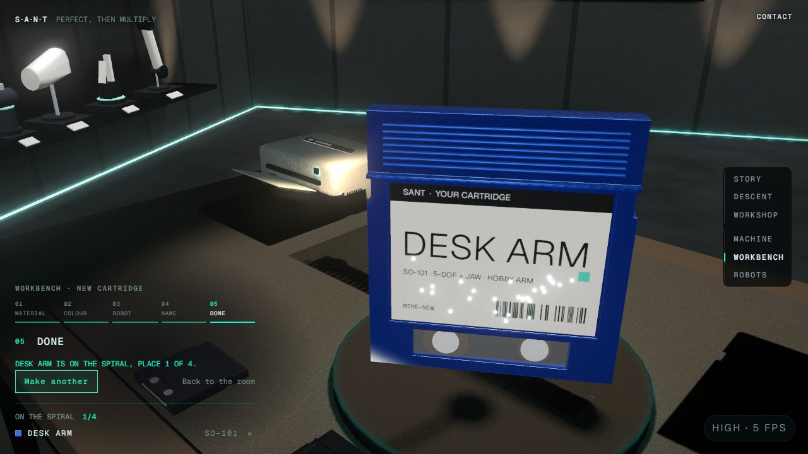 07 Finish: the sparks at the click | 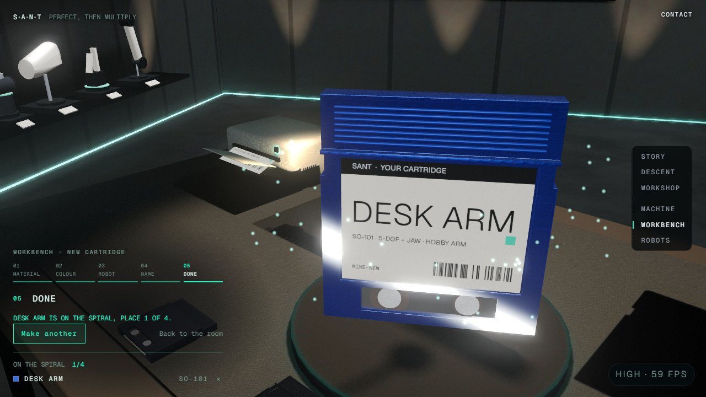 08 the light across the shell (brushed metal, Cobalt) |
| 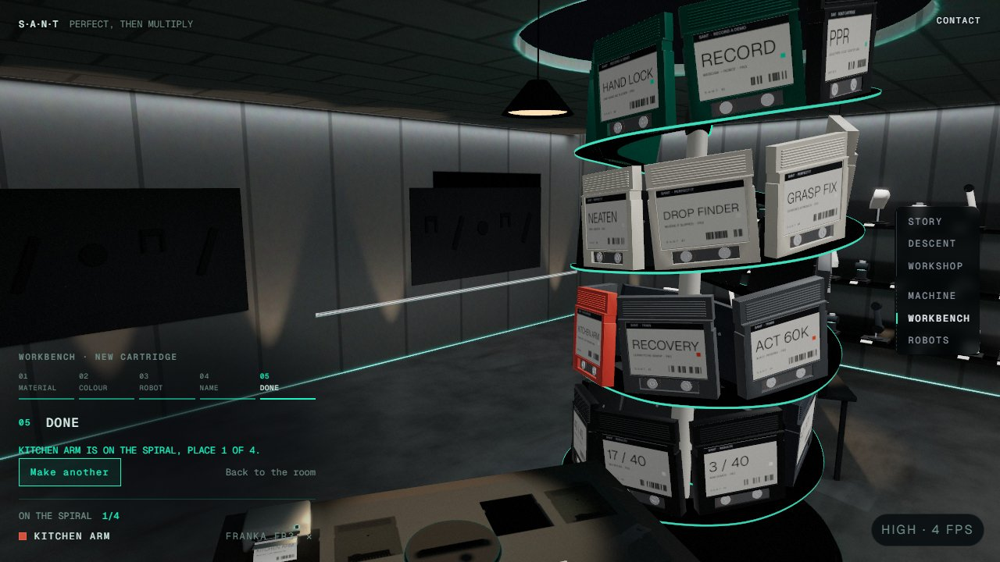 09 done: on the spiral | 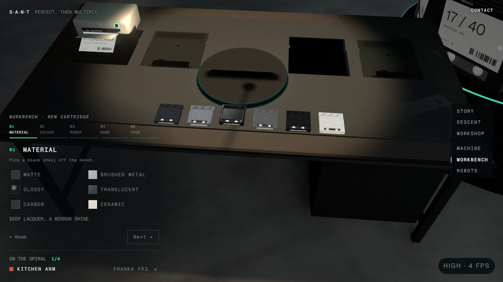 10 Make another: the blank is back in the row |
| 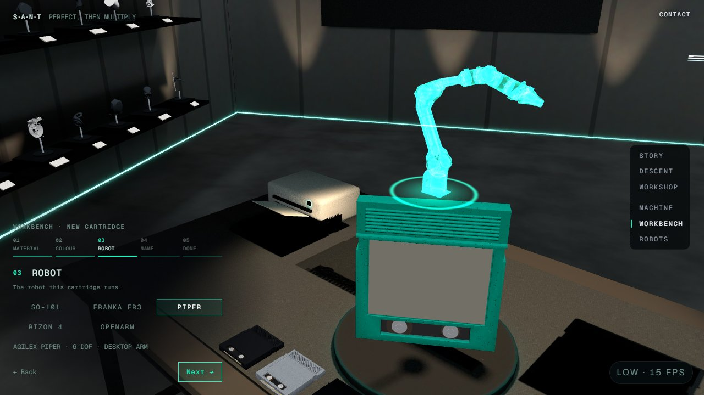 11 low tier: the PiPER | 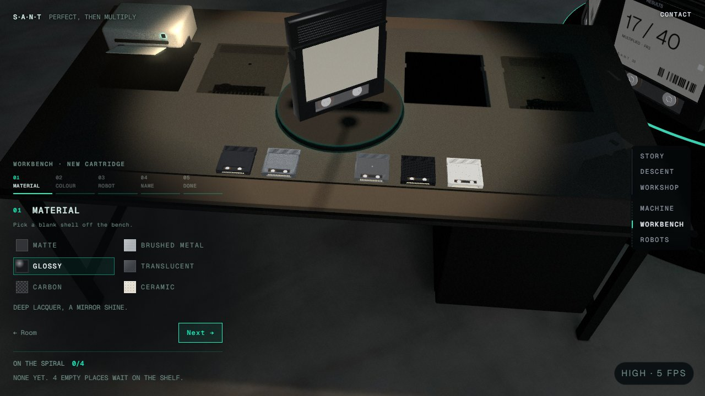 12 reduced motion: the pick lands at once |
| 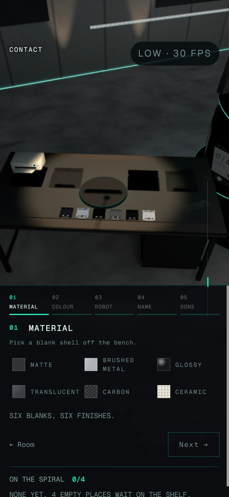 13 phone (390×844 @3×): material | 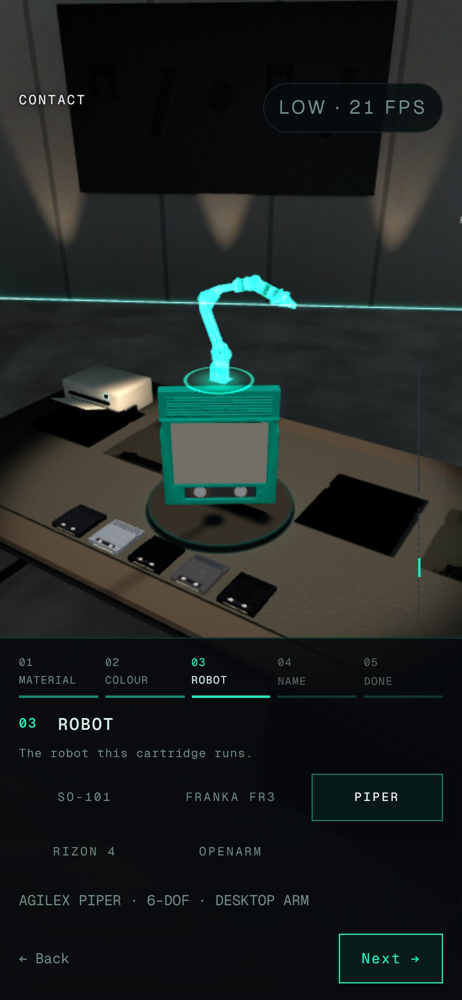 14 phone: robot |
| 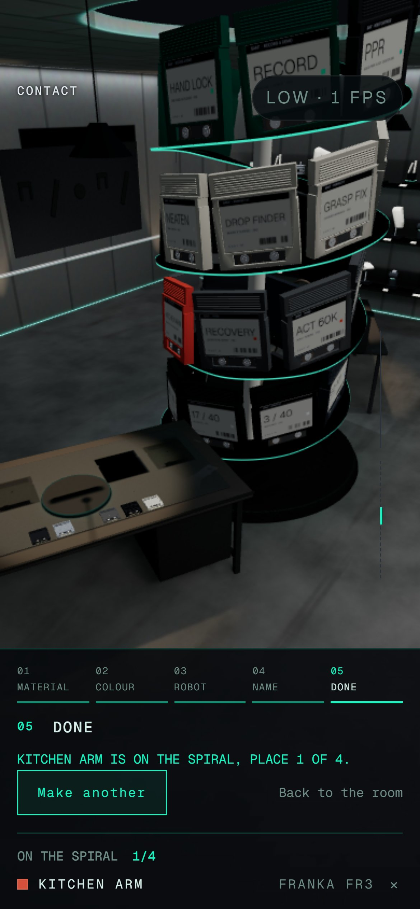 15 phone: done | 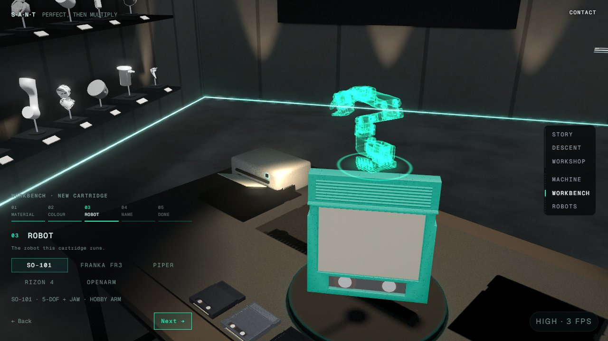 16 the SO-101 |
| 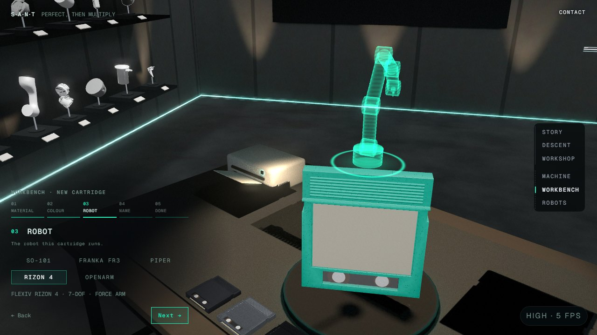 17 the Rizon 4 (the wall's stand-in) | 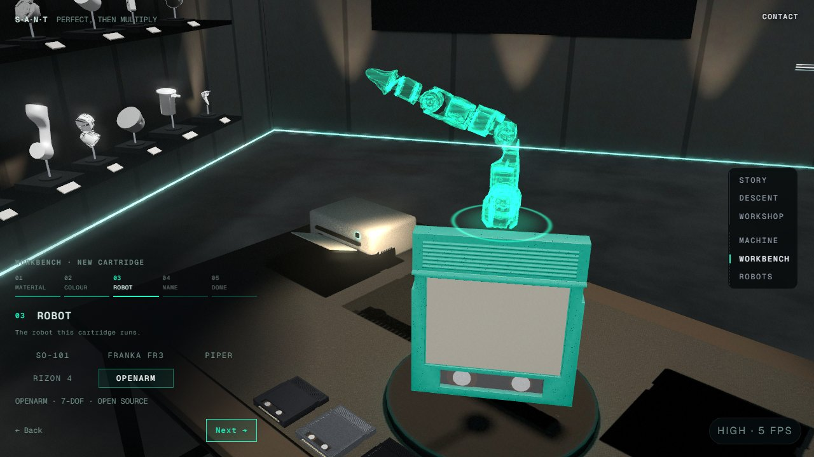 18 the OpenArm |
| 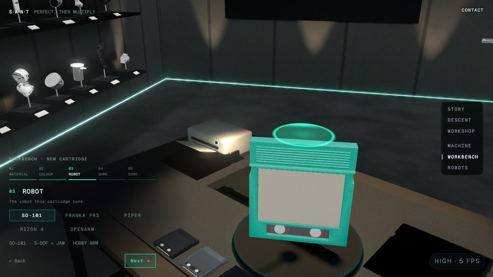 19 so101.glb blocked: the ring alone, steady | |

## Not verified, or open

- **Real GPU, ultra, a person.** Nothing ran on the RTX 4060 (it is training). SwiftShader ran at 4–6 fps on high, so the
  timing and easing were checked by numbers (the tests) and by slowed-down frames, not felt at 60–120 fps. Nobody has
  used it with a real mouse, a touch screen or a screen reader.
- **The spiral and the machine show the colour, not the finish.** The spiral's cartridges are one instanced material, so
  the saved cartridge there, and the machine's copy of it, wear its colour on the old plastic. The finish shows on the
  bench.
- **Low tier finishes.** Lambert has no roughness or metalness, so there Glossy, Matte and Ceramic differ only by their
  pattern and colour. Brushed metal reads by its streaks, Carbon by its weave and Translucent by its see-through.
- **The Rizon 4 is still a stand-in:** the site has no model for it.
- **The shimmer isn't in a screenshot.** The wall had already fetched each model into the browser's cache, so the
  hologram's load was too quick to catch. The blocked run shows the ring alone, after the failure.
- **The keyboard walk's name step.** Typing into the name field was checked in the pointer walk. In the keyboard walk my
  script's Tab left the field before typing, yet the name still saved; I didn't chase that script quirk.
- **A file of my own I deleted.** `stations/workbench/HoloRobot.tsx`, which I had just created and never committed (its
  contents became `holoMesh.ts`).
