# The SANT logo everywhere in 2D: the open-corner tesseract (`pm/brand-logo`, 2026-10-20)

Branched from `pm/live-12` at `eb3546a`. Nothing pushed, merged or rebased. No new dependencies.

**Not touched:**
- the intro hero's 3D logo (T2 is replacing it with a 4D tesseract), nor `web/public/world/mark.svg`, which `logo3d`
  still reads;
- the intro story's "S·A·N·T · perfect, then multiply" kicker (it is the hero's text, and spells the four steps).

**The source.** The user's chosen mark, the open-corner tesseract: `sant-mark.svg` (colour),
`sant-mark-mono-light.svg`, `sant-mark-mono-dark.svg` and `sant-favicon.svg`. They live in `docs/design/logo/` in the main
checkout, untracked there, with `sant-logo-sheet.png` showing the lockup. Copied to `web/public/brand/` (the three marks)
and `web/public/favicon.svg`. The design folder itself isn't added here, so it can't clash with the untracked copy in the
main checkout.

## How it is drawn

**One place.** `sant/components/logoSymbol.ts`, the "swappable symbol" every logo on the site draws, now holds the mark
itself: four stroked parts (5.2 wide, round caps) in lighting order:
1. the open frame;
2. its five corner lines;
3. the inner cube;
4. the cube's near corner, with parts 3 and 4 in the accent.

The viewBox is the lines' own box (without the file's padding), so the lockup sits tight.

**The lockup.** `sant/components/Logo` is now the logo sheet's lockup: the mark, then "SANT" set wide (0.34em, weight
600). It keeps `role="img"` and `aria-label="SANT"`, with the wordmark `aria-hidden`.

**Colour follows the ground** through `--logo-ink` and `--logo-accent`:
- teal (`#19F5C2`) and light ink on the dark pages;
- `#0B7A63` and dark ink on the paper Results page, which is the mono-dark idea.

**The power-on.** Story → app dust now lands on the mark's strokes: `PowerOn` strokes the paths instead of filling them.

## Where it shows

| Spot | What |
|---|---|
| The world's top left (`/`, `/world`) | The lockup and "perfect, then multiply" replace "S·A·N·T". It is no longer `aria-hidden`: it reads as "SANT, perfect, then multiply". |
| The loader | The world's brand already shows above the loader in that same spot, so it is there from the first frame (01). |
| The 2D stills fallback | The same brand over the stills (04). |
| Contact panel | The mark beside "Contact" (03, 11). |
| Record page header (`/record`) | The lockup leads the header, before ⏏ workshop (05, 13). |
| App nav (`/data`, `/review2`, `/robots/setup`) and story nav (`/site/results`, plus its footer) | Through `Logo` (06, 07, 08, 12). |
| The work pages' header (`/pm/review`, `/pm/dataset`, the old frame) | The lockup and its line (09). |
| Robots page (`/robots`) | The lockup in its corner (10). |
| Favicon | `favicon.svg`, then `favicon-32.png`, `favicon-16.png` and `apple-touch-icon.png` (180), drawn from the SVG by `web/scripts/brand-icons.mjs` (headless Chrome, SwiftShader, no dependencies). `index.html` has the links, `theme-color` `#0B0E11` and a one-line description. |

**On phones the world's top-left brand stays hidden**, as before: the room view's hub bar takes the top there. The mark
still shows in the Contact panel and on every other page.

**No OG image.** There wasn't one, and I didn't add one: an `og:image` needs the site's absolute URL, which isn't decided
yet.

## Checks

| Check | Result |
|---|---|
| Tests first | They failed before the code. **`logoSymbol.test.ts`:** the symbol is the file point for point; the stroke width; the four parts; the accent exactly where the file is teal; the tight viewBox; the mono files are the same lines in one ink. **`brandAssets.test.ts`:** the icon links; the PNG sizes from their headers; the favicon's content; the title and `theme-color`. **Logo:** the accent parts, the strokes, the mark alone named SANT. **WorldRoot:** the brand is the lockup over the stills. **Contact:** the panel is signed with the mark. |
| `npm --prefix web test` | 187 files, **1680 passed**, 1 skipped, 0 failed. |
| `npx tsc -b` | Clean. |
| `npm --prefix web run build` | Passes (the old >500 kB chunk notice only). The icons and `brand/` reach `dist/`. |

### In headless Chrome

SwiftShader only, at 1280×720 and 390×844 (3×). The dev server ran inside the check script and ended with it. Every spot
above was visited:
- `role="img"` named SANT, with the mark's 4 parts drawn, is found on each page;
- the four icon files are served (200, with the right types) and linked from the page's head;
- no console errors.

## Screenshots (`2026-10-20-brand-logo/`, 1280×720 unless marked)

| | |
|---|---|
| 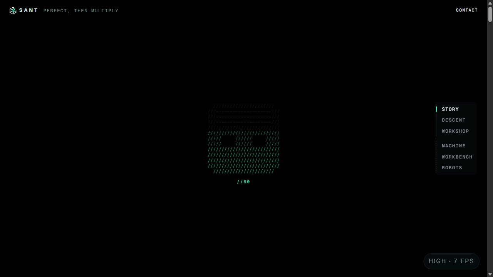 01 loading: the brand top left | 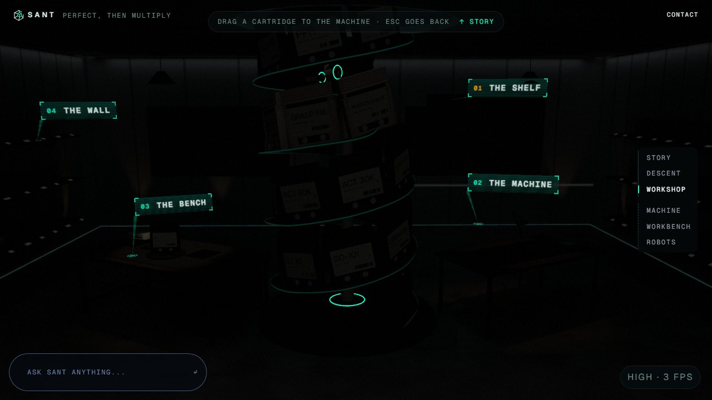 02 the room view |
| 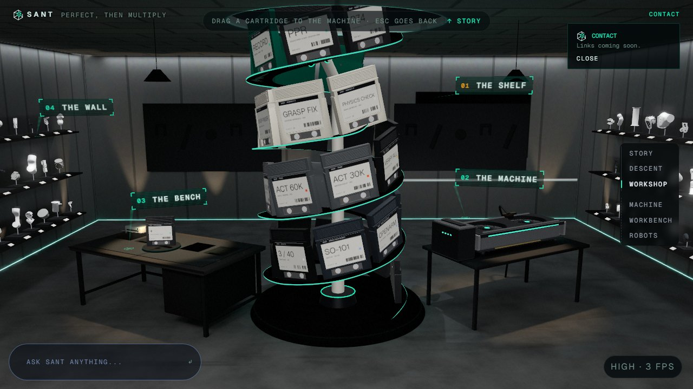 03 Contact | 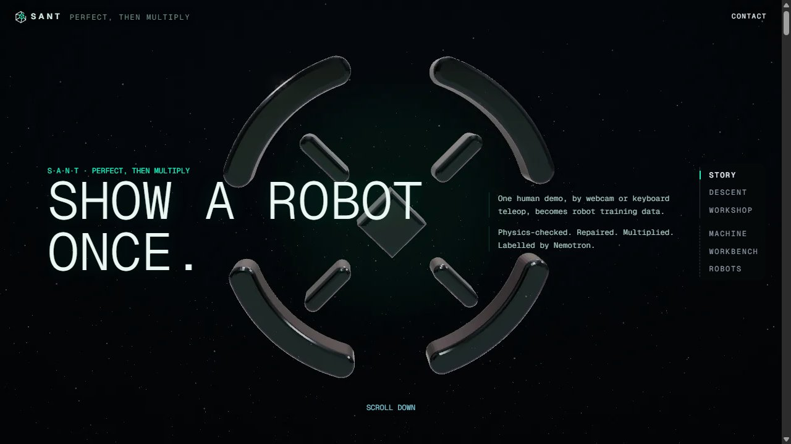 04 the stills fallback |
| 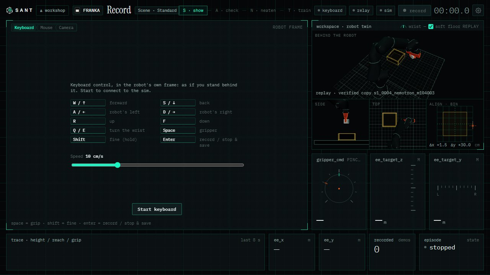 05 the Record header | 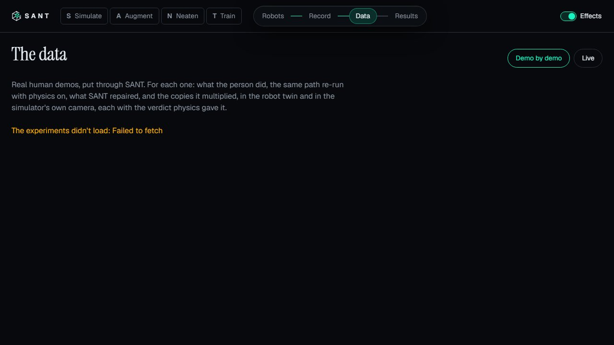 06 /data (app nav) |
| 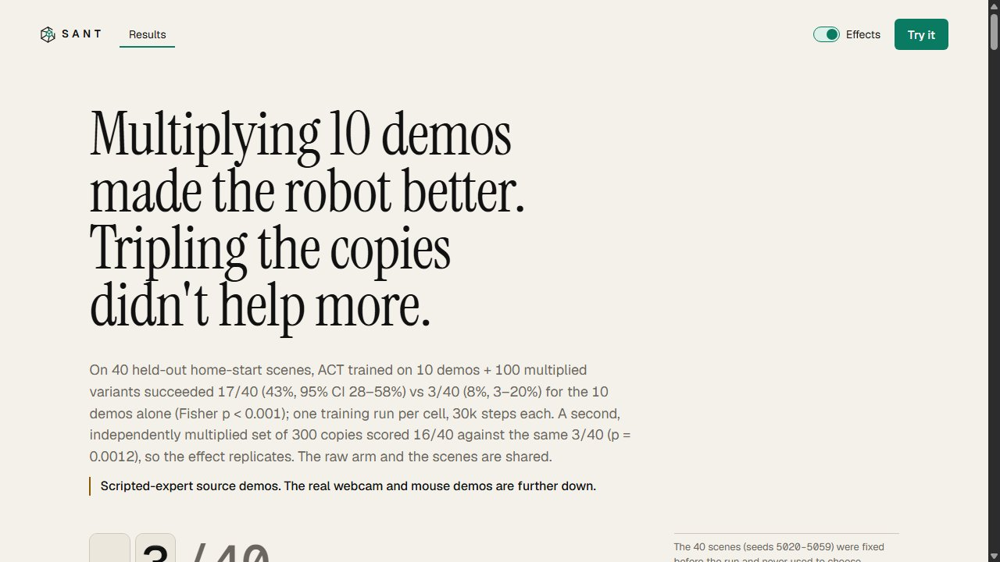 07 /site/results (story nav, paper) | 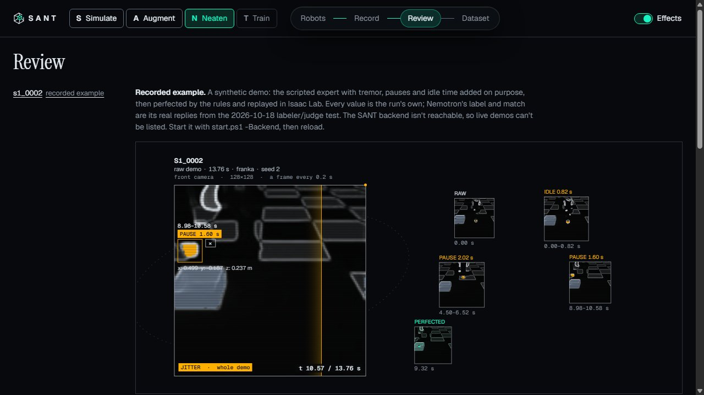 08 /review2 |
| 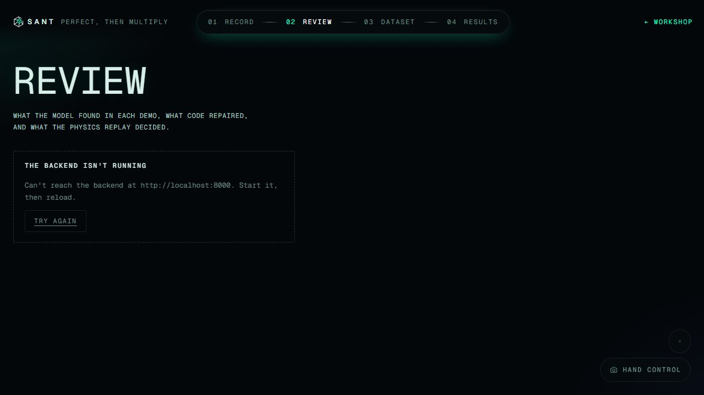 09 /pm/review (work header) | 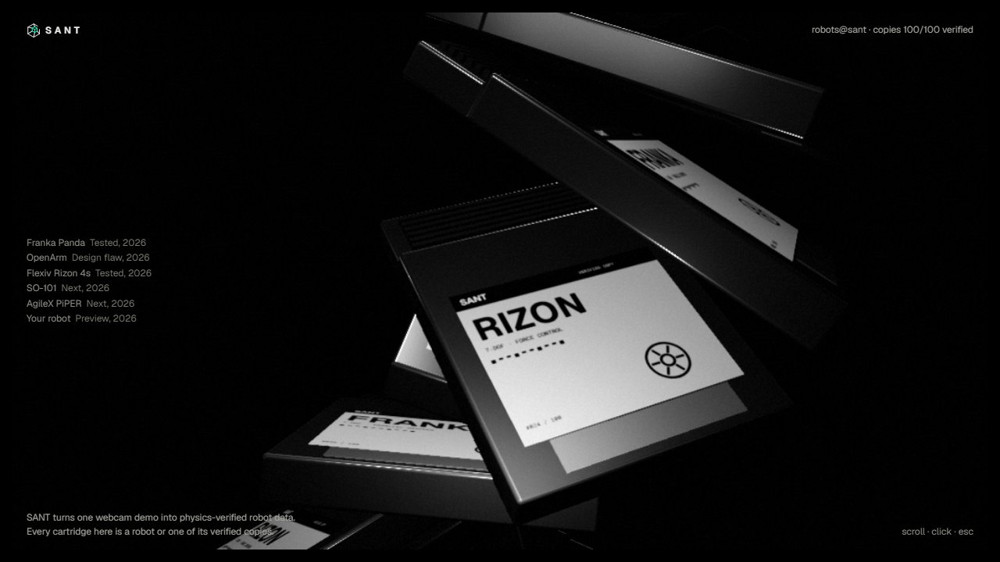 10 /robots |
| 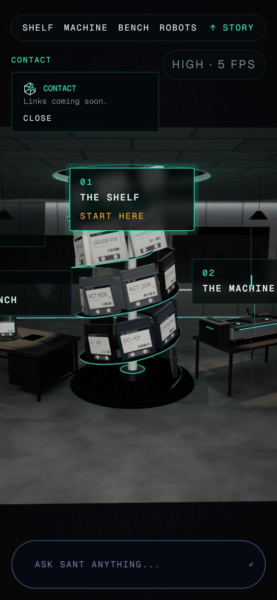 11 phone: Contact | 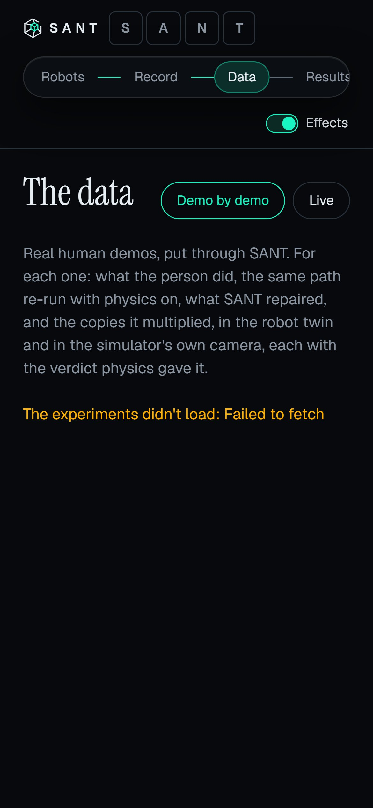 12 phone: /data |
| 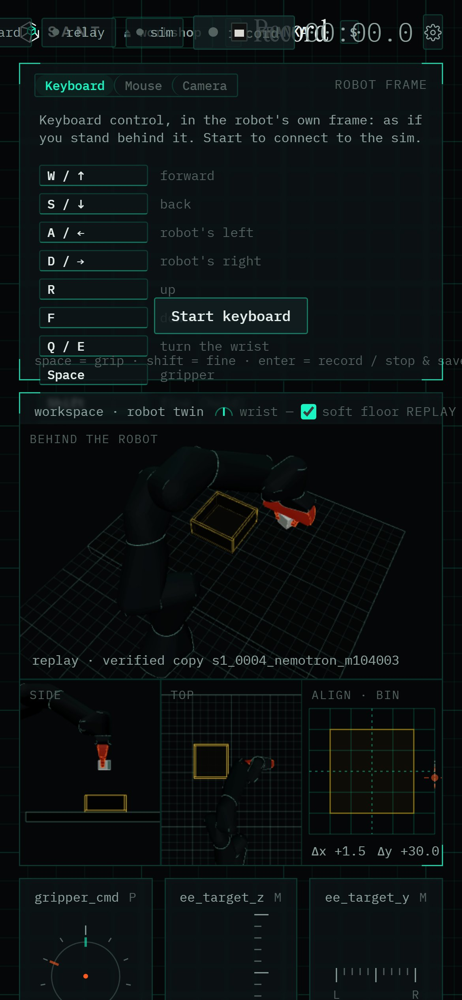 13 phone: Record |  14 the home-screen icon (180 px) |

## Open

- **The favicon in a tab.** It was checked by the files and the links, not by looking at a real browser tab or a phone
  home screen.
- **The hero's kicker** still spells "S·A·N·T" in text: that is T2's hero.
- **The PNG icons are drawn once.** Re-run `node web/scripts/brand-icons.mjs` if `favicon.svg` changes.
