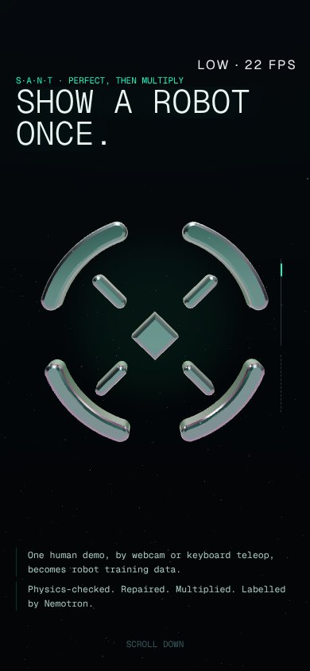
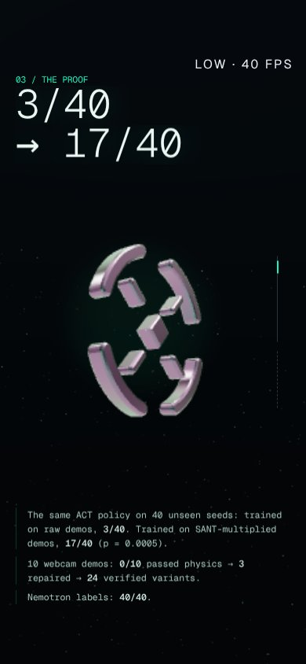
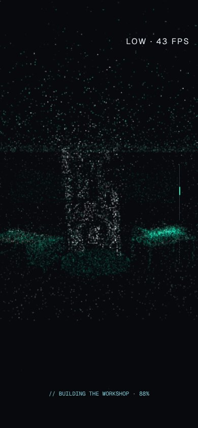
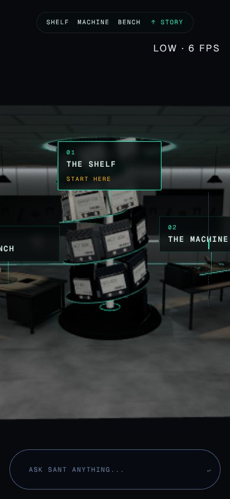

# Overnight: the new intro, the particle transition, the flicker, the audit (2026-10-20)

Branch **`claude/compassionate-cannon-u7cxjg`**, from `perfect-then-multiply` (4fd9c46). It is pushed,
with no PR (you review it and open one). Screenshots: [2026-10-20-overnight-site/](2026-10-20-overnight-site/),
all 1280×720.

## Read this first: the open issues and your decisions

Everything below is in place, tested and pushed. These are the things only you can check or decide.

1. **Look at it on the RTX 4060.** Nothing tonight ran on a real GPU: the cloud renders with
   SwiftShader, so its frame rates mean nothing; the counts in section 4 are real.
   - Open `/?hud` and watch the fps at the hero (glass: one extra transmission pass), during the burst
     (110k points on high) and in the hub.
   - If the glass costs too much on high, one line in `stations/intro/Scene.tsx` (`logoMaterial`) moves
     high to the chrome that low uses.
2. **The words.** I wrote the beat copy (table in section 1). Two things to check:
   - **Wording:** check it, above all Nemotron's four lines and "the same ACT policy on 40 unseen seeds".
   - **What I dropped**, because neither is in tonight's list: the old "30/30 Franka" line and the
     "Pick a cartridge" beat.
3. **The phone's hub is now seen from outside the room box.** Portrait screens get a taller field of
   view (`core/fov.ts`), so the phone sees the shelf, the machine and the bench. Before, it saw a
   19° sliver: only the shelf. The room reads as a lit box in the dark. Keep it, or ask for a
   phone-only camera stop.
4. **The logo is extruded from the placeholder `mark.svg`.** Drop the real symbol into
   `web/public/world/mark.svg` (white on transparent, square viewBox) and the glass logo, its ring
   split and the burst all follow; nothing else changes. The ring is still the code torus, since
   Blender is on hold.
5. **The library now stands spine-out** (the flicker fix): it matches Blender's render and the shelf
   depth, but it does change how the wall looks. Confirm.
6. **Low tier anti-aliasing:** the canvas now multisamples (4×) on low. Its cost on a weak GPU is
   unmeasured. A session the auto-tune drops to low mid-visit has no anti-aliasing until the next
   visit; that is no worse than before.
7. **Left as they were (yours to schedule):**
   - the 2D fallback still downloads three and r3f (about 220 KB gzip) without drawing 3D;
   - `machine.glb` is 1.16 MB of un-decimated tori and joints (decimate when Blender resumes);
   - the Google Fonts stylesheet blocks rendering;
   - animejs (13 KB) is still in the first chunk;
   - `/record`, `/legacy/*`, `/design` and `/pm/hand-art` weren't measured (Record is off limits tonight).
8. **Task 5:** I found no `claude/*` branches other than this one, and no commit anywhere that
   touches `goals.py`, `segment.py`, `edit_plan.py` or `nemotron_repair.py` (checked at the start and
   at the end). Nothing to review.
9. **Python:** the backend wasn't touched. Its 3 known failures (`test_launch_health.py` ×2,
   `test_make_measurement_set_v2.py`) predate tonight.

## 1. The new intro (done)

**What you asked for:** a clean dark space, the SANT logo as a slowly turning glass object in the
middle, the words beside it beat by beat, and no breaks with the 3D showing through.

**What it is now** (`web/src/world/stations/intro/`):
- **The dark space.** A near-black backdrop with a lift toward the top and a faint teal leak in the
  top-left corner, like Active Theory's (`shaders.ts` backdropFrag), plus sparse dust (a third of the
  tier's). Nothing of the room exists yet: the room only appears in the transition.
- **The 3D logo, built from `web/public/world/mark.svg`** (`logo3d.ts`):
  - SVGLoader reads the paths; strokes are outlined at their stroke width with round caps, fills are
    used as they are, then everything is extruded with a small bevel.
  - The pieces out at the edge become the "ring" group and the rest the "core".
  - **Replace mark.svg and the logo follows.** No Blender needed.
- **The material:**
  - high and ultra: real glass (`MeshPhysicalMaterial`): transmission, IOR 1.5, a faint teal
    attenuation, a little iridescence, dispersion (2.5 on high, 5 on ultra);
  - low and phones: polished iridescent chrome, with no refraction pass.
- **The beats** (`Story.tsx`, plan in `storyPlan.ts`):
  - one at a time: huge mono type on one side, a small mono column on the other, alternating sides;
  - the big lines rise out of a mask and scramble in, and the column follows line by line;
  - the scroll turns the logo exactly two whole turns over the beats and leans it per beat, plus a
    slow turn of its own on idle-capable tiers.

  | Beat | Big type | Column |
  |---|---|---|
  | Hero | SHOW A ROBOT ONCE. | One human demo, by webcam or keyboard teleop, becomes robot training data. Physics-checked. Repaired. Multiplied. Labelled by Nemotron. |
  | 01 The problem | ROBOTS NEED DEMOS. | It takes hundreds of demos; teleop is expensive; human demos are sloppy. |
  | 02 S·A·N·T | SIMULATE / AUGMENT / NEATEN / TRAIN | One line per letter. |
  | 03 The proof | 3/40 → 17/40 | The same ACT policy on 40 unseen seeds: raw 3/40, SANT-multiplied 17/40 (p = 0.0005). 10 webcam demos: 0/10 passed physics → 3 repaired → 24 verified variants. Nemotron labels: 40/40. |
  | 04 Nemotron | NEMOTRON PROPOSES. PHYSICS VERIFIES. | Creates the task. Understands the demo. Repairs it where physics says no. Labels every verified variant. Strict physics check, forgiving repair. |

  Those are the only numbers on the page. The old "30/30 Franka" line is gone, because it isn't in
  tonight's list.
- **The end of the intro:** the core spins away into the centre and the ring's tube grows over the
  arcs (a shader scales the torus's tube about its centre line), so the logo becomes the portal ring.
- **Phones:** the logo and its ring shrink to the screen's aspect (`layout.ts logoFit`), the big type
  sits on top and the column at the bottom.
- **Accessibility:** each heading carries its real words in `aria-label`, so the scramble is only
  visual. Reduced motion: no line motion, no scramble, no spin.

| | |
|---|---|
|  |  |
|  |  |
|  | |

**Removed:**
- the breaks (`ui/Breaks.tsx`, `ui/wipe.*`, `intro/sections.tsx`, `intro/storyline.ts`);
- the particle logo and its roof lattice.

## 2. The particle transition into the workshop (done)

**What you asked for:** no wormhole. The logo becomes the ring; the ring breaks into particles that
fill the dark; they converge onto the workshop like Active Theory's generator; the real room
materializes with a glowing noise edge; then the lamps flicker on and the hub is live.

**What it is now:**
- **The burst** (the descent, `stations/descent/`):
  - the intro's ring shrinks to nothing as particles leave its surface;
  - they fill the dark round the camera, which pushes into them, then drops down in front of the
    room's open wall (it never flies through a wall: `path.ts`, tested);
  - every particle streams onto its target, arcing, low targets first, so the room builds from the
    floor up.
- **The targets** (`generatorPlan.ts`, `Generator.tsx`):
  - points sampled by area from the baked GLBs themselves: room, shelves, pedestal, bench, desk and
    machine body;
  - plus boxes for the spiral's cartridges and the library;
  - each takes the colour of the baked atlas at its point, so the sculpture is the room, in light;
  - one `Points` draw: 24k points on low (and phones), 110k on high, 150k on ultra.
- **The materialize** (`scene/dissolve.ts`, `scene/Materialize.tsx`):
  - over the workshop's travel the real room appears through a noise field with a thin teal edge;
  - every built-in material under `<Materialize>` (the room, the furniture, the cartridges, the
    machine) is patched once;
  - the particles evaluate the same field at their target and fade exactly where their surface
    appears;
  - the patch is applied before the warm-up compiles, so it doesn't hitch.
- **Then the lamps:** at `LAMPS_AT` (0.86 of the travel) the existing sputter and power-on flicker
  runs, and the hub unlocks.
- **Reduced motion:** no particles. The room fades in behind the veil.

**Removed:** the dive (`dive.ts`, `Portal.tsx`), the skylight well (`Well.tsx`) and the
above-the-roof hiding (`BelowRoof.tsx`).

| | | | |
|---|---|---|---|
|  |  |  |  |
|  |  |  |  |

**Kept and checked:**
- the hub "game": the shelf, the machine with the hologram, the bench, Escape, and no scroll once in
  the workshop;
- "↑ Story" back to the hero;
- the journey rail's iris jumps;
- the loader;
- the 2D fallback: its intro and descent stills are re-rendered from the new scene, canvas only.

## 3. The flicker (done, by a parallel agent)

Full write-up with crops: [2026-10-20-overnight-site/flicker.md](2026-10-20-overnight-site/flicker.md).
- **The wall:** a geometry bug. The 442 library cartridges faced the room 1.38 m wide on 0.254 m
  slots, so each overlapped about five neighbours and they cut each other into stripes. They now
  stand spine-out, as in Blender's render (a test checks that none intersect).
- **Low tier:** it had no anti-aliasing at all; the canvas now multisamples (4×) on low.
- **The thin teal rings** (the spiral's edge, the hologram's base) are drawn with soft edges, with the
  same maths in TS and GLSL (`materials.ts softLine`). The hologram view has 5 fewer draw calls.
- **The popping pixels under mouse look:** the shelves went from 15–24 % to 0.4–2.9 %.

## 4. Check and optimize the whole site (done)

Done by a parallel agent (branch `overnight/site-audit`, merged); full write-up in
[2026-10-20-overnight-site/audit.md](2026-10-20-overnight-site/audit.md). Then I re-ran its script,
`web/scripts/site-audit.mjs`, on this final branch for the "after" column.

**Fixed:**
- **The intermittent page error after the loader:** `Cannot read properties of undefined (reading
  'isReady')`. three r169's `compileAsync` throws from its own timer if a material is disposed while
  it waits, and never settles; in the intro's compile, that held the loader.
  - We both found it independently. `web/src/three/compileSafe.ts` replaces it everywhere: the intro,
    the warm-up and the robots page.
  - Seen in about 1 in 28 3D loads before, none after.
- **`/favicon.ico` 404** on every page.
- **Phone:** the machine and the bench couldn't be opened from the hub (their tags were off screen).
  Below 700 px the hub bar now carries Shelf · Machine · Bench. With the wider portrait view the
  shelf's and the machine's tags show too; the bench's is cut at the edge, so use the bar.
- **`/review2`** overflowed a 390 px phone by 15 px.
- **The cartridge tip** ran off the right edge; it now flips left of the cursor.
- **The hub bar** covered the shelf's tag at 1280×720.

**Optimized:**
- **Every page in `App.tsx` is lazy.** The archive's hand cursor loads only on `/legacy`.
- **On first use only:** MediaPipe loads when hand control starts, and urdf-loader when the hologram
  loads the robot.
- **The workshop's and the machine's 3D** load after the first frame.
- **`web/src/firstLoad.test.ts`** walks the static import graph and fails if any of this creeps back.

**Before and after** (1280×720; production build on `vite preview`, gzip). "Before" is
`perfect-then-multiply` at 4fd9c46; "after" is this branch's tip.

| | before | after |
|---|---:|---:|
| JS on the first request (index chunk) | 477.5 KB / **153.5 KB gzip** | 187.8 KB / **62.7 KB gzip** |
| CSS on the first request | 14.8 KB gzip | 9.7 KB gzip |
| `/?q=high`: transferred before the loader lets go | **498.2 KB** (20 requests) | **378.2 KB** (18 requests) |
| of it, JS decoded | 1590.8 KB | 1225.4 KB |
| Loader at 100, SwiftShader (ms; noisy, shared machine) | 4872 | 2456 |
| `/` stills fallback: transferred before ready | 683.1 KB | 624.8 KB |
| WorldRoot chunk | 50.4 KB gzip | 45.8 KB gzip (includes the new intro and transition) |
| Draw calls, high: intro / hub / machine | 17 / 55 / 92 | 19 / 54 / 79 |
| Draw calls, low: intro / hub / machine | 3 / 41 / 77 | 4 / 40 / 65 |
| Draw calls, the transition | the dive's mask quad | +1 (one `Points`: 24k low, 110k high, 150k ultra) |
| JS heap per `/` → `/site/results` → `/review2` → `/` round trip | ≈0 (noise) | 0.22 MB (noise; flat over 4 trips) |
| WebGL contexts left after leaving `/` | 0 | 0 |
| Page errors | `isReady` (intermittent), favicon 404 | none |
| Sideways overflow (1920×1080, 1280×720, 390×844) | `/review2` at 390 px | none |

**Notes on the table:**
- **Between the audit branch alone and this tip,** the first load grew from 343 KB to 378 KB. That is
  the new intro: SVGLoader, the extrusion and the glass logo.
- **The frame intervals** for every viewport, tier and point are in `site-audit.final.json`, next to
  the audit's before and after runs. They are SwiftShader numbers, good only for comparing with each
  other.
- **The route walk** passes at all three viewports: every route, plus on `/` the intro, the hub, the
  shelf, the machine, the bench and "↑ Story". The only errors are the expected refused requests to
  the offline backend.

| | | | |
|---|---|---|---|
|  |  |  |  |

Phone, 390×844, low tier.

## 5. Other `claude/*` branches from tonight

None found. `git ls-remote` on the repo shows `claude/compassionate-cannon-u7cxjg` (this branch)
and `perfect-then-multiply` plus the older `pm/*` branches; no commit on any branch touches
`goals.py`, `segment.py`, `edit_plan.py` or `nemotron_repair.py`. Checked at the start of the night and
again before the last push. If those sessions push later, they weren't reviewed.

## Verification

- **Web:** 134 test files and 1138 tests pass, the typecheck is clean and `npm run build`
  succeeds, on the final tip.
- **The new tests:**
  - `storyPlan.test.ts`: one beat at a time, the logo ends square on, the camera is smooth;
  - `logo3d.test.ts`: stroke outlines, and the mark split into ring and core;
  - `dissolve.test.ts`: the reveal schedule, the shader injection, patching once;
  - `generatorPlan.test.ts`: area-weighted sampling, box sampling against three's quaternions, the
    budget split, burst before converge, floor first;
  - `descent/path.test.ts`: the camera stays in front of the open wall;
  - `core/fov.test.ts`;
  - the WorldRoot story test;
  - the flicker agent's: no library cartridges intersect, one AA kind per tier, `softLine`;
  - the audit agent's: the first-load graph, `compileSafe`, the hub bar.
- **The Windows trap.** `fileNames.test.ts` caught two names I first gave (`story.ts` next to
  `Story.tsx`, and `generator.ts` next to `Generator.tsx`), which would have blanked the site on
  Windows again. They are `storyPlan.ts` and `generatorPlan.ts`.
- **Visually,** in headless Chrome (SwiftShader):
  - every intro beat, the transition frame by frame, and the hub at 1280×720 on high;
  - 1920×1080 on ultra;
  - 390×844 on low;
  - reduced motion;
  - the hub walk: shelf, machine and hologram, bench, Escape, "↑ Story".

  The screenshots were taken by scrolling in small steps and waiting: at about 1 fps, the damped
  camera and beats otherwise lag behind a big jump.
- **Not verified:** frame rates on a real GPU (see the top).
