# Overnight: the new intro, the particle transition, the flicker, the audit (2026-10-20)

Branch **`claude/compassionate-cannon-u7cxjg`**, from `perfect-then-multiply` (4fd9c46). It is pushed,
with no PR (you review it and open one). Screenshots: [2026-10-20-overnight-site/](2026-10-20-overnight-site/),
all 1280×720.

## Read this first: the open issues and your decisions

<!-- OPEN-ISSUES -->

## 1. The new intro (done)

**What you asked for:** a clean dark space, the SANT logo as a slowly turning glass object in the
middle, the words beside it beat by beat, and no breaks with the 3D showing through.

**What it is now** (`web/src/world/stations/intro/`):
- **The dark space.** A near-black backdrop with a lift toward the top and a faint teal leak in the
  top-left corner, like Active Theory's (`shaders.ts` backdropFrag), plus sparse dust (a third of the
  tier's). Nothing of the room exists yet: the room only appears in the transition.
- **The 3D logo, built from `web/public/world/mark.svg`** (`logo3d.ts`):
  - SVGLoader reads the paths; strokes are outlined at their stroke width with round caps, fills are
    used as they are, then everything is extruded with a small bevel.
  - The pieces out at the edge become the "ring" group and the rest the "core".
  - **Replace mark.svg and the logo follows.** No Blender needed.
- **The material:**
  - high and ultra: real glass (`MeshPhysicalMaterial`): transmission, IOR 1.5, a faint teal
    attenuation, a little iridescence, dispersion (2.5 on high, 5 on ultra);
  - low and phones: polished iridescent chrome, with no refraction pass.
- **The beats** (`Story.tsx`, plan in `storyPlan.ts`):
  - one at a time: huge mono type on one side, a small mono column on the other, alternating sides;
  - the big lines rise out of a mask and scramble in, and the column follows line by line;
  - the scroll turns the logo exactly two whole turns over the beats and leans it per beat, plus a
    slow turn of its own on idle-capable tiers.

  | Beat | Big type | Column |
  |---|---|---|
  | Hero | SHOW A ROBOT ONCE. | One human demo, by webcam or keyboard teleop, becomes robot training data. Physics-checked. Repaired. Multiplied. Labelled by Nemotron. |
  | 01 The problem | ROBOTS NEED DEMOS. | It takes hundreds of demos; teleop is expensive; human demos are sloppy. |
  | 02 S·A·N·T | SIMULATE / AUGMENT / NEATEN / TRAIN | One line per letter. |
  | 03 The proof | 3/40 → 17/40 | The same ACT policy on 40 unseen seeds: raw 3/40, SANT-multiplied 17/40 (p = 0.0005). 10 webcam demos: 0/10 passed physics → 3 repaired → 24 verified variants. Nemotron labels: 40/40. |
  | 04 Nemotron | NEMOTRON PROPOSES. PHYSICS VERIFIES. | Creates the task. Understands the demo. Repairs it where physics says no. Labels every verified variant. Strict physics check, forgiving repair. |

  Those are the only numbers on the page. The old "30/30 Franka" line is gone, because it isn't in
  tonight's list.
- **The end of the intro:** the core spins away into the centre and the ring's tube grows over the
  arcs (a shader scales the torus's tube about its centre line), so the logo becomes the portal ring.
- **Phones:** the logo and its ring shrink to the screen's aspect (`layout.ts logoFit`), the big type
  sits on top and the column at the bottom.
- **Accessibility:** each heading carries its real words in `aria-label`, so the scramble is only
  visual. Reduced motion: no line motion, no scramble, no spin.

| | |
|---|---|
| 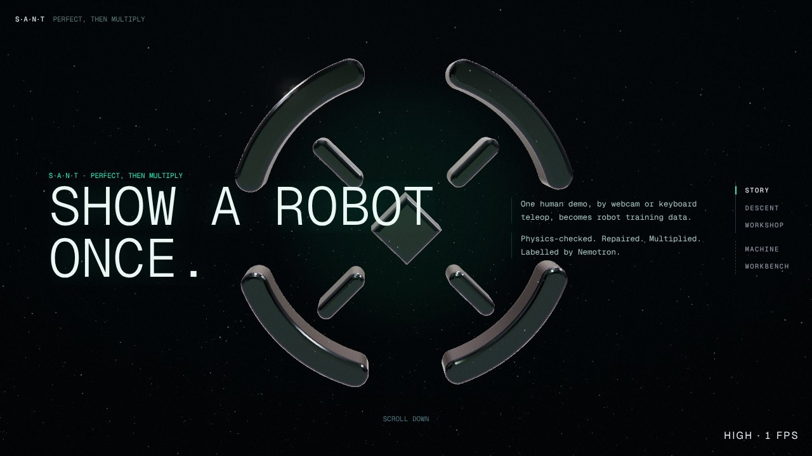 | 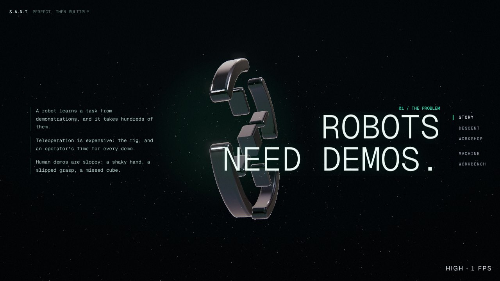 |
| 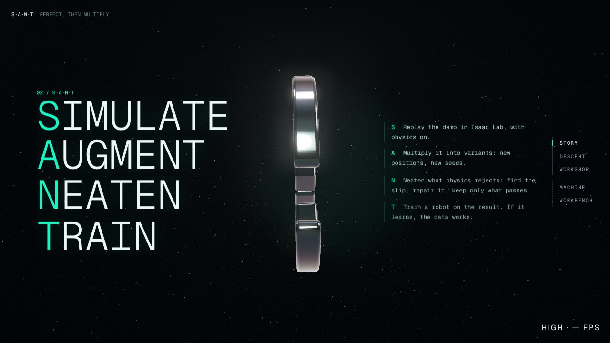 | 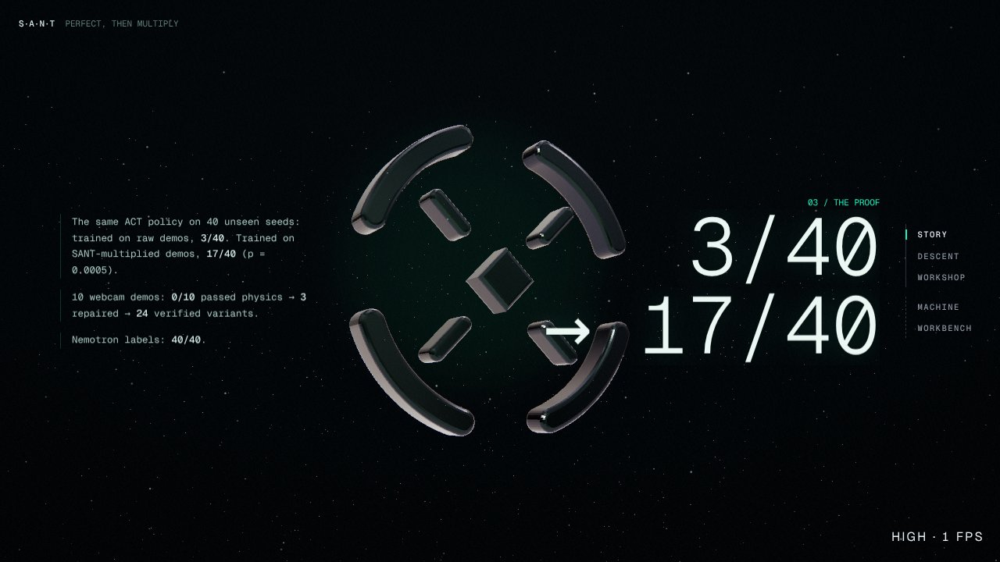 |
| 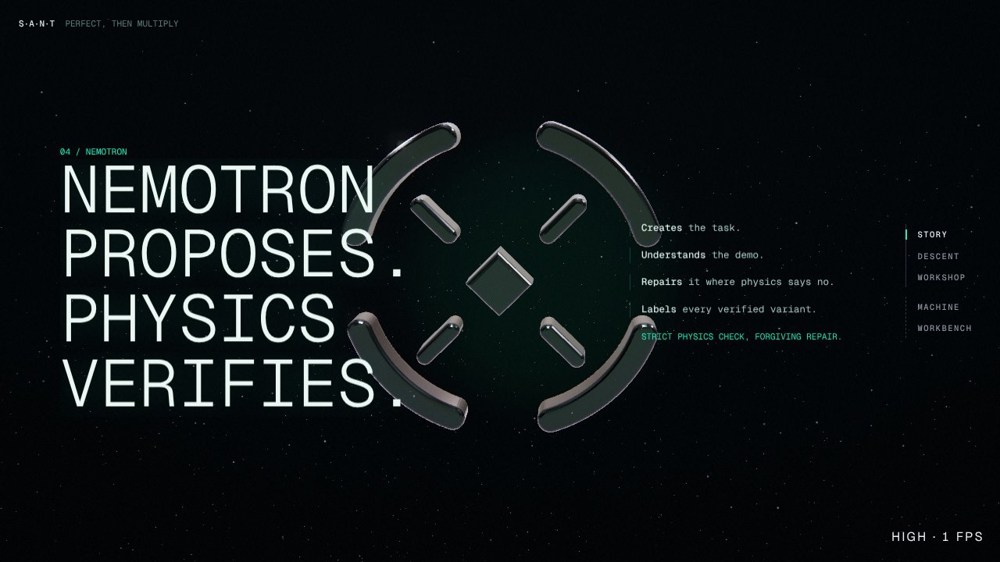 | |

**Removed:**
- the breaks (`ui/Breaks.tsx`, `ui/wipe.*`, `intro/sections.tsx`, `intro/storyline.ts`);
- the particle logo and its roof lattice.

## 2. The particle transition into the workshop (done)

**What you asked for:** no wormhole. The logo becomes the ring; the ring breaks into particles that
fill the dark; they converge onto the workshop like Active Theory's generator; the real room
materializes with a glowing noise edge; then the lamps flicker on and the hub is live.

**What it is now:**
- **The burst** (the descent, `stations/descent/`):
  - the intro's ring shrinks to nothing as particles leave its surface;
  - they fill the dark round the camera, which pushes into them, then drops down in front of the
    room's open wall (it never flies through a wall: `path.ts`, tested);
  - every particle streams onto its target, arcing, low targets first, so the room builds from the
    floor up.
- **The targets** (`generatorPlan.ts`, `Generator.tsx`):
  - points sampled by area from the baked GLBs themselves: room, shelves, pedestal, bench, desk and
    machine body;
  - plus boxes for the spiral's cartridges and the library;
  - each takes the colour of the baked atlas at its point, so the sculpture is the room, in light;
  - one `Points` draw: 24k points on low (and phones), 110k on high, 150k on ultra.
- **The materialize** (`scene/dissolve.ts`, `scene/Materialize.tsx`):
  - over the workshop's travel the real room appears through a noise field with a thin teal edge;
  - every built-in material under `<Materialize>` (the room, the furniture, the cartridges, the
    machine) is patched once;
  - the particles evaluate the same field at their target and fade exactly where their surface
    appears;
  - the patch is applied before the warm-up compiles, so it doesn't hitch.
- **Then the lamps:** at `LAMPS_AT` (0.86 of the travel) the existing sputter and power-on flicker
  runs, and the hub unlocks.
- **Reduced motion:** no particles. The room fades in behind the veil.

**Removed:** the dive (`dive.ts`, `Portal.tsx`), the skylight well (`Well.tsx`) and the
above-the-roof hiding (`BelowRoof.tsx`).

| | | | |
|---|---|---|---|
| 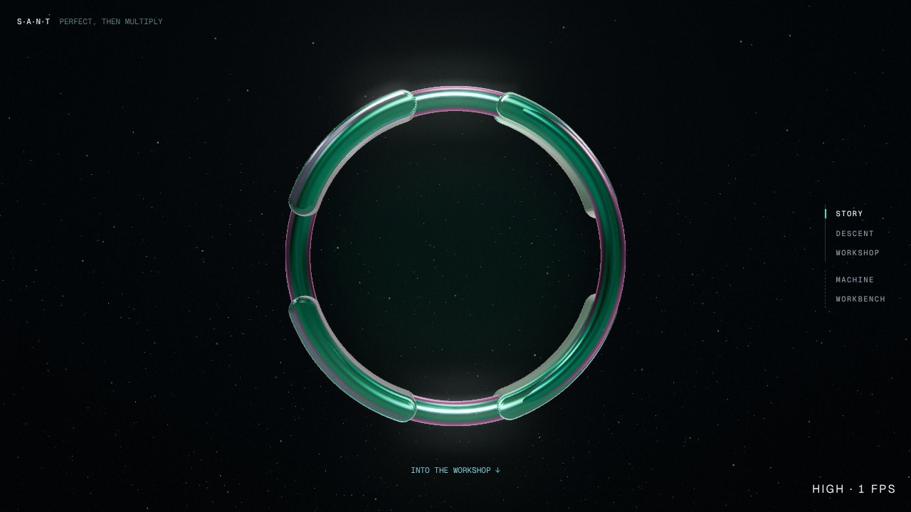 | 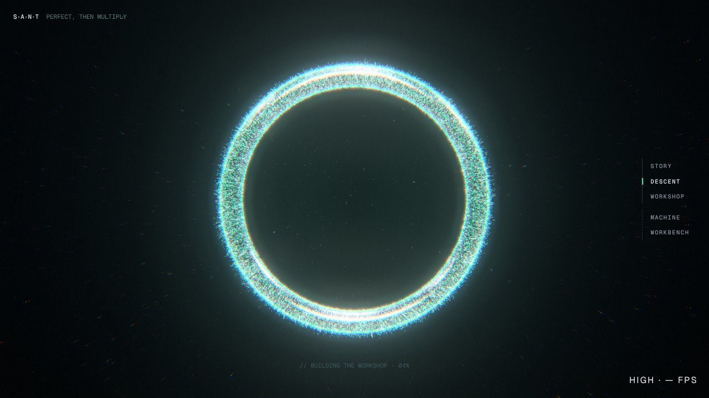 | 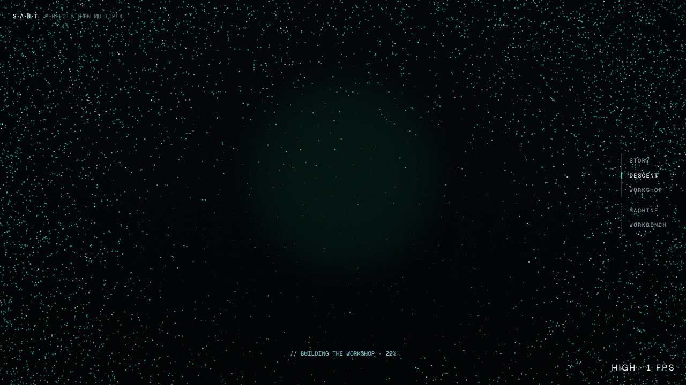 | 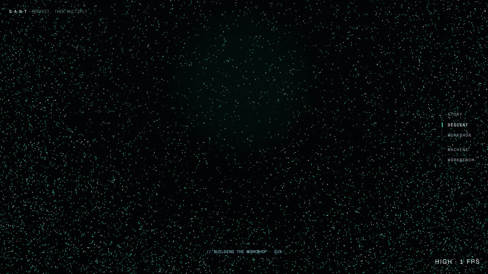 |
| 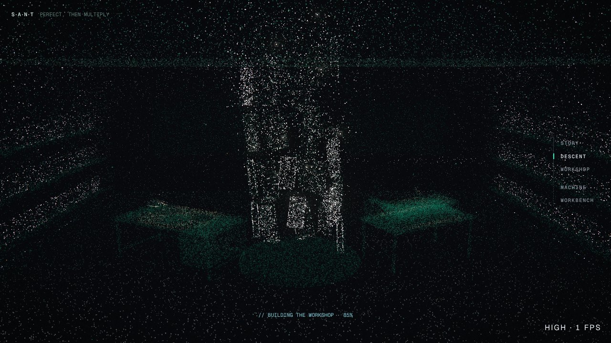 | 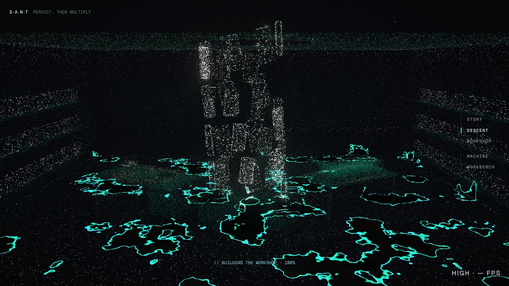 | 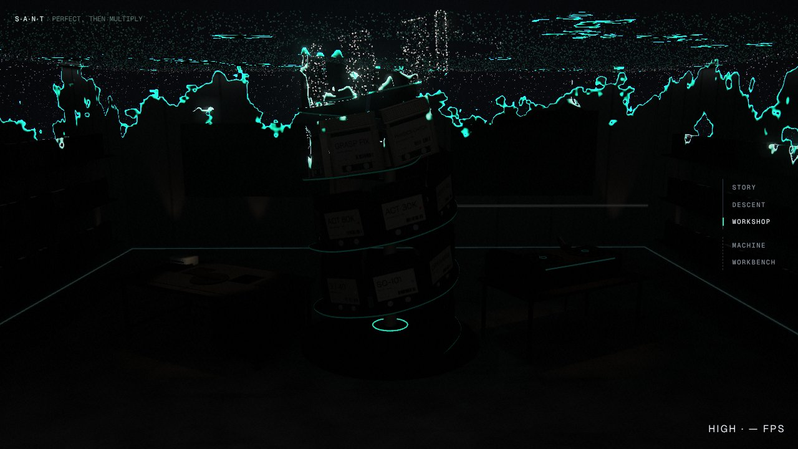 | 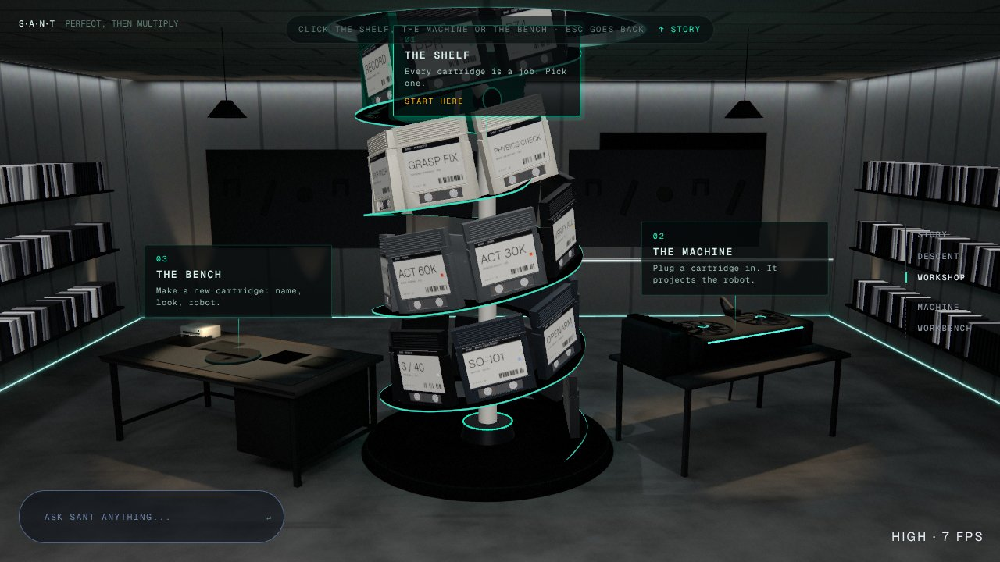 |

**Kept and checked:**
- the hub "game": the shelf, the machine with the hologram, the bench, Escape, and no scroll once in
  the workshop;
- "↑ Story" back to the hero;
- the journey rail's iris jumps;
- the loader;
- the 2D fallback: its intro and descent stills are re-rendered from the new scene, canvas only.

## 3. The flicker (done, by a parallel agent)

Full write-up with crops: [2026-10-20-overnight-site/flicker.md](2026-10-20-overnight-site/flicker.md).
- **The wall:** a geometry bug. The 442 library cartridges faced the room 1.38 m wide on 0.254 m
  slots, so each overlapped about five neighbours and they cut each other into stripes. They now
  stand spine-out, as in Blender's render (a test checks that none intersect).
- **Low tier:** it had no anti-aliasing at all; the canvas now multisamples (4×) on low.
- **The thin teal rings** (the spiral's edge, the hologram's base) are drawn with soft edges, with the
  same maths in TS and GLSL (`materials.ts softLine`). The hologram view has 5 fewer draw calls.
- **The popping pixels under mouse look:** the shelves went from 15–24 % to 0.4–2.9 %.

## 4. Check and optimize the whole site

<!-- AUDIT -->

## 5. Other `claude/*` branches from tonight

<!-- BRANCHES -->

## Verification

<!-- VERIFY -->
