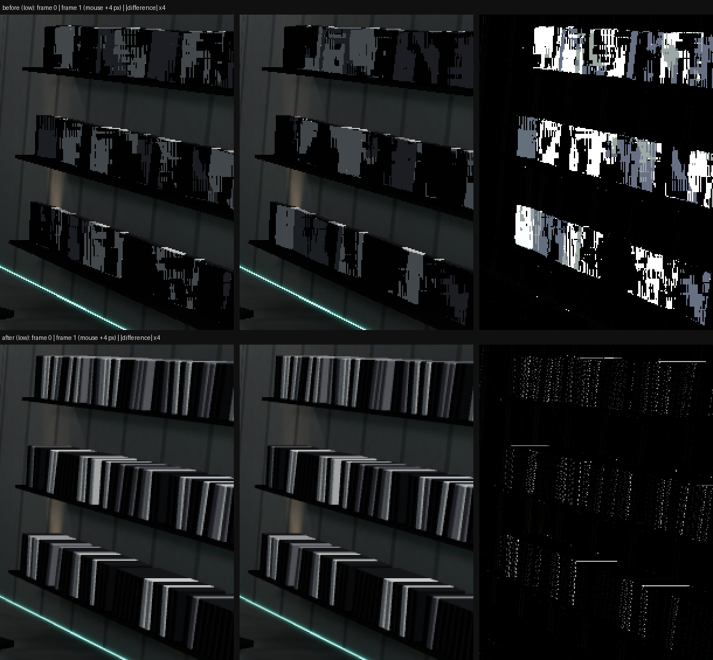
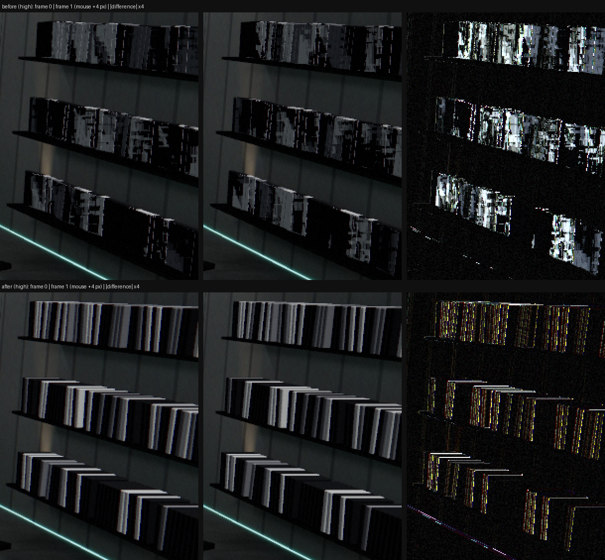
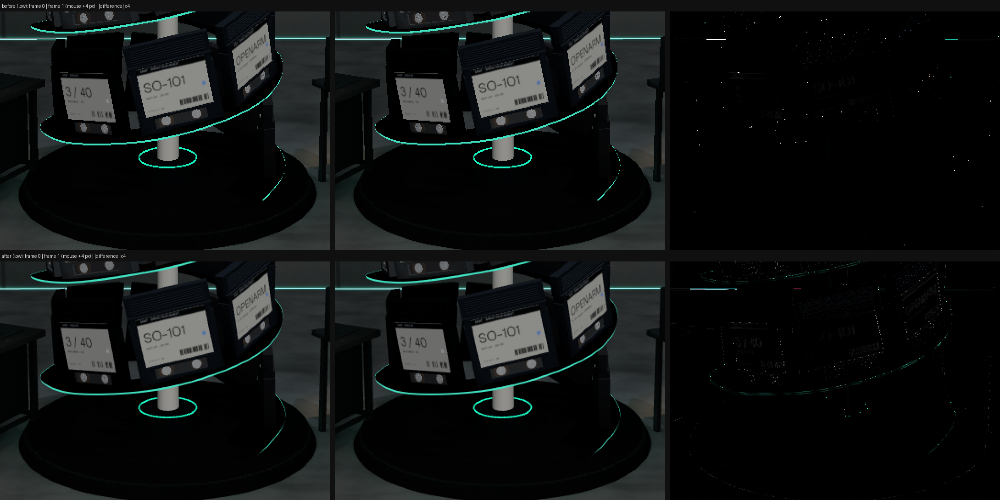
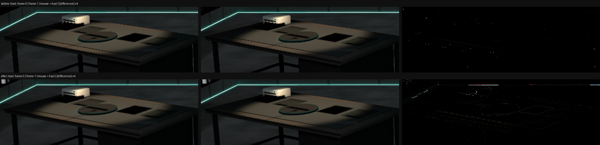
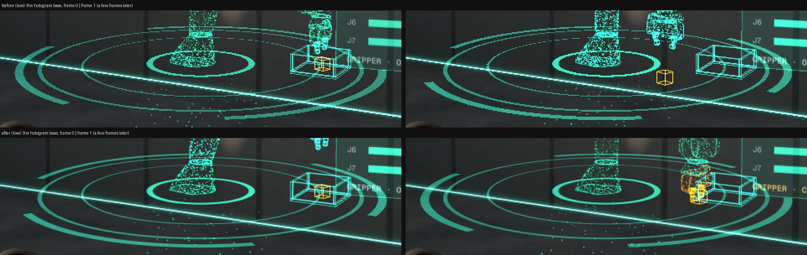
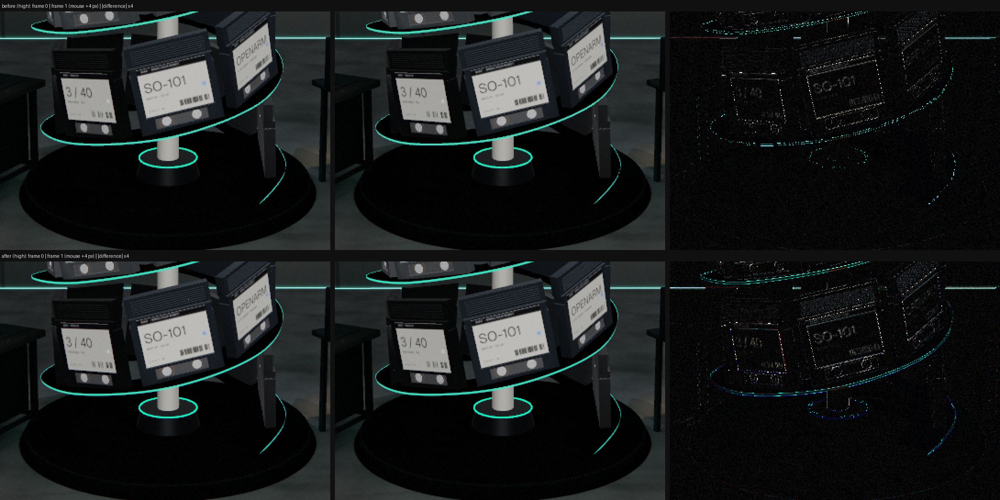

# Overnight task 3: the workshop's flicker

Branch `overnight/flicker`, from `perfect-then-multiply` at 4fd9c46.

**The report:** wall items and floor circles flicker with the mouse look in the workshop.

**What it was:**
- **Wall items:** mostly a geometry bug. Anti-aliasing could not have fixed it.
- **Floor circles:** teal lines a pixel or two wide, drawn with hard edges, with no anti-aliasing at
  all on the low tier.

The three fixes are below. Mipmaps and anisotropy were already right everywhere, so they needed no
change (details at the end).

## How it was measured

In the hub (Blender's "Workshop intro" stop), the mouse look moves the camera up to 0.9 m sideways.
A 4 px mouse step moves it about 5 mm, which is less than a pixel at the walls, 25–45 m away.
- **Well-filtered content:** it changes linearly from one frame to the next under that motion.
- **Aliased content:** it pops on and off whole pixels.

So the measure is the second difference over six frames, 4 px of mouse apart:
`|f[i-1] - 2 f[i] + f[i+1]|`. A pixel whose value jumps by more than 24/255 counts as a pop.

The frames are rendered at 1280×720 in SwiftShader from the dev build (`window.__world3d`). Each
step advances 45–60 frames by hand before the canvas is read back. The rig eases the look by a
clamped 1/30 s per frame, so the camera has fully settled however slow the software renderer is.
The mouse sits at (900–920, 640), on the floor, so nothing hovers.

Share of pixels that pop (> 24/255), in each region:

| region | low before | low after | high before | high after |
|---|---|---|---|---|
| left wall shelves | 14.7 % | 0.4 % | 15.7 % | 1.3 % |
| right wall shelves | 22.3 % | 1.1 % | 24.1 % | 2.9 % |
| floor, lower left (shelf + teal strip) | 14.2 % | 0.5 % | 15.5 % | 1.8 % |
| helix | 0.4 % | 0.3 % | 1.8 % | 1.3 % |
| floor at the helix's base | 0.07 % | 0.01 % | 0.36 % | 0.12 % |

High's numbers have a floor from the film grain, which changes every frame. The machine region on
high is busy with its own idle animation, so it isn't a fair before/after and is left out.

## 1. The library shelves: cartridges overlapping five deep

**What flickered.** The 442 library cartridges (`scene/Library.tsx`). Up close they were not
cartridges at all, but interleaved stripes.

**Why:**
- `layout.json`'s library rotations face each LOD cartridge into the room, so each one is 1.38 m
  wide along the wall.
- The slots are only 0.254 m apart, so each cartridge overlapped about five neighbours.
- Each slot has its own slight lean, about 1–3°. The five nearly coplanar, slightly tilted faces
  therefore cut each other into thin stripes. Which face wins a pixel changes with every millimetre
  of camera motion.

This is interpenetration, not depth precision: no amount of MSAA or mipmapping fixes it.

Blender's render (`docs/design/blender/W-hero-intro-v2.png`) stands them **spine-out**, like books.
Two facts in the files agree:
- the baked shelf is 1.6 m deep (x 20.0 → 21.6);
- the slot pitch is 0.254 m, against a 0.204 m spine.

**The fix.** `libraryMatrix` in `scene/cartridge.ts` adds a quarter turn about the cartridge's own
vertical axis. `cartridge.test.ts` checks two things with oriented boxes (three's `OBB`):
- every cartridge now sits inside the shelf's depth;
- no two neighbours intersect. The old matrices made every neighbouring pair intersect.

**Cost:** none. It is the same two instanced draw calls and the same 442 instances.

In each sheet:
- **Top row (before):** two frames one 4 px mouse step apart, then their difference ×4. Whole
  blocks of the wall change.
- **Bottom row (after):** spines with 5 cm gaps, and only a speckle of edge pixels in the
  difference.

## 2. No anti-aliasing at all on the low tier

**What flickered.** On low, every thin edge:
- the bench's turntable ring;
- the pedestal's rim;
- the arm's base ring;
- the teal floor strips;
- the gaps between the new spines.

**Why.** High and ultra multisample the post target (4×). Low has no post, and the canvas was made
with `antialias: false`, so nothing anti-aliased it.

I checked that the post MSAA really works on high and ultra:
- `WebGLRenderTarget({ samples: 4 })` is resolved by three after every render into it;
- tone mapping happens per material before the resolve, so the resolve averages display values;
- the glow colours are ≤ 1, so bright lines aren't clipped after the resolve.

Edges on high are smooth in the captures.

**The fix.** `TIERS.low.antialias = true` (`core/quality.ts`): the browser's own 4× MSAA on the
canvas. `quality.test.ts` now holds every tier to exactly one kind of multisampling: the canvas on
low, and the post target on high and ultra. Never both, because post draws a full-screen pass to the
canvas.

**Why MSAA and not FXAA or SMAA on low.** Both are post passes, and low has no post. Adding one costs:
- a render target;
- a full-screen pass (SMAA needs three);
- and FXAA is spatial only: on sub-pixel edges it still shimmers from frame to frame.

Canvas MSAA adds no pass and no target: the samples resolve when the frame is shown. On a phone's
tiled GPU, the resolve happens on chip and is close to free.

**Its cost:**
- **Memory.** About 4× colour + depth for the backbuffer: roughly 30 MB at 1280×720 and dpr 1
  (≈ 0.9 MP × 8 B × 4). Resolution.ts's 1.3 MP budget for low caps it at about 42 MB.
- **Bandwidth.** A little more per frame on an integrated desktop GPU.
- **Passes and draw calls:** none extra.

**Caveat.** `antialias` is a context attribute, set once when the canvas is made. A session that
starts on high and is auto-tuned down to low has no AA until the next visit, which then starts on low
from the saved tier. Before this change, low never had AA either.

`docs/design/world-core.md`'s tier table and its note on the canvas say this now.

## 3. The teal rings: hard edges a pixel wide

**What flickered:**
- the spiral band's teal edge (`scene/Ribbon.tsx`), the rings round the helix;
- the hologram's rings of light and the turning dial (`scene/HoloTwin.tsx`).

**Why.**
- The band's lip is 5.5 cm tall, which is about two pixels from the hub.
- The hologram's rings are 2.4–6 cm wide, a pixel or less from the machine's views.

Drawn as hard geometry, a line that thin breaks into dashes and crawls as the camera slides: a pixel
is lit or not depending on whether its centre falls inside the line. In the "before" floor crop,
lower right, the band's edge is a dotted line.

**The fix.** `softLine(d, px, halfW)` in `scene/materials.ts`, the same arithmetic in TS and GLSL. It
computes a line's coverage from its screen-space derivative:
- a one-pixel ramp at each edge;
- a line thinner than a pixel is drawn a pixel wide and fainter.

So the light a line gives off stays the same wherever it falls between pixel centres. The tests
check this, and also that a hard edge pops by a whole pixel.

How each piece uses it:
- **The band's edge.** `withSoftEdge` patches its MeshBasicMaterial, so the lamps still drive its
  colour through `addGlow`. The strip is widened to three times the lip (`EDGE_REACH`), giving the
  ramp room. At close range the lit core is exactly the old lip. Draw calls: the same one. It is now
  transparent (normal blending, no depth write); fill is about 6 px × the band's length.
- **The hologram.** The three rings and three dial arcs were six meshes. They are now one 3.8 m quad
  with one shader (`baseRingsShader`), generated from `BASE_RINGS` and `DIAL`, which keep the old
  radii, widths and brightness. Cost: **five fewer draw calls** in the machine view, for one cheap
  fragment shader over the quad's few hundred pixels.

Before: the thin middle ring (1.15 m, 2.4 cm wide) is a dashed line. After: it is continuous.

On high, the before difference shows the band edge as separate popping dots. After, it is a thin
continuous outline: the line moving smoothly.

## Mipmaps and anisotropy: already right, nothing to change

- **Baked atlases.** All six baked GLBs (`room`, `shelves`, `pedestal`, `bench`, `desk`,
  `machine_body`) declare `minFilter` LINEAR_MIPMAP_LINEAR (9987). GLTFLoader generates their mips.
  Anisotropy comes from `stations/workshop/Scene.tsx`: 2 on low, 8 on high and ultra. The back wall
  and the floor pop on < 0.03 % of pixels in every capture.

  **No change to `Baked.tsx` is needed.** If the lead wants a little more on the low tier's grazing
  floor, an optional one-liner in `stations/workshop/Scene.tsx` (not mine, so not made):
  `const anisotropy = quality.name === "low" ? 4 : 8;` in place of `? 2 : 8`. It is cheap on any
  GPU, but the captures don't show a need.
- **The label atlas.** `labelAtlas()` in `cartridge.ts` is a CanvasTexture: mipmapped by default
  (LinearMipmapLinear), with anisotropy 4. The library already uses a plain paper label, because
  sampling the atlas at a few pixels blends neighbouring tiles.
- **The hologram's panels.** CanvasTextures, mipmapped by default.

## Left as they are

- **The arm's glow rings** (`scene/Arm.tsx`, tori with a 2.5 cm tube). Not in this task's files.
  With MSAA now on every tier they are anti-aliased. `withSoftEdge` or `softLine` could soften them
  later if they still read as thin.
- **The intro's ring over the skylight** (`stations/intro`, out of bounds tonight). It shows in the
  difference maps, but it moves on its own anyway.

## Costs in one place

| change | draw calls | passes | other |
|---|---|---|---|
| library spine-out | 0 | 0 | none |
| low: canvas MSAA 4× | 0 | 0 | ≈ 30 MB backbuffer at 1280×720, dpr 1; resolve at present |
| band edge soft line | 0 | 0 | transparent strip 3× the lip's height; derivative per fragment |
| hologram rings in one shader | −5 (machine view) | 0 | one quad's fragments |

High and ultra are unchanged in passes and targets: bloom at half resolution plus the final pass,
with 4× MSAA on the scene target. The workshop's draw calls don't change (47 on high at the last
handoff, budget 60).

## Checks

- `npx vitest run`: 127 files, 1114 tests, all passing. That is +3 files and +10 tests:
  - `cartridge.test.ts`;
  - `materials.test.ts`;
  - `HoloTwin.test.ts`;
  - more in `Ribbon.test.ts` and `quality.test.ts`.
- `npx tsc --noEmit -p .`: clean.
- `npm run build`: builds.
- **Not verified:** a real GPU. SwiftShader shows the geometry and the AA. The frame-time cost of
  canvas MSAA on a low-end machine is still to be read off the HUD (PERF.md).
