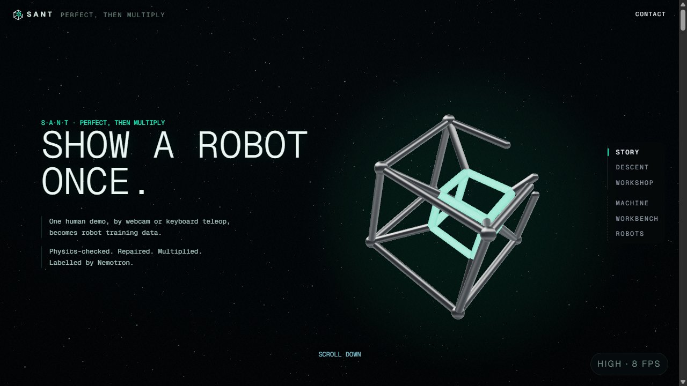
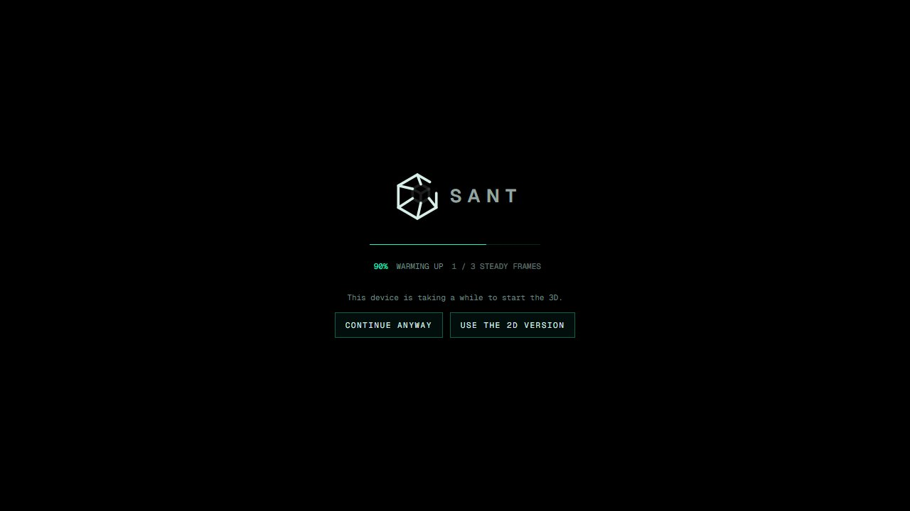
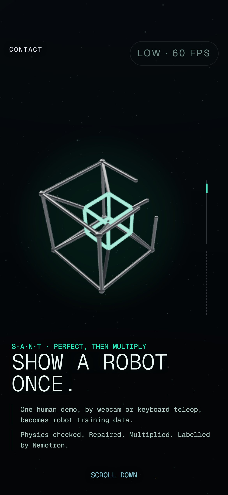
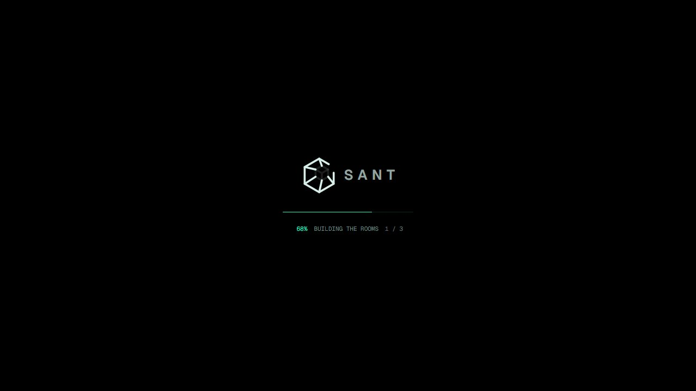
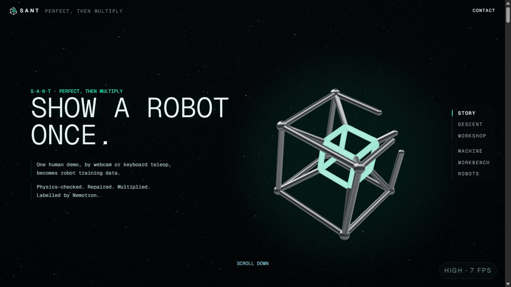
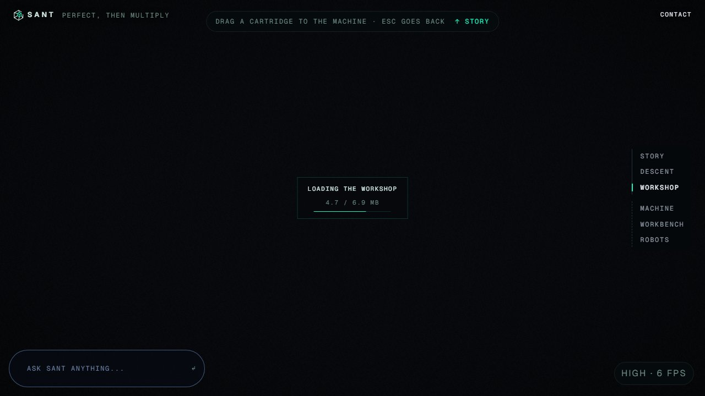
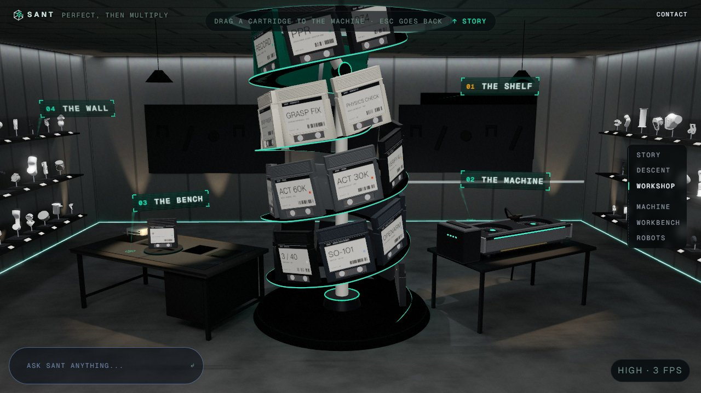

# A real loading screen (`pm/real-loader`, 2026-10-20 and 10-21)

Branched from `pm/live-12` at `309ee2e`, with `pm/hero-tesseract` at `0e02132` (T2's hero perf fix) merged in. Nothing
pushed. No new dependencies.

Built on 10-20, paused overnight, and finished on 10-21 (a training day: the GPU was busy, so 10-21's checks are
SwiftShader only). One check is still to do: the real-GPU scroll through the stations (see "Still to do").

## Done

**The loader holds until the first scene is truly ready**, with a bar driven by the real work, not a timer
(`stations/intro/progress.ts`, `Loader.tsx`):

| Step | What it waits for |
|---|---|
| engine | the 3D chunk arrived and the WebGL context is up |
| fonts | each face the hero, the beats and the wordmark use, counted as it loads (capped at 4 s each) |
| build | the tesseract and the dust made for the tier |
| shaders | every program compiled and linked, counted one by one (`compileSafe`'s new `onProgress`) |
| rooms | the later scenes built and compiled under the loader (below) |
| frames | 3 frames drawn back to back at a steady frame time (`frameGate`: within a third of the median of the last 3, judged against itself; it lets go after 12 frames whatever they were) |

The hero is built in code (the tesseract), so it fetches no files: its real costs are the engine, the type, the shaders
and the first frames.

**Visually:**
- the new SANT mark at the centre, its four parts lighting as the work gets done;
- a hairline bar (`transform` only, no layout);
- the share, and what it waits for now ("Compiling shaders 12 / 31", "Building the rooms 4 / 5");
- `role="progressbar"`, with the step in `aria-valuetext`.

**The lift:** the mark rises and dissolves as the black opens. With reduced motion it is a plain 0.25 s fade.

**The page is held still while loading:**
- `overflow: hidden` on the root, so no wheel, touch or keyboard scrolling;
- the world's chrome (brand, rail, Contact, HUD, skip link) waits behind the loader and comes in with the hero.

**The loader is mounted at the world's root**, not in the intro's overlay, so it also covers a visit that opens
elsewhere (a return lands in the workshop).

**A way on when it takes too long:**
- at 12 s it offers "Continue anyway" (in at what is ready) and "Use the 2D version" (the stills);
- if the 3D engine never even started by 30 s, it falls back to the stills by itself.

**The rooms (`core/rooms.ts`, `core/RoomBuild.tsx`).** Under the loader, after the hero's shaders:
1. It mounts every later scene whose files are already in (the forest and reactor, then the stations that have a scene),
   one at a time, out of sight.
2. Then it compiles everything once, every object shown for the compile, and uploads the textures.
3. Files still on their way get a 2 s grace.
4. A 6 s budget keeps the loader short on a slow device.
5. A room that never stands (its scene threw) counts as built after 8 s.

What isn't in by then is built after the reveal, one room per idle moment (`requestIdleCallback`), or at once when the
visitor reaches it.

**The background (`core/assets.ts`, `core/waiting.ts`):**
- **What it fetches:** the heavier stations' files, in the journey's order: the forest's crack and robots, then what
  the descent builds the workshop from, then the rest.
- **How:** two at a time, each file once.
- **Real bytes:** counted as they arrive, against the files' known sizes (`assetSizes.json`, from
  `scripts/asset-sizes.mjs`, checked against the files by a test).
- **Where they go:** finished files go into three's cache, so drei's `useGLTF` and GLTFLoader find them without a
  second download. The crack and the robot models fetch through it.

**Scrolled ahead of what has arrived (`ui/Wait.tsx`):** a small chip in the middle of the view, for example "Loading
the workshop 4.1 / 6.9 MB" with a bar.
- It shows after 250 ms, so a quick arrival never flashes.
- The visitor's station's files jump to the front of the queue.
- It lifts once the files are in and the scene stands.

## Measured

**Real GPU** (RTX 5080, headless d3d11, 1280×800 at 1.5×; `web/scripts/world-perf.mjs`'s new `MODE=reveal`).
The lead checked first, and Blender was idle (0 CPU, GPU 0–2%). 3 fresh loads per tier, holding the hero for 6 s after
the reveal:

| | Before (`0e02132`) | After (`pm/real-loader`) |
|---|---|---|
| Loader lets go | 1.0–1.2 s | 1.9–2.1 s |
| Worst frame in the 6 s after | 83–150 ms | 8.5–16.7 ms |
| Frames over 16.7 ms | 10–14 | 0–1 (the one at 16.7) |
| Stall (sum over 16.7 ms) | 400–533 ms | 0 ms |
| Long tasks | 5–7 (to 118 ms) | 0 |

That held on both high and ultra. On the GPU, the rooms step takes about 0.8 s.

**SwiftShader:**
- The loader lets go at 11.6 s at 1280×720 on high (27 s before the rooms budget).
- With every model download held 1.5 s and a jump to the workshop right after the reveal, the chip showed "Loading the
  workshop" at 4.1, then 5.3, then 5.8 / 6.9 MB, then lifted onto the room.
- SwiftShader can't judge the "no frame over 16 ms" target: every software frame is itself about 120 ms.

**Checks:** web tests 194 files, 1739 passed, 1 skipped; `tsc -b` clean.

**New tests:**
- `progress.test.ts` (the steps, counts, status, release, `frameGate`);
- `Loader.test.tsx` (the held scroll, the real value and text, letting go only when done, the 12 s choices, the
  stills fallback, reduced motion);
- `assets.test.ts`, `waiting.test.ts` (the sizes against the files), `rooms.test.ts`, `Wait.test.tsx`;
- `compileSafe`'s progress.

### SwiftShader, 10-21 (headless Chrome, no GPU; the dev server ran inside the check script and ended with it)

| Run | Result |
|---|---|
| 1280×720, high | The loader lets go at 14.2 s (SwiftShader draws about 120 ms a frame), through every step, the rooms counted (01, 02). The hero after it (03). |
| 1280×720, high, CPU throttled 6× (a weak device) | "Continue anyway" and "Use the 2D version" are offered at 12 s (seen at 16.4 s and 17.5 s, the probe's polling being slow under the throttle) (04). "Continue anyway" took it in at what was ready: the loader lifted 1.8 s after the click. |
| 390×844 @3×, low tier (phone) | The loader lets go at 5.3 s (05); the hero over the copy (06). |
| 1280×720, reduced motion | 3 rooms (the forest is left out: reduced motion holds the hero); the plain fade; the mark's still pose (07, 08). |
| Model downloads held 1.5 s each, a jump to the workshop right after the reveal | The chip "Loading the workshop" counts up (4.1, 4.7, 5.8 / 6.9 MB) and lifts onto the room (09, 10). |

No console errors in any run.

**Checks on 10-21:** web tests 194 files, 1739 passed, 1 skipped, 0 failed; `tsc -b` clean; `npm --prefix web run build` passes.

## Screenshots (`2026-10-20-real-loader/`, SwiftShader, 1280×720 unless marked)

| | |
|---|---|
|  01 the loader at 60%: the rooms begin |  02 building the rooms, the mark's frame lit |
|  03 the hero after the reveal, the chrome back |  04 a weak device: the 12 s choices |
|  05 phone (390×844 @3×): the loader at 100%, lifting |  06 phone: the hero |
|  07 reduced motion: building 1 / 3 |  08 reduced motion: the still mark |
|  09 jumped ahead of the files: loading in place |  10 the room once they are in |

## Still to do

- **Real-GPU scroll check: still to do** (the GPU was busy with training on 10-21). Measure the first scroll into each
  station after the reveal with `web/scripts/world-perf.mjs`. Only the hero hold was measured on the GPU (above). The
  stations' shaders are compiled under the loader, so the scroll should be smooth.
- **The low tier on a desktop** (where the forest skips the crack's model) was seen only on the phone run.
- **The temporary checkout of `0e02132`** (the "before" for the GPU numbers) sits in my scratchpad: `git worktree list`
  shows it, with a junction to `web/node_modules`. Keep it for the GPU scroll check's "before", then remove it with
  `git worktree remove --force <path>`.
