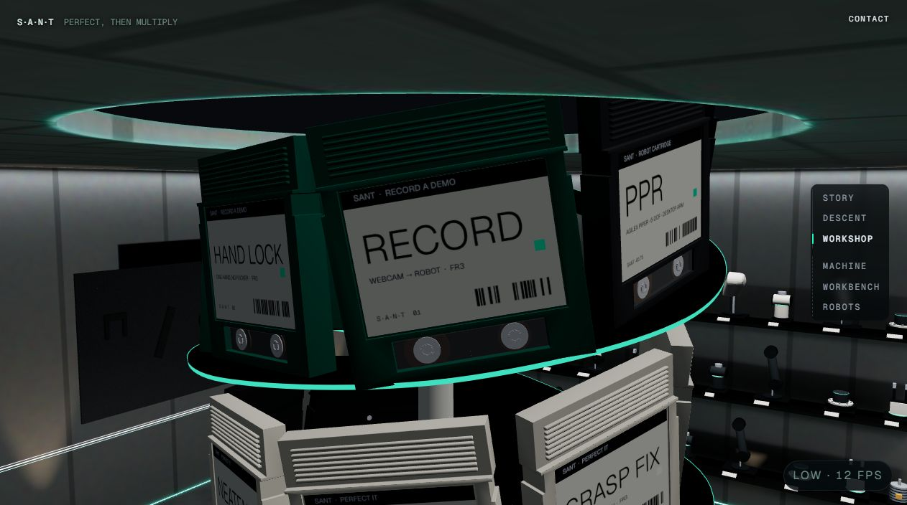
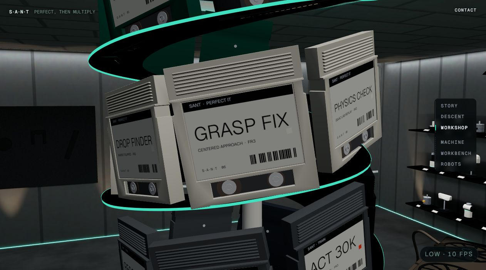
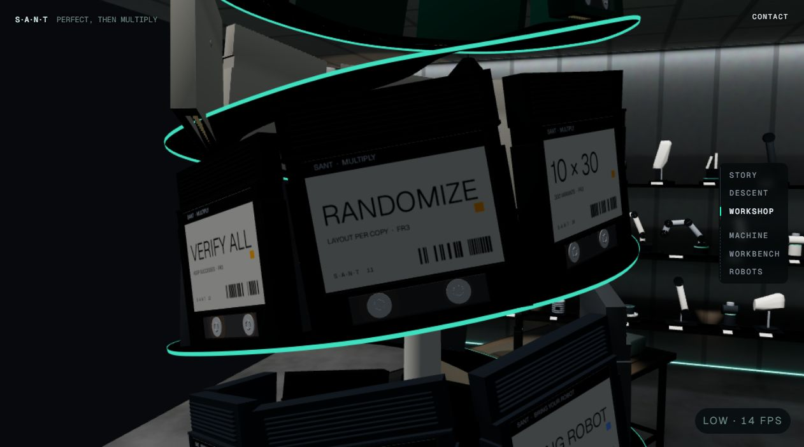
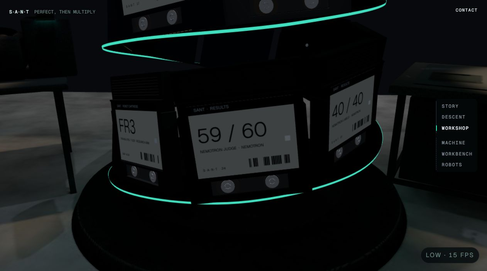

# The shelf scroll zoomed into the spiral (2026-10-20, branch `pm/shelf-scroll-fix`)

Branched from `pm/live-12` (`d28e591`). No GPU: unit tests, plus headless Chrome on SwiftShader. Never pushed.

**The bug (the user's report).** On the workshop's spiral shelf, scrolling should walk the camera round the spiral
one cartridge at a time. After a few steps it zoomed in instead, as if it skipped the cartridges already passed.

## Root cause

Each wheel notch, swipe or arrow key moved the shelf one step, and the step itself was right: `nextStep` gave +1,
held inside the steps there are. The camera was the problem:

1. **Each step was a new held shot.** `store.setOverride(stepView(d))` gave each step its own key, and
   `CameraRig` flew to each new shot **in a straight line** (`mixPose`, 1.1 s, starting from wherever the camera
   was).
2. **The steps came faster than the flights.** A step can come every 240 ms, so after a few notches the straight
   line spans several cartridges, 100–200° round the spiral. A chord that long passes close to the spiral's axis:
   the camera flies into the spiral. That is the zoom, and it skips the cartridges in between.
3. **One step across the helix's gap did it too.** At steps 3→4 (where the spare slots for saved cartridges sit),
   two neighbours are 161° apart. Even a single slow step cut in to 2.9 m from the axis.

The camera's closest approach to the spiral's axis, measured with `shelf-probe.ts` (the rig's own shot code,
60 fps, from step 0). The orbit is 9.27–11.07 m:

| scrolling | steps | before | after |
|---|---|---|---|
| a notch every 1.5 s | 6 | 2.94 m (the gap) | 9.27 m |
| a notch every 0.3 s | 10 | **0.54 m** (through the middle) | 9.29 m |
| a flick, a notch every 30 ms | 4 | 6.83 m | 9.29 m |

## The fix

- **The shelf's shot is on a track** (`HeldShot.track` in `core/types.ts`; `shelfShot(d)` in `stepper.ts`):
  `{ id: "shelf", at: d, pose: stepView }`.
- **The camera glides along the track.** `core/shot.ts` `heldShot()` glides the camera's fractional step toward
  `at` with a critically damped spring (`GLIDE_W = 6`, about 0.8 s for one step). The spring never overshoots, so
  the camera passes every cartridge in between and never swings back. One more cartridge is not a new shot, so
  there is no new straight-line tween.
- **Between two steps the camera goes round the spiral, not across it.** `stepView(d)` for a fractional d is
  `arcPose` (`core/rail.ts`): azimuth the short way round the vertical axis, with distance and height lerped. This
  is also what fixes the 161° gap. Integer steps give the same poses as before.
- **A far jump is a new shot, but round, not through.** A filter or Ask SANT going back to step 0 is a move of more
  than `MAX_GLIDE = 3` steps. That stays a new shot, a 1.1 s tween, but an `arcPose` tween round the axis, so it
  doesn't spin through every cartridge or cut across. Opening the shelf from the room tweens the same way.
- **Reduced motion is unchanged:** each step is still a cut behind the veil.
- **The rig's shot logic is now pure**, so it is tested: `retarget` and `mixShot` moved out of `CameraRig.tsx`
  unchanged, before the fix. The shelf's wheel, key and touch handling moved out of `useStepper` into
  `createShelfInput()` the same way.
- **Small extra:** a wheel in pages (`deltaMode` 2, a Firefox setting) never reached the 40 px step, so it never
  moved. It is now one step per page.

## Tests

`web/src/world/stations/workshop/shelfScroll.test.ts` flies the camera the way `CameraRig` does, at 60 fps, under
real input sequences. It drives the real input controller, the store and the rig's shot functions. Each scenario
checks three things:
- the camera stays on the orbit (between the nearest and farthest step views, ±0.25 m);
- its azimuth never turns back;
- it ends facing the step the scroll is on.

The scenarios:
- single notches;
- steady scrolling (a notch every 0.3 s);
- a fast flick (a notch every 30 ms: at most one step per 240 ms);
- a trackpad (6 px every frame for 2 s);
- scrolling back up;
- a touch swipe;
- a held arrow key;
- the last cartridge (it stops there);
- a filter (it stops at the last match);
- every fractional view (the gap included);
- a far jump back to the top;
- reduced motion (each step is a cut).

All 8 scenario tests failed on the old code ("off the orbit"), the reproduction. `rail.test.ts` adds `arcPose`.
`stepper.test.ts` now expects the held shot to carry the shelf's track.

Results: web `npx vitest run` 1565 passed, 1 skipped (live-12 had 1552). `tsc --noEmit` is clean.

## In the browser (SwiftShader, no GPU)

`shelf-shots.mjs` does this:
- starts vite in-process and opens `/world?quality=low` in headless Chrome
  (`--use-angle=swiftshader`; renderer "SwiftShader driver");
- skips the intro and clicks "The shelf";
- scrolls with **real wheel events** (CDP `mouseWheel`, deltaY 100, 300 ms apart);
- reads the camera from the dev-only `window.__world3d`.

Over 406 samples from step 0 to the last, the camera stayed **9.27–11.07 m** from the axis, exactly the orbit.
Each settled pose matches the unit tests.

| step 0 (01 RECORD) | step 5 (06 GRASP FIX) |
|---|---|
|  |  |
| **step 10 (11 RANDOMIZE)** | **step 23, the last (24 59 / 60)** |
|  |  |

**Not checked:**
- a real trackpad, touch screen or GPU (the input sequences are simulated in the unit tests);
- how the glide feels at 60 fps on the 4060. SwiftShader ran at 10–15 fps, and the rig clamps a frame's dt to
  1/30 s, so there the glide runs slower than real time.

**Re-run:**
- the probe: from `web`, `npx vite-node ../docs/superpowers/notes/2026-10-20-shelf-scroll/shelf-probe.ts`
  (add `-- --fixed` for the new path). The plain run reproduces the old straight-line flight.
- the browser check: `node .../shelf-shots.mjs <out dir>`.

Both have `C:/dev/pm-t3` paths written in.
