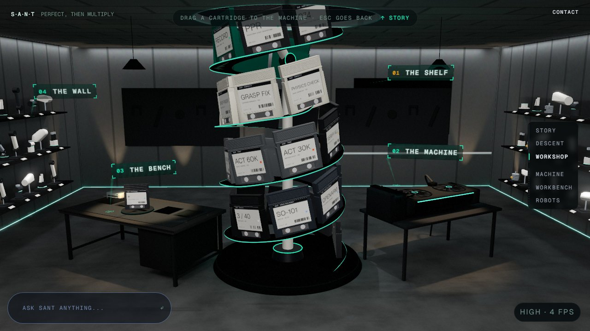
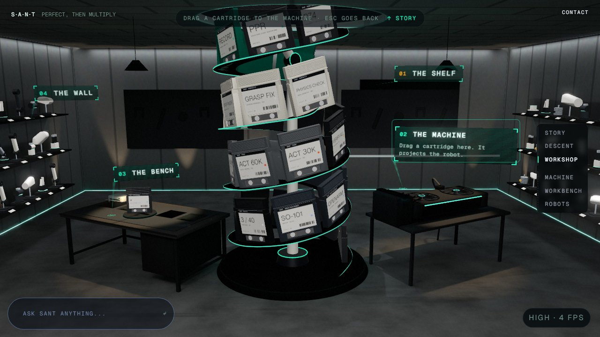
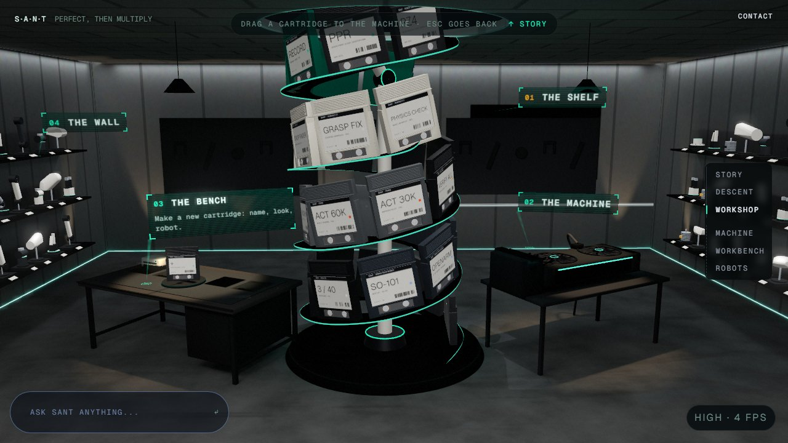
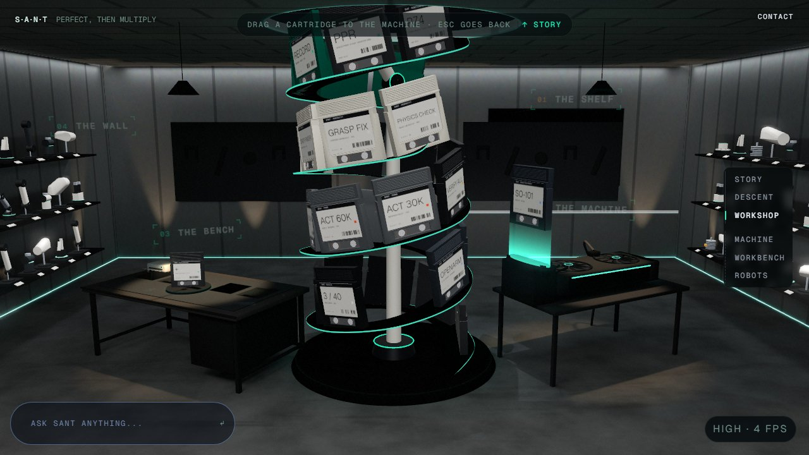
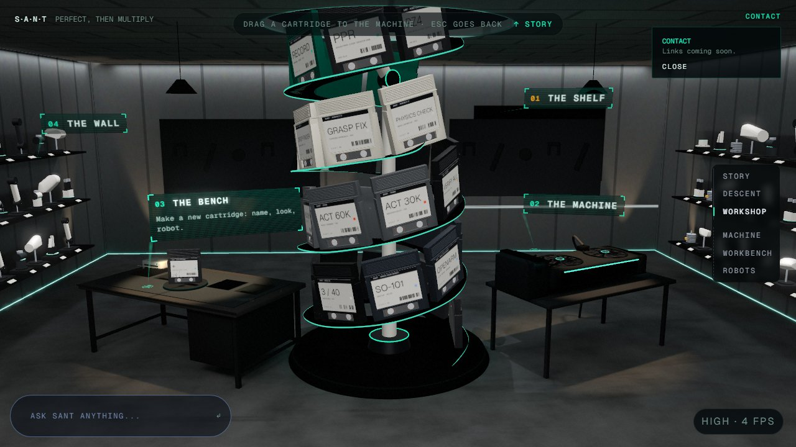
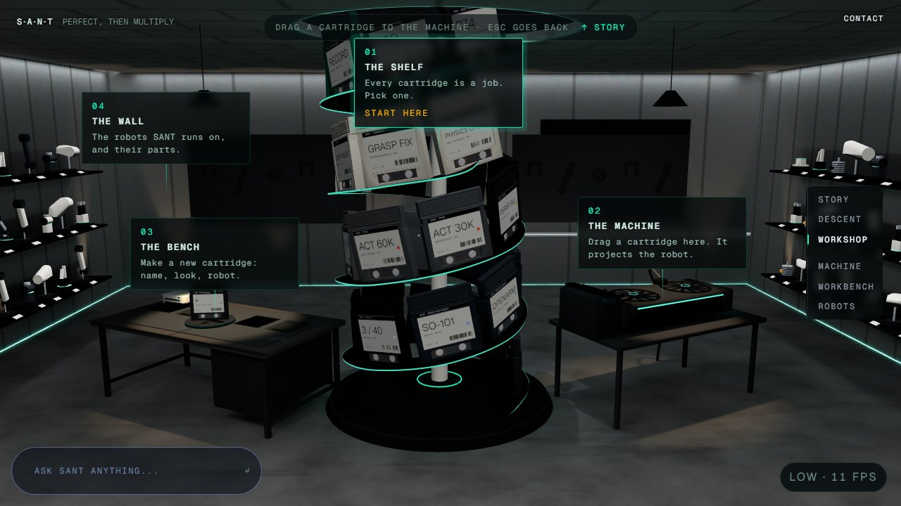
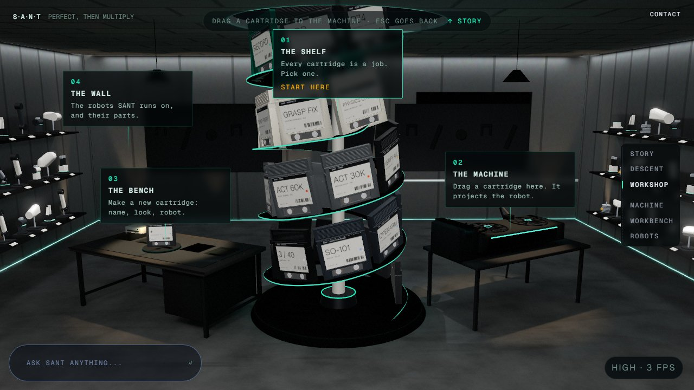

# The room's tags as small holographic labels, and a Contact entry point (`pm/site-holo-ui`, 2026-10-20)

Branched from `pm/live-11` at `2abc94e`; started as `pm/site-holo-carts` and renamed. The first brief (cartridge
holograms) was withdrawn before any code was written. Nothing was pushed, merged or rebased. No new dependencies. Not
touched: the intro and descent, the robot wall, the Record page.

**Two passes:**
- `bdd3f21`: the tags became large holographic glass panels.
- The commit after it: the user kept the see-through level but found the panels too big, so the panels became small
  labels in the manner of activetheory.net's in-world labels. This note describes the second pass.

## 1. The hub tags are small holographic labels

The room view's four tags ("01 The shelf", "02 The machine", "03 The bench", "04 The wall") are holograms on high and
ultra (`stations/workshop/HubHolograms.tsx`, layout in `holoTags.ts`).

**At rest:**
- one line, "01  THE SHELF": a teal number, then the title in bold caps;
- corner brackets on the same see-through teal glass as before;
- about 140–165 × 34–41 px at 1280×720, which is **15–19% of the old card** (240×136); the test bound is a third;
- it stands just above or beside its object, never over it. The shelf's sits off to the right of the spiral's upper
  turns, clear of every cartridge; the machine's and the bench's sit just over them; the wall's sits over its robots.

**The light:**
- a small emitter disc with a pulsing ring, on the object itself;
- a slim, faint beam (8 px at the label) from the emitter to the label's bottom-left corner, 38–72 px long;
- a faint flicker and a scanline texture.

**Hover and focus:**
- the label lights, stutters back in (a third of a second), and **unfolds** up and to the right to 248×76 px: the
  title rises and its line appears under it (up to two lines);
- its bottom-left corner, where the beam meets it, never moves;
- entering the room view materializes all four, one after another;
- a cartridge in the hand dims them (04).

**The first visit's "start here":**
- at rest it is an amber "01" on the shelf's label;
- unfolded, the line begins "Start here.".

**Text** is drawn into a canvas atlas at 3× screen size, mipmapped, with a 14 px title.

**Accessibility:**
- the HTML buttons stay, with the same names and the same Tab order (shelf, machine, bench, wall: checked in the
  browser) and the same clicks;
- they are see-through, stand up from each label's bottom-left corner, and grow with it as it unfolds;
- keyboard focus also draws a thin outline round the label (02);
- clicking a label opens its branch (checked with the bench).

**The fallback:** the HTML cards, exactly as before, in the stills, on the low tier, with reduced motion, and below
700 px wide (`holoMode`; 06, 07).

**Cost:**
- one draw call for all four: one indexed geometry (`buildHoloGeometry`) and one premultiplied-alpha shader that clips
  each label's quad to the part shown;
- **hub on high: 55**, as in `bdd3f21` (54 before the holograms), within the ≤ 60 budget;
- 0 outside the room view;
- **low (40) and reduced motion (54) are unchanged.**

**Layout tests** (`holoTags.test.ts`, 15 tests). From the room view's camera at 1280×720:
- each label at rest is under a third of the old card;
- unfolded, each label stays on screen (under the hub bar, above Ask SANT, clear of the journey rail) and never
  covers its own object (the spiral's cartridges, the machine, the bench, the wall's robots);
- no label overlaps another, at rest or while one unfolds;
- every beam is short;
- emitters sit on their objects;
- the labels face the camera.

**A fix found on the way:** `HubTags` showed the tags only when the room view came or went. drei makes the tag
elements anew when the cards and the holograms swap, and the new ones started hidden. It now checks each element
every frame (a string compare).

## 2. The hub bar hint and Ask SANT stay HTML

**Why:**
- Neither stands on anything in the room: there is nothing to project them from.
- Ask SANT is a real text input and must stay readable over anything behind it.

## 3. Contact

- **The entry point.** A quiet "Contact" button, top right in the brand's mono caps (on a phone it sits under the hub
  bar on the left, clear of the tier badge). It opens a small panel under itself (`world/ui/Contact.tsx`).
- **The links** come from one config file, `web/src/site/contact.ts` (`CONTACT_LINKS`, empty for now, so it says
  "Links coming soon."). Only `https://`, `http://` and `mailto:` links are listed, opening in a new tab with
  `rel="noopener noreferrer"`.
- **Closing.** Escape, Close or a click outside closes it, and focus goes back to the button. Its Escape doesn't reach
  the world's.
- **Where it shows.** The world page only; the Record page is untouched.

## Checks

| Check | Result |
|---|---|
| Tests first | `holoTags.test.ts` (15, rewritten for the labels) and `Contact.test.tsx` (2) failed before the code. |
| `npm --prefix web test` | 162 files, **1448 passed**, 1 skipped, 0 failed (1433 on `2abc94e`). |
| `npx tsc -b` | Clean. |
| `npm --prefix web run build` | Passes; the only warning is the old >500 kB chunk notice. |

### In headless Chrome

**SwiftShader only:** the GPU is training (T4), so no real-GPU browser. The dev server ran inside the check script's
own Node process and closed with it; nothing was left running.

| What | Viewport and tier | Result |
|---|---|---|
| The labels | 1280×720, high | All four on. The buttons' boxes match the labels at rest (shelf 841,141 145×34; machine 164×37; bench 141×41; wall 139×33). |
| Hub draw calls | 1280×720, high | 55. |
| Tab order | 1280×720, high | Shelf > machine > bench > wall. |
| Focus (machine), hover (bench) | 1280×720, high | The label lights and unfolds. |
| Clicking the bench's label | 1280×720, high | Opens the bench. |
| Drag to the machine | 1280×720, high | Machine opens; labels dim while the cartridge is in the hand. |
| Contact | 1280×720, high | Opens; Escape closes it. |
| Low, reduced motion, phone | 1280×720 low; 1280×720 high + reduced; 390×844 @3× low | HTML cards everywhere. Draw calls 40 (low) and 54 (reduced). Same Tab order. |

No console errors or exceptions, apart from React Router's future-flag warnings.

## Screenshots (`2026-10-20-site-holo-ui/`, 1280×720; re-shot over the first pass's files)

| | |
|---|---|
|  01 the room view: four labels at rest |  02 keyboard focus: the machine's label unfolded |
|  03 hover: the bench's label unfolded |  04 dimmed while a cartridge is in the hand |
|  05 Contact open |  06 low tier: the HTML cards |
|  07 reduced motion: the HTML cards | |

## Not verified, or open

- **Real GPU, ultra, a person.** Nothing ran on the RTX 4060 (the GPU is busy training). The flicker and the
  sharpness at 120 fps on ultra are unseen. Nobody has used it with a real mouse or a screen reader.
- **Two things in the scene can still cross a label:**
  - The machine's unfolded label crosses the room's bright horizontal light strip behind it. The strip is brighter
    than white in the HDR target, so it shows through the glass a little (02).
  - The bench's unfolded label ends a few pixels short of the spiral's lower cartridges.
  - Neither covers its own object.
- **Ultrawide screens.** The labels are sized for the room view at 16:9 and scale with the viewport; on very wide or
  very tall windows they keep their place in the scene, not their pixel size.
