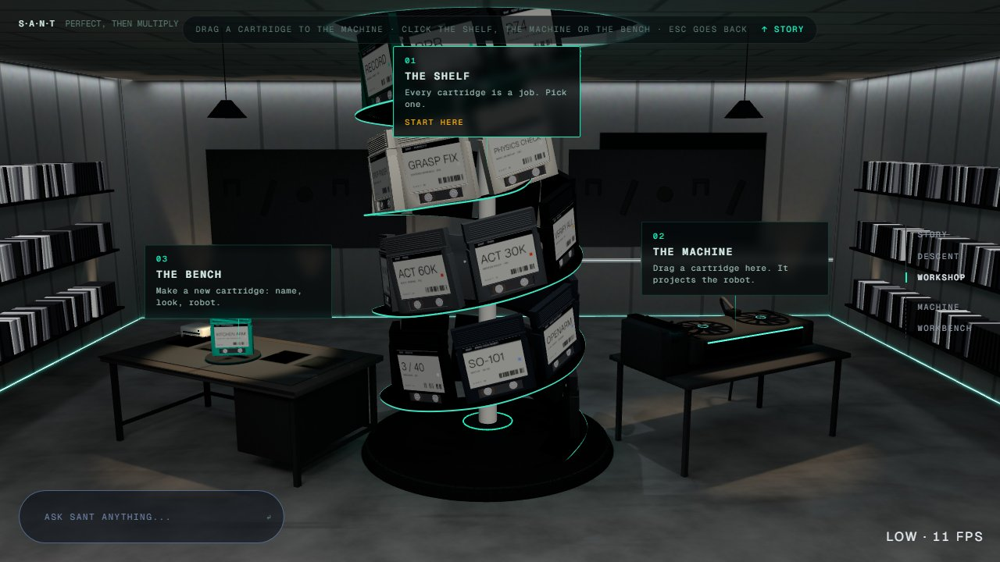
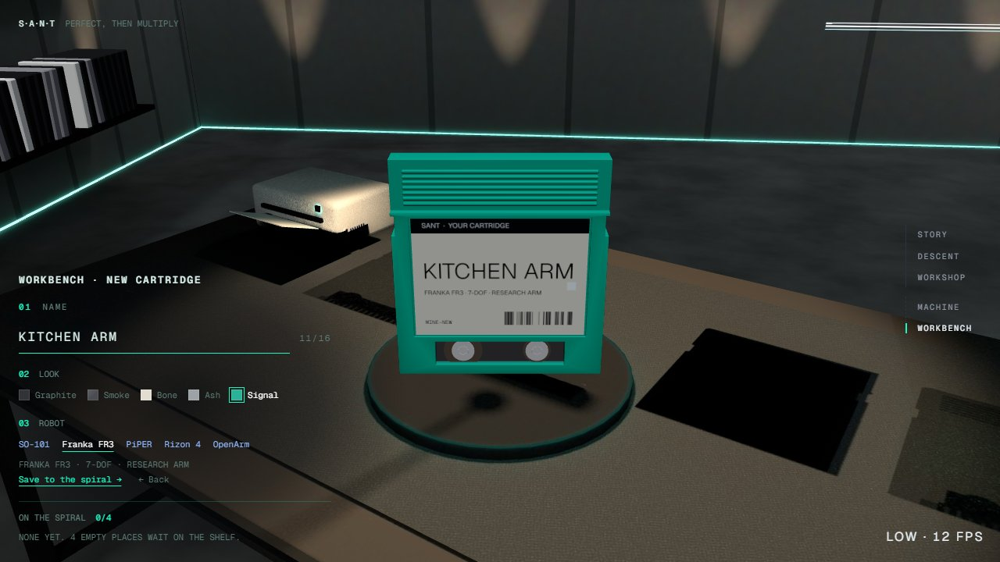
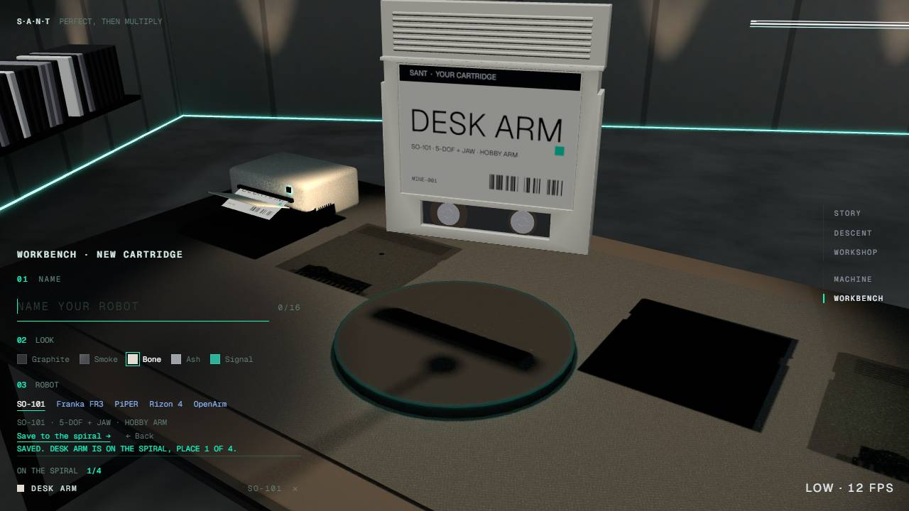
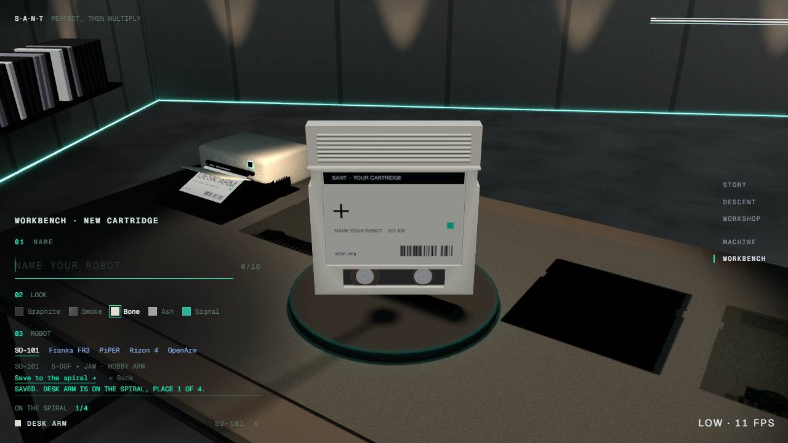
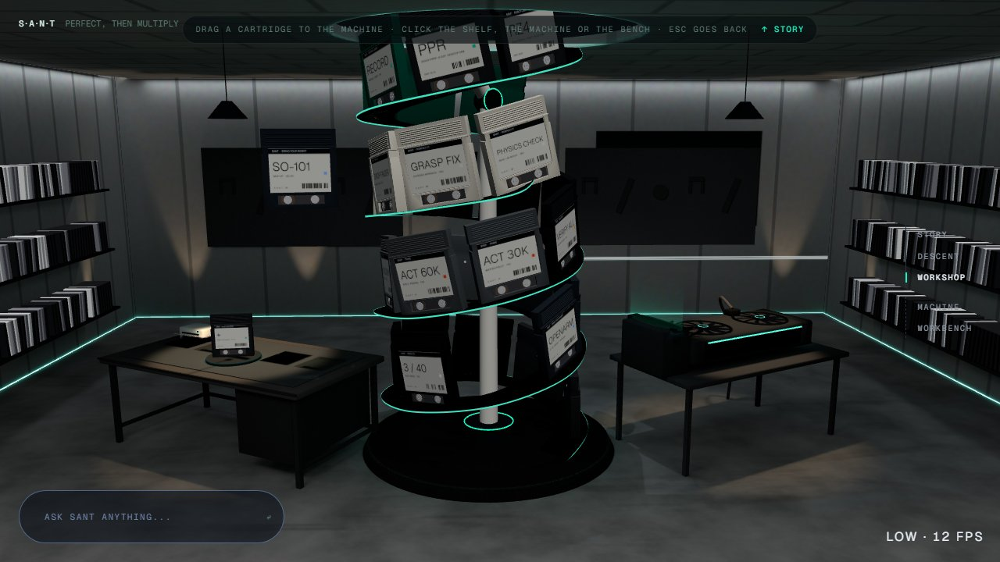
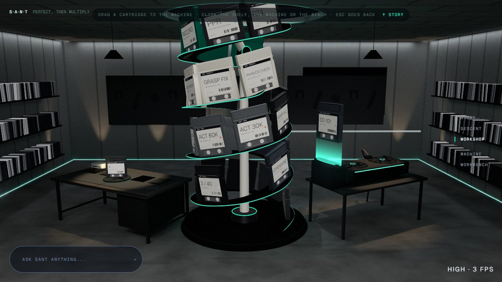
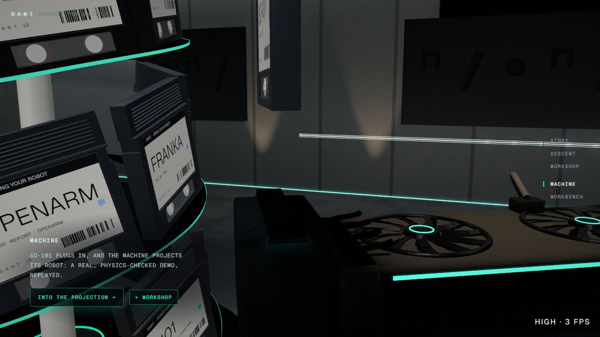
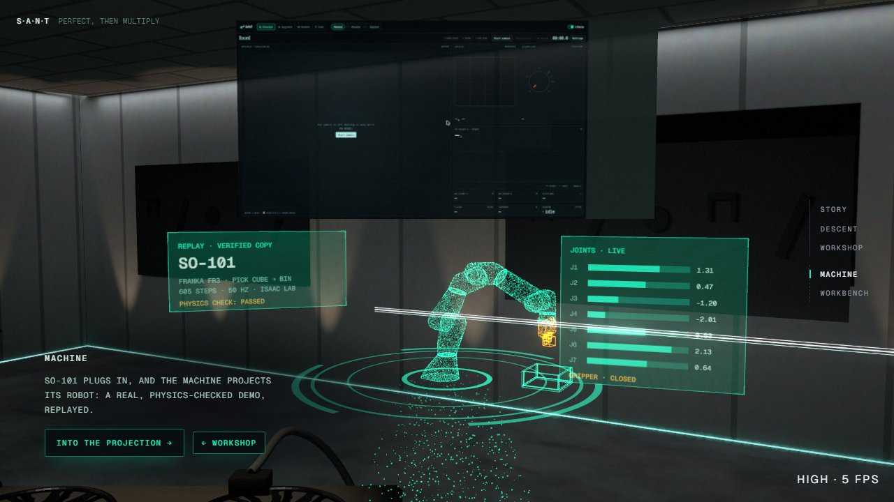
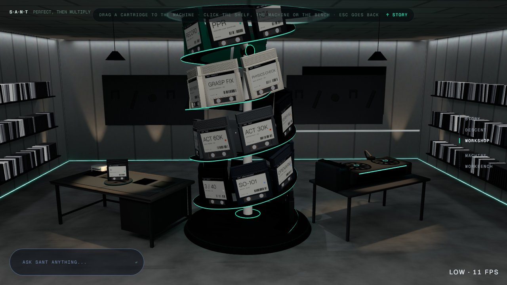

# The workshop's interactions: the bench and dragging cartridges (`pm/site-interact`, 2026-10-20)

Branched from `pm/live-11` at `91b3ef8`: record-aids, plus the cloud's overnight site, plus site-bench, as T7 merged
them. Nothing was pushed, merged or rebased. No new dependencies, no Blender. Not touched: the Record page, the
Python backend, the intro and descent, the walls and library.

## 1. The bench

**What was there:** the editor (site-bench) worked once you opened the bench. In the room view, though, the
turntable stood empty.

**What it does now:**
- **The room view.** The draft stands on the turntable: its name, its shell and its robot.
  - It is one more instance of the spiral's instanced meshes (`scene/Helix.tsx` `BENCH_INSTANCE`), so the hub's draw
    calls don't change.
  - Its label is a new tile in the label atlas (`labels.ts` `DRAFT_TILE`; the atlas grows from 9 rows to 10).
  - The tile is reprinted only when the bench closes on a changed draft: one atlas upload, not one per keystroke.
- **Opening the bench.** The camera moves to the edit stop as before. The turntable turns the cartridge one whole
  turn round to you, with a small lift, as the camera arrives.
  - The room copy and the close copy now switch on the same frame. Before this fix, the turntable showed empty for
    one frame.
- **Editing.** The cartridge follows every change live, as before (02).
- **Saving.** The saved cartridge flies off the turntable to its empty place on the spiral (`workbench/layout.ts`
  `flightPose`, 1.4 s). The printer slides its label out, and a fresh blank grows in on the turntable (03, 04).
  - The spiral keeps that place hidden until the flight lands.
  - Back, or a remove, lands it at once.
- **The bench's label canvases** (the close cartridge, the one in flight, the printer's label) are drawn at full size
  from the start. A canvas that grows after its texture's first upload draws black; the flying label did, until this
  fix.

### Did the cloud's merge leave any of the editor unreachable?

| What I checked | Result |
|---|---|
| Editor code | None lost. Since site-bench, the only change to the workbench was T7's repointed import in `Editor.test.tsx`. |
| Ways in after the merge | All work: the bench's 3D tag and its click box, the dock's "+ Add a cartridge" (on the shelf), the phone hub bar's "Bench", the journey rail's "Workbench", and Ask SANT's `go_to_section(bench)`. |
| Esc and Back | Work. |
| Phone (390×844) | The editor fits with no sideways scroll, though it covers the bottom of the cartridge. |
| Saved cartridges in 3D, by keyboard | **Unreachable; fixed.** They could only be clicked on the spiral. The dock now has a button for each, next to the robots' buttons; it plugs that cartridge into the machine. |
| Saved cartridges in the stills (no WebGL) | **Unreachable; fixed.** The 2D list only had the 24 jobs. The same dock buttons cover it. |

## 2. Dragging cartridges to the machine

- **Press, then drag.** Press a cartridge on the spiral and move it at least 6 px (12 px for a finger). It leaves its
  slot and follows the pointer (06).
  - It moves on a plane that faces the camera through where you grabbed it, turned toward you and leaning with the
    pointer's speed.
  - A drag that starts on the shelf closes the shelf, so the camera eases back to the room view and the machine is in
    shot.
- **The drop target.** While a cartridge is in the hand:
  - a teal light stands up out of the machine's slot and pulses (07);
  - the hub tags step back, so the port stays in view.
- **Over the machine.** The cartridge glides to the port and waits there edge-on, and the light comes full up.
  - "Over the machine" is the same box that takes the machine's click (`drag.ts` `DROP_ZONE`, shared with
    `HubTags`).
- **Letting go over the machine** runs the existing plug-in, then the hologram (08, 09).
  - The cartridge doesn't fly back out to its slot first: it is **held**
    (`plugSequence.ts` `cartridgePose(…, held)`, `plug.held`).
  - It waits over the port until the insert, on the same beat as a click's plug-in, so the machine's camera move, the
    slot flash and the projector keep their timing.
  - It doesn't open the page by itself (no autoplay), like a robot's click.
- **Letting go anywhere else, or Escape,** floats it back to its slot in a small arc (`backPose`, 0.55 s) (10).
  - A cancelled pointer, or the room leaving view, does the same.
- **Clicking still works as before.** A click on a job opens its detail view; a click on a robot or a saved cartridge
  plugs it in.
  - The browser's click after a drag's pointerup is ignored, on the spiral and on the machine's click box.
  - Keyboard: the stepper's arrows and Enter, and the dock's buttons.
- **Touch.** Pointer events, with `touch-action: none` on the canvas only while the room holds the page still, so the
  journey's scroll is untouched.
- **Reduced motion.** It follows the pointer without easing, snaps to the port, and is back in its slot at once.

## Files

- **The ones named in the task:**
  - `stations/workshop/`: `drag.ts` (new), `Dragged.tsx` (new), `Scene.tsx`, `send.ts`, `stepper.ts`, `Dock.tsx`,
    `HubTags.tsx`, `HubBar.tsx`, `workshop.css`;
  - `stations/workbench/`: `Scene.tsx`, `Editor.tsx`, `draft.ts`, `layout.ts`;
  - `stations/machine/Scene.tsx`: the plug-in trigger only, which passes `plug.held` to the pose.
- **Shared scene files the spiral and the plug-in live in:**
  - `scene/Helix.tsx`: the spiral (the grab, the empty slot in the hand, the bench instance);
  - `scene/plugSequence.ts` (`held`, `ABOVE_PORT`, `PORT_TOP`) and `scene/plug.ts` (`held`);
  - `scene/labels.ts` and `scene/cartridge.ts` (the draft tile).
- **Copy changes:**
  - `ui/HoverTip.tsx`: "· click to open · drag to the machine";
  - the hub bar: "Drag a cartridge to the machine · click the shelf, the machine or the bench · Esc goes back". Below
    1100 px the middle part is dropped so the bar fits on one line (at 760 px it was 813 px wide before that).

## Checks

| Check | Result |
|---|---|
| Tests first | The new tests failed before the code: `drag.test.ts` (8), plugSequence `held`, the label atlas's draft tile, the bench's room pose and flight path, the draft's flight state, and Editor (the flight; the dock buttons for saved cartridges). |
| `npm --prefix web test` | 149 files, **1319 passed**, 1 skipped, 0 failed (1304 on `pm/live-11`). |
| Flaky test | One full run timed out in `App.test.tsx` "opens the journey at /" (5.2 s against its 5 s limit) while headless Chrome was running. It passed 3 of 3 runs alone, and in the next full run. |
| `npx tsc -b` | Clean. |
| `npm --prefix web run build` | Passes; the only warning is the old >500 kB chunk notice. |
| Hub draw calls, one frame | **40 on low, 54 on high**: the same as the overnight note. The bench instance costs none; the cartridge in the hand and the target light are drawn only during a drag. |

### In headless Chrome

**Software rendering (SwiftShader), not the GPU:** Blender was open on the PC, and only one heavy GPU renderer may
run at a time. The tier was forced with `?q=` (SwiftShader runs about 3–14 fps). The runs drove real CDP mouse and
touch input against the dev server.

| What | Viewport and tier | Result |
|---|---|---|
| Drag to the machine | 1280×720, high and low | Machine opens; panel reads "SO-101 plugs in…"; hologram up. ("SO-101" is the job's own title in `items.ts`.) |
| Drop elsewhere | 1280×720, high | Floats back; the slot's instance is shown again. |
| Escape mid-drag | 1280×720, low | Back in its slot before the pointer came up. |
| Plain click on the same cartridge | 1280×720, high | Detail view opens. |
| Touch drag to the machine | 390×844 @3×, low | Machine opens; the page didn't scroll. |
| Reduced-motion drop | 1280×720, low | Machine opens. |
| Bench walk | 1280×720, high, low, reduced motion | Edit; Back (the room copy shows the new name and shell, 01); save (the flight, 03); Back. The saved cartridge's instance stands in its place (world `-2.86, 5.86, -1.39`). The dock lists it. |
| Hub bar | 760 px wide | 472 px wide on one line. |

No console errors or exceptions in any run, apart from React Router's future-flag warnings.

## Screenshots (`2026-10-20-site-interact/`, 1280×720)

| | |
|---|---|
|  01 the room view: the draft (Kitchen arm, Signal) on the turntable |  02 the bench: live edit |
|  03 save: it flies to the spiral, the label prints (low) |  04 a fresh blank on the turntable (low) |
|  05 back in the room view |  06 a cartridge in the hand; the port's light pulses |
|  07 over the machine: waiting edge-on over the port |  08 dropped: the machine's camera move, held over the port |
|  09 plugged in: the hologram |  10 let go elsewhere: back in its slot |

## Not verified, or not done

- **Real GPU.** Frame rates and the feel of the drag on the RTX 4060 are unmeasured.
- **A person.** Nobody has used it with a real mouse, a real finger on a real phone, or a pen.
- **Not driven in the browser:** a drag started from the shelf view (it closes the shelf; unit-level logic only),
  the ultra tier, the stills page with a saved cartridge (covered by the Editor test with `webgl={false}`), and
  removing a cartridge while it is still flying.
- **Hub mouse-look during a drag.** The camera's look-around still follows the pointer while you drag (the room view
  sways a little). The cartridge stays under the pointer, but the drag could freeze the look if that feels wrong;
  that is in `core/CameraRig.tsx`, outside this task's files.
- **On a phone the bench editor covers the bottom of the cartridge.** The edit camera is Blender's stop, so moving the
  cartridge up there needs a phone-only stop.
- **Ask SANT still doesn't know about saved cartridges** (as in the site-bench note).
- **Still at most 4 saved** (the spiral's empty places).
