# /data in the holo look, and the hand-offs Record → Pipeline → Data (`pm/data-holo`, 2026-10-21)

Branched from `pm/live-13` at `7637481`. Nothing pushed. No new dependencies. **Status:** done at `dfd9304` (the
Record strip fix included); the lead queued it for T7 to merge. Training day: no real GPU. Every check
here is headless Chrome with SwiftShader, run after 17:35 (the lead's CPU window); before that, code and targeted
tests only.

## Shared with T2 and T5 (agreed before writing)

T2 (`/pipeline`, `pm/pipeline-holo`) and I agreed that I own one small set of holo primitives and they don't write
their own. T5 (`/test-track`) uses the same set. All of it is in `web/src/site/holo/`:

| | What it is |
|---|---|
| `HoloPage` | The frame of a work page: Record's top strip (the mark, "⏏ workshop", one `h1`, the path Record › Pipeline › Data as `nav "Pages"` with `aria-current`, the page's actions, `nav "More"`: Robots, Results, Test track), then the void with the faint cutting-mat grid. It keeps the `.sant` Volt root, and inside it the `--sant-*` tokens take the holo values, so the pages' own `.sant .data-*` / `.pipe-*` rules come out holo without restyling each. The strip isn't sticky (about 48 px; on phones it stacks into 3 rows, nothing hidden). |
| `.holo-panel` | A see-through panel: glass, a hairline, corner ticks on `::before` (`::after` is left to the page). No display, padding or overflow, so any element can take the class. `data-holo-state="pass\|fail\|live"` turns the ticks teal or amber. |
| `.holo-tag`, `.holo-rule`, `.holo-trace` | A mono capital label (optional dot); a hairline fading right with a label at its left; a hairline with a light running along it (still with reduced motion). |
| `--holo-*` tokens | Record's values: teal `#19F5C2` only (no NVIDIA green), amber for failures, glass `rgba(14,22,24,0.72)`, ink `#e6eeec` / `#8fa3a0`, IBM Plex Mono for labels, Instrument Serif for the title. |
| `HandoffLink`, `handoff.ts` | The hand-off between pages (below). |

Commits for the others to cherry-pick: `2bb9484` (the primitives), `2bd1fd9` (the test track in More; phones stack),
`96699c6` (reduced-motion focus), and `80683b6` (`/data` only: `site/data/*`). T2 has the first two on
`pm/pipeline-holo` (`0dd8cf2`, `b37c3fb`) with `/pipeline` on `HoloPage`. T5 has the first on `pm/test-track`.

## /data

- **The frame:** `HoloPage` in place of `AppShell`: the path shows where Data sits after Record and the pipeline.
- **The views are holo panels:** a verified view's frame and title turn teal, a failed one's amber, the human's own take
  stays neutral (`data-holo-state` from the verdict). The same goes for the variant cards and the live variants.
- **Labels in mono capitals** (the pane titles, chips, table heads, captions); a section heading runs on into a
  hairline; the summary is a readout with a teal tick; buttons are squared hairline boxes, the selected one filled
  faintly in teal; the scrubber is a hairline with a small square head (the native range input, so the keyboard works
  as before).
- **"What SANT changed"** is one panel: the issues, the repairs, and the before/after table with the change in teal.
- **Live:** the running stage gets a trace along its foot (`HoloTrace`), the stages are squared.
- Every class name and every text is unchanged (`/pipeline` imports `data.css` and its tests read the badge texts).

## The hand-offs

The site's router is `BrowserRouter`, not a data router, so react-router's `viewTransition` does nothing here. A link
made with `HandoffLink` instead:
1. brings a veil up on `<body>` (opacity only, 320 ms): the void and grid, a teal line drawing across, the next page's
   name ("→ PIPELINE");
2. changes the route under it, so the next page's code loading never shows a blank page;
3. the next page's `HoloPage` (or Record) lifts it (420 ms) and takes the focus to its title. A page without the
   frame still gets it lifted after 2.5 s.

A click with a modifier (a new tab) and a link to the page already shown are plain links. With reduced motion there is
no veil: the route changes at once and the focus still goes to the new title.

Where: Record's "Run SANT →" (and Record lifts an arriving veil); the path links in every `HoloPage`; T2 put one at
the pipeline's end ("Next: Data …", in the Export view, on `pm/pipeline-holo`). "Your data is ready" stays a plain link:
it goes to another stage of the same page.

## Checks (SwiftShader, 2026-10-21)

- **Desktop 1280×720:** the showcase, what changed, live, and the pipeline (which shares `data.css`), before and after.
  No horizontal overflow, no console errors.
- **Phone 390×844 @3×:** the same. No horizontal overflow. Before, the old nav cut "Data" off at the right edge.
- **Reduced motion:** no veil (`veil null`), the route changes at once, no entrance motion.
- **Hand-offs:**
  - Record → Pipeline: the veil comes up. `/pipeline` isn't on `HoloPage` on this branch, so here the veil lifts on the
    2.5 s failsafe (T2's branch lifts it at once).
  - Data → Record by the path: the veil was gone 835 ms after the click (desktop) and 876 ms (phone), and the focus
    was on Record's title.
- **The data:** the read-only showcase backend ran from my worktree on port 8010, `DATA_DIR` = pm-t6's data (only
  read), its db and uploads in my scratchpad; it was stopped after the shots. The two dev servers ran inside the shot
  script and ended with it.
- **Tests:** new `site/holo/Holo.test.tsx` (the frame, the path, the test track in More, the primitives, the hand-off:
  veil, navigation, lift, focus, reduced motion, modifier click, failsafe, double click); `DataPage.test.tsx` (the
  frame and the panels' states); `RecordConsole.test.tsx` ("Run SANT" brings the veil up).
- **Full web suite** (at `96699c6`): 199 files, 1801 passed, 1 skipped, 0 failed; `tsc -b` clean; `npm --prefix web run build` passes.

## Screenshots (`2026-10-21-data-holo/`, SwiftShader)

| Before (`pm/live-13`) | After |
|---|---|
| 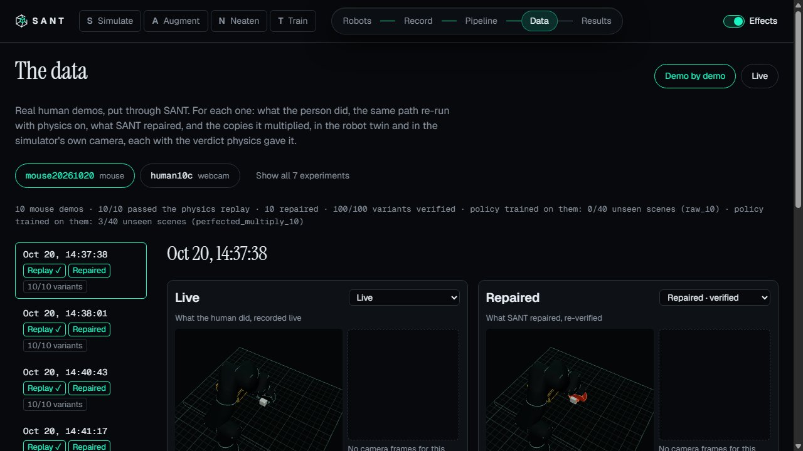 01 | 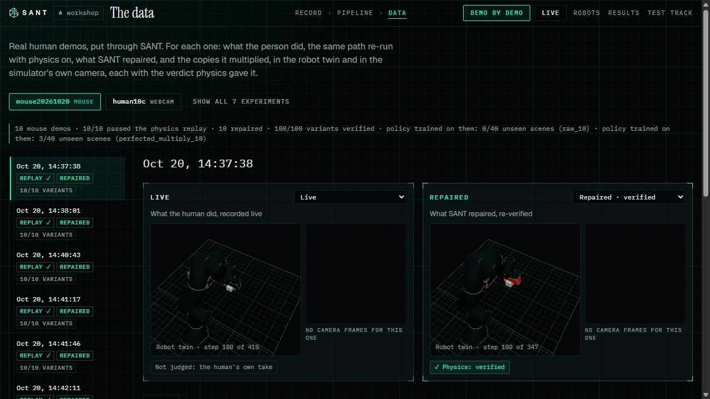 02 the frame, holo panels, the verified view in teal |
| 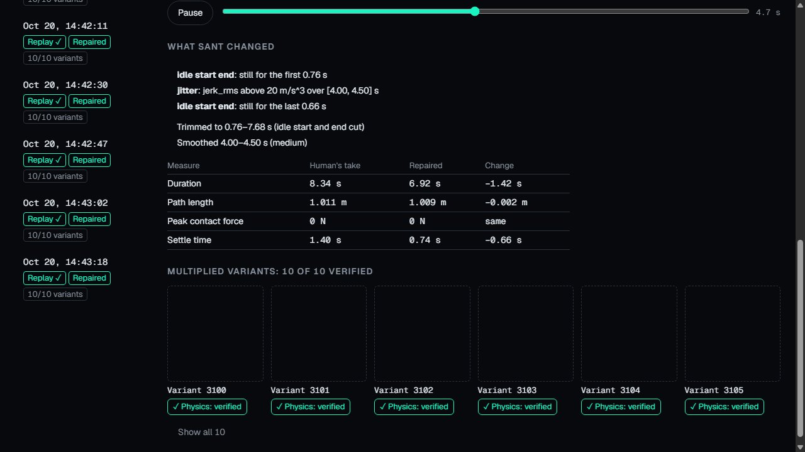 03 | 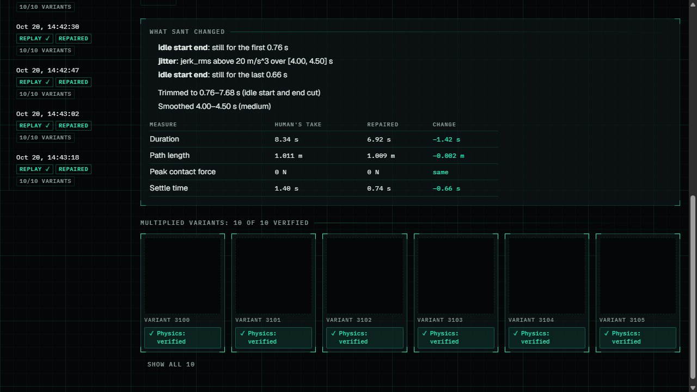 04 what SANT changed, the variants |
| 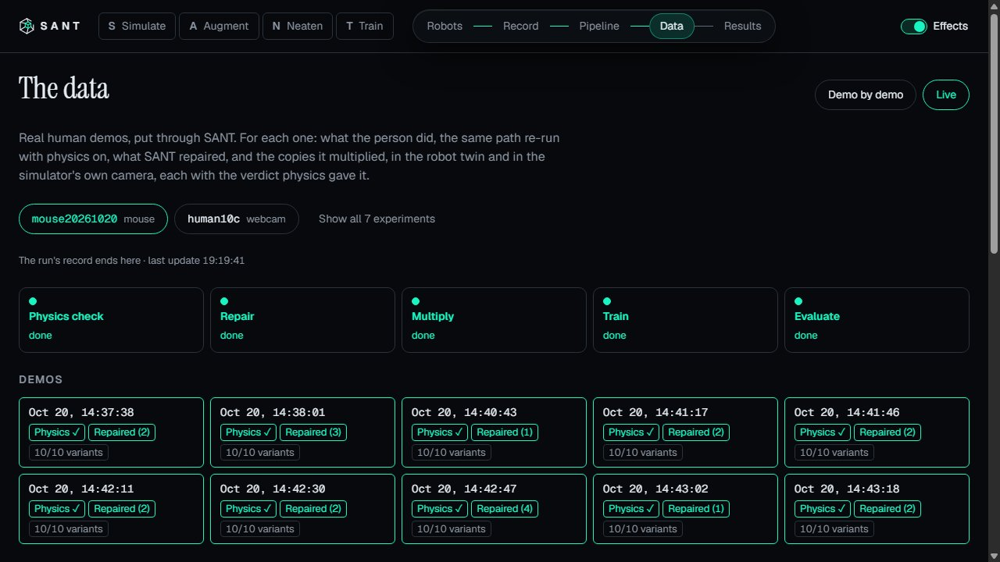 05 | 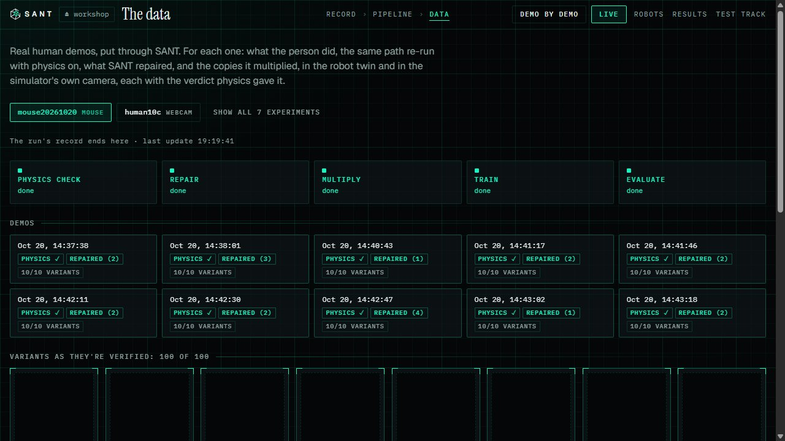 06 live |
| 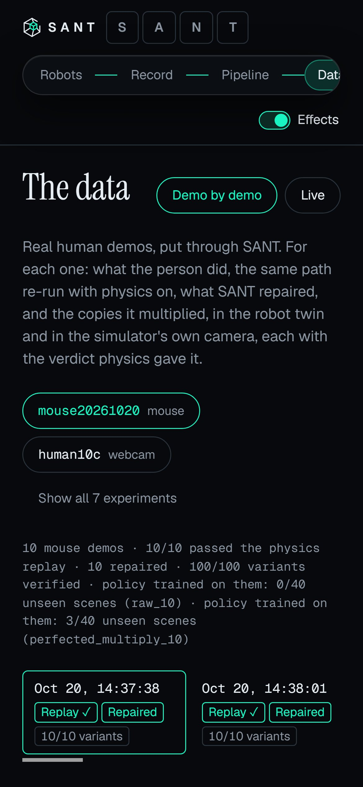 07 phone | 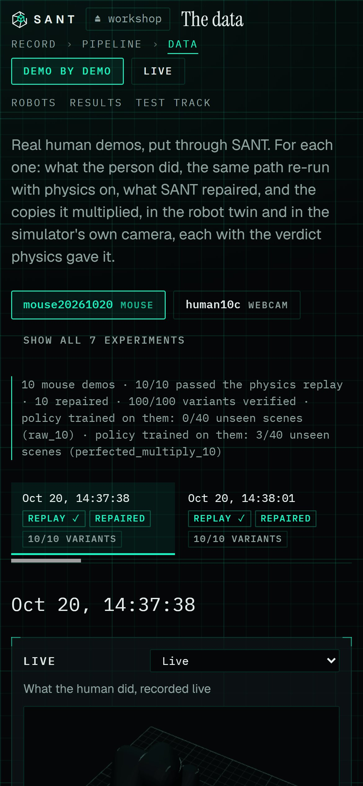 08 phone |
| 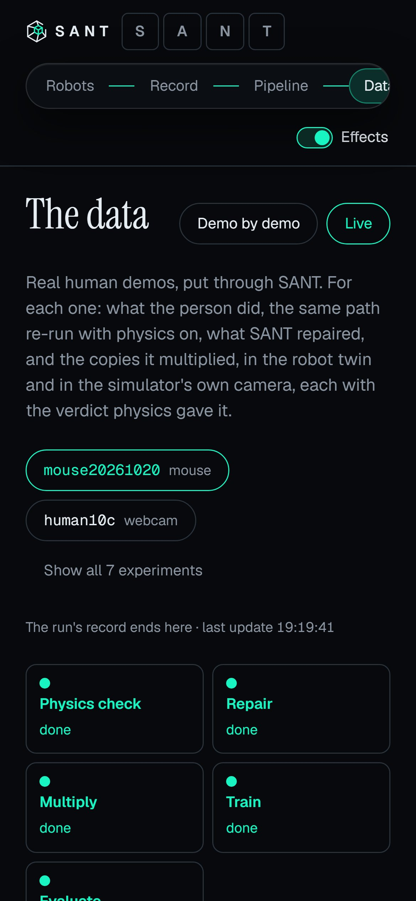 09 phone, live | 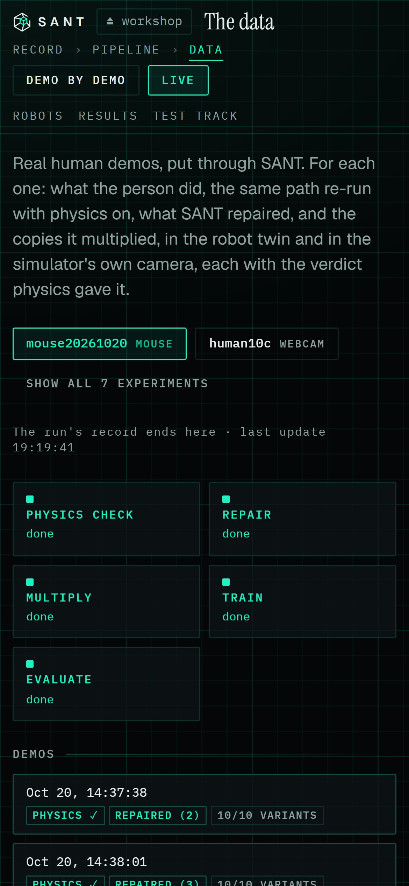 10 phone, live |
| 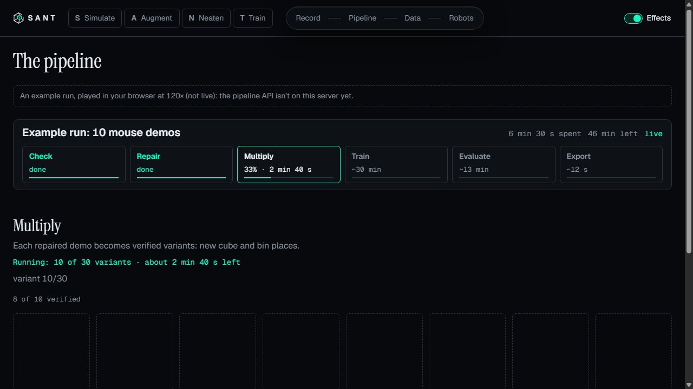 16 the pipeline (shares `data.css`) | 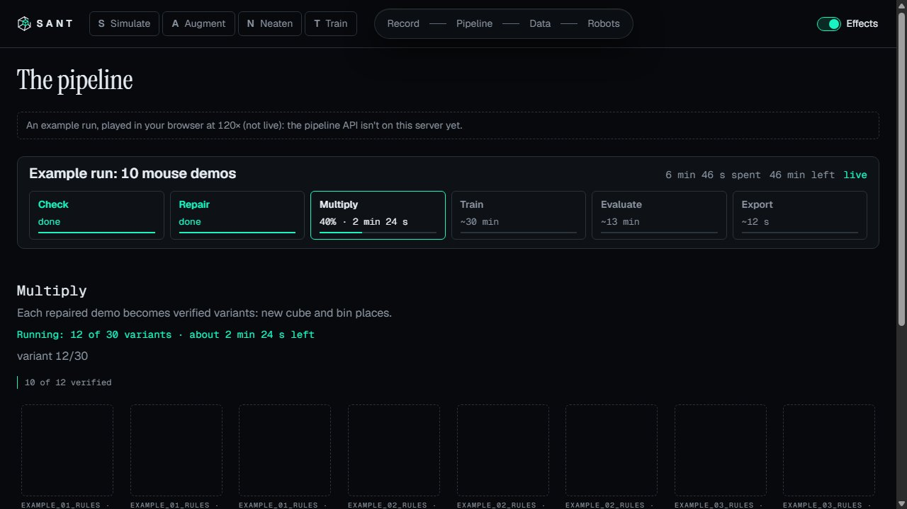 17 its badges and notes, before T2's own restyle |

| Hand-offs and motion | |
|---|---|
| 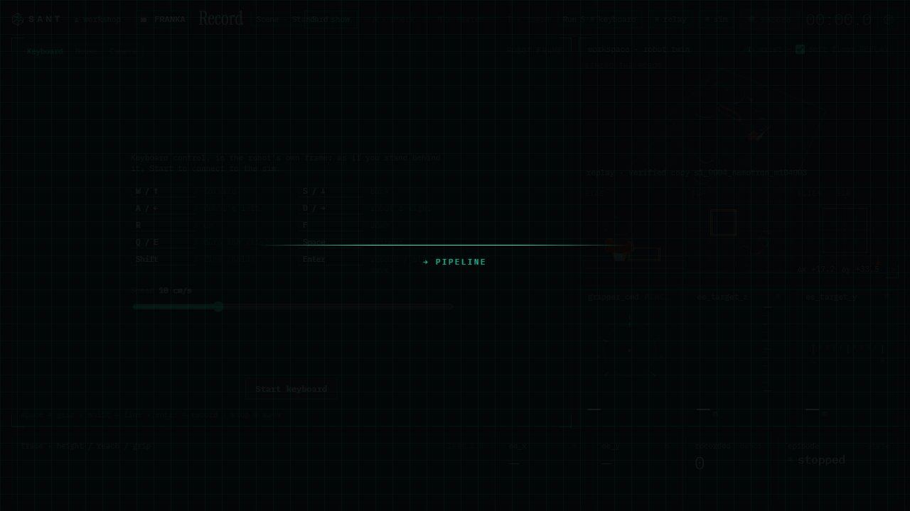 11 Record → Pipeline, 150 ms in | 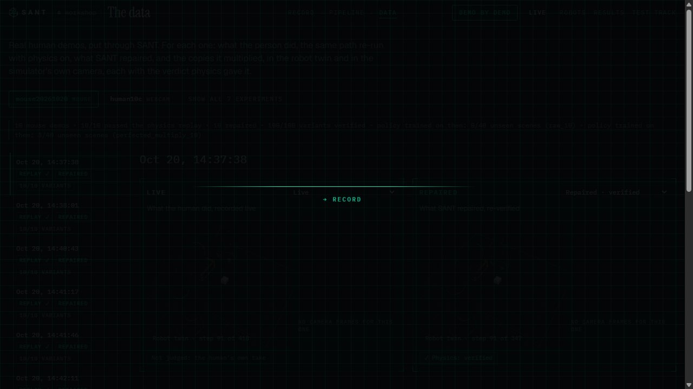 12 Data → Record by the path |
| 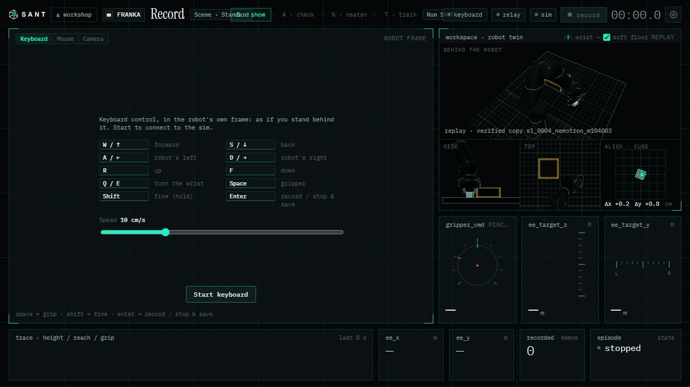 13 Record, the veil lifted | 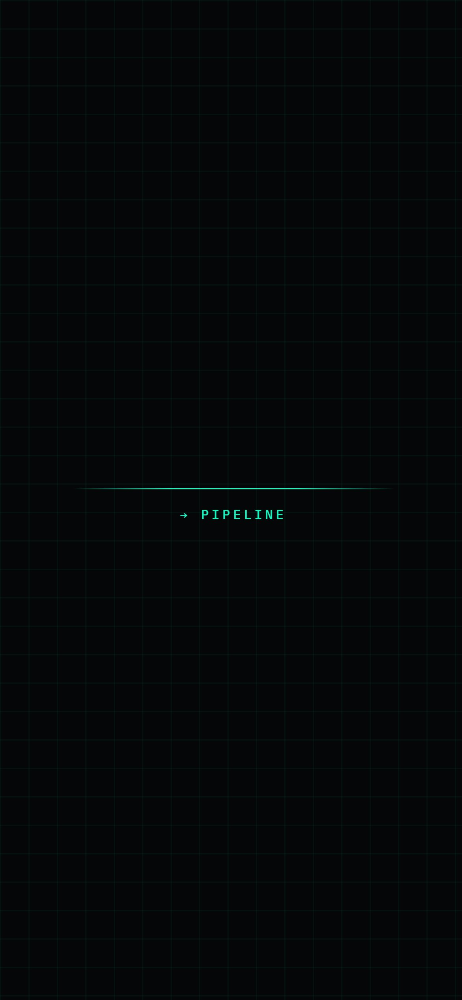 14 phone, the veil |
| 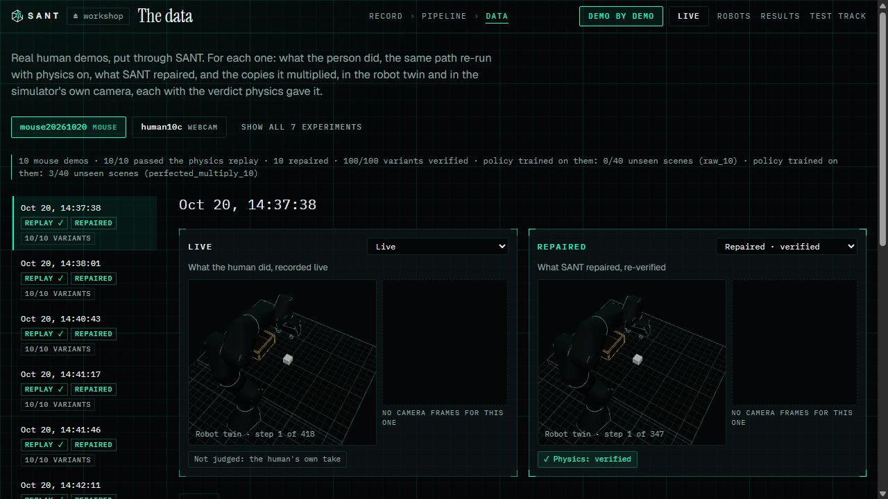 15 reduced motion: the same page, still | |

## Record's top strip at laptop widths (fixed after the lead's go-ahead)

It overlapped itself from 961 to 1280 px (already so on `pm/live-13`): the scene button ran into "S · show", and
"Run SANT →", the hand-off's button, sat under the status chips. Between 961 and 1500 px the strip was a fixed
3-column grid whose middle track (about 320 px at 1280) was narrower than the steps (about 434 px).

The fix (`record-hologram.css`, `RecordConsole.tsx`):
- Between 961 and 1500 px the strip is a row that wraps: a group that doesn't fit drops to a second line instead of
  overlapping (e.g. the extra buttons while recording).
- The steps show their letters only: S · A · N · T, the current one lit. The word ("show") is still read by screen
  readers and is in the title.
- Above 1500 px and on phones (960 px and under, where the steps are hidden) nothing changes.

Measured in SwiftShader (`rgtop.mjs`: overlaps between the three groups, anything leaving the window, the strip's
height):

| Width | Before | After |
|---|---|---|
| 961, 1024, 1100 | 6–7 overlaps (up to 91 px) | none; 2 rows (67 px) |
| 1280 | "Run SANT" under the chips (41 px), the scene button under the steps (41 px) | none; 1 row (31 px) |
| 1366–1920 | none | none, unchanged |

| | |
|---|---|
| 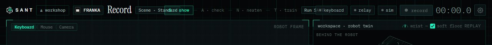 18 before, 1280 | 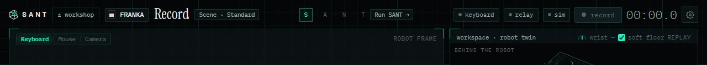 19 after, 1280 |
| 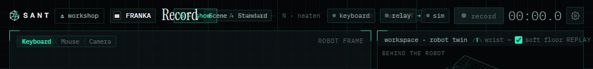 20 before, 1024 | 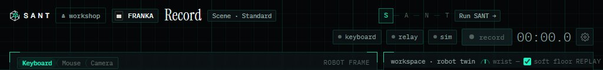 21 after, 1024 |

Full web suite after the fix: 199 files, 1801 passed, 1 skipped; `tsc -b` clean; the build passes.

## Open

- **Recording state not seen at laptop widths:** with no sim here, Stop & discard and Delete last demo never showed;
  the wrap is what keeps them from overlapping, untested live.
- **No camera frames** in this data folder for the mouse set: the sim-camera boxes are empty before and after alike.
- **The real GPU** wasn't used (training). The pages add no WebGL: the twin canvases are the same as before.
- **The scratch worktree** `before-data` (a detached checkout of `7637481`, a junction to `web/node_modules`) is in my
  scratchpad for the before shots. Remove it with `git worktree remove --force <path>` when no longer needed.
